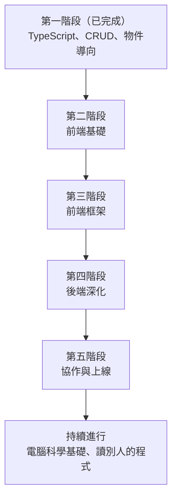

# 兩週之後的學習路線

兩週課程打的是基礎：你能讀懂並寫出一個有型別、有分層、有測試的小型 CRUD 程式。這離「專業軟體工程師」還有一段距離，差距主要在三個地方：

- **廣度**：前端、資料庫、部署、協作流程都還沒接觸。
- **深度**：每個主題都只學了最常用的部分。
- **經驗**：沒有在別人的程式庫裡工作過，也沒有維護過上線的系統。

以下是建議的方向與順序，不是完整課綱。每個階段的時間以每天 1–3 小時估算。

## 階段總覽

## 第二階段：前端基礎（約 2 週）

目標：幫 Day 13 的 Todo API 做一個網頁介面。

- HTML 的結構與語意標籤
- CSS 的版面配置：盒模型、Flexbox、Grid
- 在瀏覽器裡用 TypeScript 操作 DOM、處理事件
- 用 `fetch` 呼叫自己的 API，處理載入中與錯誤狀態

完成的標準：在瀏覽器裡新增、勾選、刪除待辦事項，重新整理後資料還在。

## 第三階段：前端框架（約 3 週）

目標：用 React 重寫第二階段的介面，理解框架解決了什麼問題。

- 元件、props、state
- 副作用與資料載入
- 表單與驗證
- 路由與多頁面

完成的標準：能說出「同樣的功能，用 React 寫比直接操作 DOM 好在哪裡、代價是什麼」。

## 第四階段：後端深化（約 3 週）

目標：把 Todo API 做到可以給真實使用者用。

- 關聯式資料庫設計：多張資料表、外鍵、JOIN、索引
- 從 SQLite 換到 PostgreSQL，學習 migration
- 使用者註冊、登入與權限
- 輸入驗證、錯誤處理與日誌
- API 的整合測試

完成的標準：每個使用者只看得到自己的待辦事項，而且有測試證明這件事。

## 第五階段：協作與上線（約 2 週）

目標：學會和其他工程師一起工作，並把程式部署出去。

- Git 分支、Pull Request、code review 的流程
- 寫出別人看得懂的 commit 與 PR 說明
- 持續整合：每次推送自動跑型別檢查、lint 與測試
- 用容器包裝應用程式並部署到雲端
- 環境變數與機密資料的管理

完成的標準：你的 Todo App 有一個公開網址，而且每次合併到主分支都會自動部署。

## 持續進行

這幾件事沒有終點，和上面的階段同時進行：

- **資料結構與演算法**：陣列、雜湊表、樹、圖，以及時間複雜度。先求看得懂、會選用，不必急著刷題。
- **讀別人的程式**：挑一個你每天在用的開源套件，從它的測試開始讀。
- **設計原則**：SOLID、常見設計模式。Day 09–10 已經用到其中幾個，之後遇到時再回頭對照。
- **除錯能力**：學會用中斷點、看堆疊追蹤、縮小問題範圍，不靠猜。
- **寫作**：把每個階段學到的東西用自己的話寫下來。能教會別人，才算真的懂。

## 怎麼判斷自己進步了

不要用「學了幾個主題」衡量。用這三個問題：

1. 拿到一個沒看過的錯誤訊息，我能不能自己找到原因？
2. 別人讀我的程式，需不需要我在旁邊解釋？
3. 需求改變時，我要改幾個地方？改完之後我有多少把握沒有弄壞別的東西？
