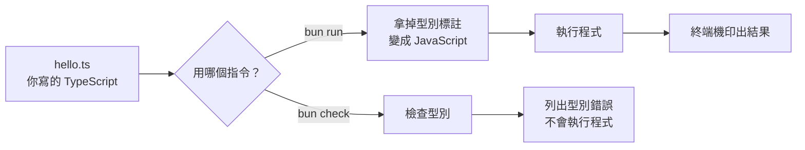
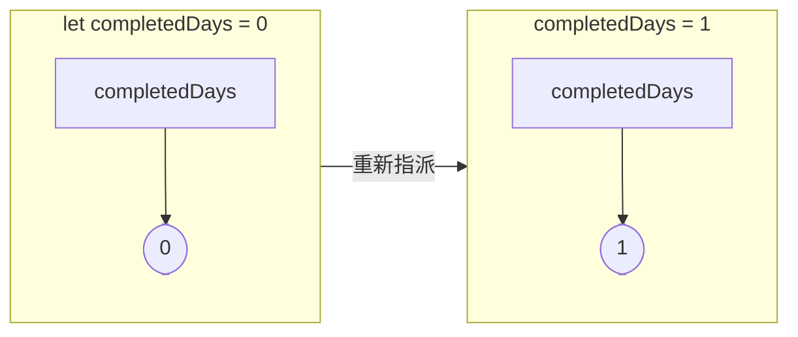
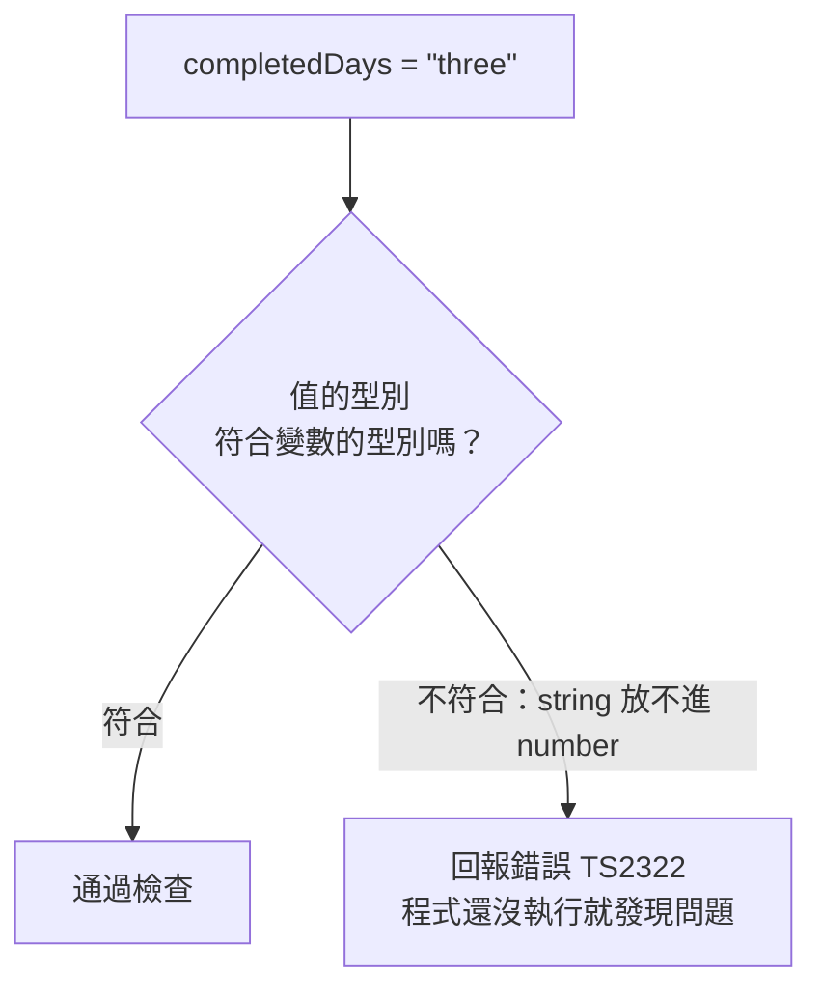

# Day 01 — 環境、變數與基本型別

> 第 1 週｜基礎｜必修約 60 分鐘，加練可到 3 小時

## 學習目標

完成今天的課程後，你能夠：

- 用 `bun run` 執行一支 TypeScript 程式，用 `bun check` 檢查型別。
- 說出「執行」與「型別檢查」是兩件不同的事。
- 用 `const` 與 `let` 宣告變數，並說出兩者的差別。
- 使用三種基本型別：`string`、`number`、`boolean`。
- 看懂一則 TypeScript 型別錯誤訊息。

## 時間分配

| 區塊 | 內容                   | 時間        |
| ---- | ---------------------- | ----------- |
| 必修 | 觀念說明＋圖解         | 20 分鐘     |
| 必修 | 逐步解說（範例 01–04） | 20 分鐘     |
| 必修 | 練習 01、02            | 20 分鐘     |
| 加練 | 練習 03、延伸挑戰      | 30–120 分鐘 |

## 觀念說明

### 1. TypeScript 是什麼

TypeScript 是「加上型別的 JavaScript」。型別（type）是一種標籤，用來說明「這個值是哪一種資料」：文字、數字，還是真假值。

電腦實際執行的是 JavaScript。型別只在你寫程式、檢查程式時有用，執行前會被整個拿掉。所以同一支 `.ts` 檔案有兩條路可以走：



重點：

- `bun run` 只負責執行，**不會**幫你檢查型別。
- `bun check` 只負責檢查型別，**不會**執行程式。
- 專業的做法是兩個都跑：先 `bun check` 確認沒有型別錯誤，再 `bun run`。

### 2. 變數：幫值取名字

變數（variable）是「一個名字指向一個值」。宣告變數有兩個關鍵字：

| 關鍵字  | 名字之後能不能指向別的值 | 什麼時候用                 |
| ------- | ------------------------ | -------------------------- |
| `const` | 不能                     | 預設都用這個               |
| `let`   | 可以                     | 確定這個值之後會改變時才用 |

用 `let` 宣告的變數可以重新指派（reassign），也就是讓同一個名字改指向新的值：



用 `const` 宣告的變數不能重新指派，名字和值綁定之後就不會變：


### 3. 三種基本型別

| 型別      | 代表什麼               | 範例                  |
| --------- | ---------------------- | --------------------- |
| `string`  | 文字                   | `"買牛奶"`、`"Hello"` |
| `number`  | 數字（整數與小數都是） | `15`、`3.14`、`-2`    |
| `boolean` | 真假值                 | `true`、`false`       |

一行變數宣告可以拆成四個部分：

```text
const title: string = "買牛奶";
  │     │      │         │
  │     │      │         └─ 值（value）
  │     │      └─ 型別標註（type annotation）：這個變數只能放文字
  │     └─ 名稱（name）
  └─ 關鍵字（keyword）：const 或 let
```

型別標註可以省略。TypeScript 會從值自動判斷型別，這叫做型別推論（type inference）：

```ts
let completedDays = 0; // TypeScript infers: number
```

### 4. 型別檢查怎麼保護你

當你把一個值指派給變數，TypeScript 會比對「值的型別」和「變數的型別」：



沒有型別的話，這種錯誤要等到程式跑起來、算出奇怪的結果才會被發現。

## 逐步解說

以下每一步對應 `examples/` 裡的一個檔案。請在專案根目錄執行指令。

### 步驟 1：執行第一支程式

檔案：[`examples/01-hello.ts`](examples/01-hello.ts)

```bash
bun run day-01-setup-variables-types/examples/01-hello.ts
```

1. `console.log(...)` 會把括號裡的值印到終端機。
2. `1 + 2` 是數字相加，結果是 `3`。
3. `"1" + "2"` 是文字相接，結果是 `"12"`。同一個 `+`，遇到不同型別會做不同的事，這就是型別重要的原因。

### 步驟 2：`const` 與 `let`

檔案：[`examples/02-variables.ts`](examples/02-variables.ts)

```bash
bun run day-01-setup-variables-types/examples/02-variables.ts
```

1. `const courseName = ...` 宣告一個不會再改的名字。
2. `let completedDays = 0` 宣告一個之後會改的名字。
3. `completedDays = 1` 是重新指派，注意這一行**沒有** `let`。`let` 只在第一次宣告時寫。
4. `completedDays = completedDays + 1` 先算等號右邊（`1 + 1`），再把結果放回左邊的名字。
5. 檔案最後有一行被註解掉的程式。把開頭的 `//` 刪掉，然後執行 `bun check`，你會看到錯誤 `TS2588`。看完記得把 `//` 加回去。

### 步驟 3：基本型別與樣板字串

檔案：[`examples/03-basic-types.ts`](examples/03-basic-types.ts)

```bash
bun run day-01-setup-variables-types/examples/03-basic-types.ts
```

1. 前三行示範型別標註的寫法：`名稱: 型別 = 值`。
2. 接著示範型別推論：沒寫型別，TypeScript 自己判斷。
3. `typeof` 可以在執行時查出一個值的型別。
4. 樣板字串（template literal）用反引號 `` ` `` 包起來，裡面的 `${...}` 會被換成變數的值。
5. 最後示範型別轉換：`Number("42")` 把文字轉成數字，`String(42)` 把數字轉成文字。

### 步驟 4：看懂型別錯誤

檔案：[`examples/04-type-errors.ts`](examples/04-type-errors.ts)

這個檔案故意放了一個型別錯誤，並用 `// @ts-expect-error` 這行註解告訴 TypeScript「我知道下一行有錯」，所以整個專案的檢查仍然會通過。

1. 先執行它，觀察程式照樣跑完，還印出了不合理的結果：

   ```bash
   bun run day-01-setup-variables-types/examples/04-type-errors.ts
   ```

2. 把 `// @ts-expect-error` 那一行刪掉，然後檢查型別：

   ```bash
   bun check day-01-setup-variables-types/examples/04-type-errors.ts
   ```

3. 你會看到這則錯誤。讀法如下：

   ```text
   error TS2322: Type 'string' is not assignable to type 'number'.
         │            │                                   │
         │            │                                   └─ 變數要的型別
         │            └─ 你給的值的型別
         └─ 錯誤代碼，可以拿去搜尋
   ```

4. 看完把那一行註解加回去，讓專案恢復成可通過檢查的狀態。

這一步的結論：`bun run` 不會攔下型別錯誤，`bun check` 才會。

## 規範重點

- **預設用 `const`**，只有確定會重新指派時才用 `let`。讀程式的人看到 `const` 就知道這個值不會變。
- **不要用 `var`**。它是舊語法，行為容易出錯。
- **變數名稱用 camelCase**：第一個字小寫，之後每個字的開頭大寫，例如 `completedDays`、`courseName`。
- **名稱要說明內容**。寫 `completedDays`，不要寫 `d` 或 `x`。
- **能推論就不必標註**。`let count = 0` 已經夠清楚，不需要寫成 `let count: number = 0`。今天的範例為了教學才特別標註。

## 常見錯誤

| 錯誤訊息                                                    | 原因                     | 修法                                    |
| ----------------------------------------------------------- | ------------------------ | --------------------------------------- |
| `TS2588: Cannot assign to 'x' because it is a constant.`    | 對 `const` 變數重新指派  | 確定會改變就改用 `let`                  |
| `TS2322: Type 'string' is not assignable to type 'number'.` | 值的型別和變數的型別不符 | 給對的型別的值，或用 `Number(...)` 轉換 |
| `TS2451: Cannot redeclare block-scoped variable 'x'.`       | 同一個名字宣告了兩次     | 重新指派時不要再寫 `let`                |
| 算出 `"12"` 而不是 `3`                                      | 把文字當數字相加         | 先用 `Number(...)` 轉成數字             |

## 練習

練習檔在 `exercises/`。每個檔案裡標著 `TODO` 的地方就是你要改的地方。

```bash
# 檢查你的答案：全部顯示 pass 就完成了
bun test day-01
```

| 練習                                           | 內容                       | 類型 |
| ---------------------------------------------- | -------------------------- | ---- |
| [`01-variables.ts`](exercises/01-variables.ts) | 宣告變數、重新指派         | 必修 |
| [`02-sentences.ts`](exercises/02-sentences.ts) | 樣板字串、數字運算         | 必修 |
| [`03-todo-line.ts`](exercises/03-todo-line.ts) | 把一筆待辦事項組成一行文字 | 加練 |

卡住超過 15 分鐘再看 `solutions/` 裡的參考解答。看完後把解答關掉，自己重寫一次。

### 延伸挑戰（加練）

1. 在 `examples/` 新增一個自己的檔案，用變數描述你今天的三件待辦事項，並印出來。
2. 故意寫出「常見錯誤」表格裡的每一種錯誤，用 `bun check` 確認錯誤訊息和表格相符，然後修好它。

## 自我檢查清單

- [ ] 我能說出 `bun run` 和 `bun check` 各自做什麼。
- [ ] 我能說出 `const` 和 `let` 的差別，並知道預設該用哪一個。
- [ ] 我能分辨 `string`、`number`、`boolean`。
- [ ] 我能解釋為什麼 `"1" + "2"` 的結果是 `"12"`。
- [ ] 我看得懂 `TS2322` 這則錯誤在說什麼。
- [ ] `bun test day-01` 全部通過。

## 下一課

[Day 02 — 型別系統](../day-02-type-system/README.md)：今天用三個獨立的變數描述一件待辦事項，明天會把它們組合成一個 `Todo` 型別。
