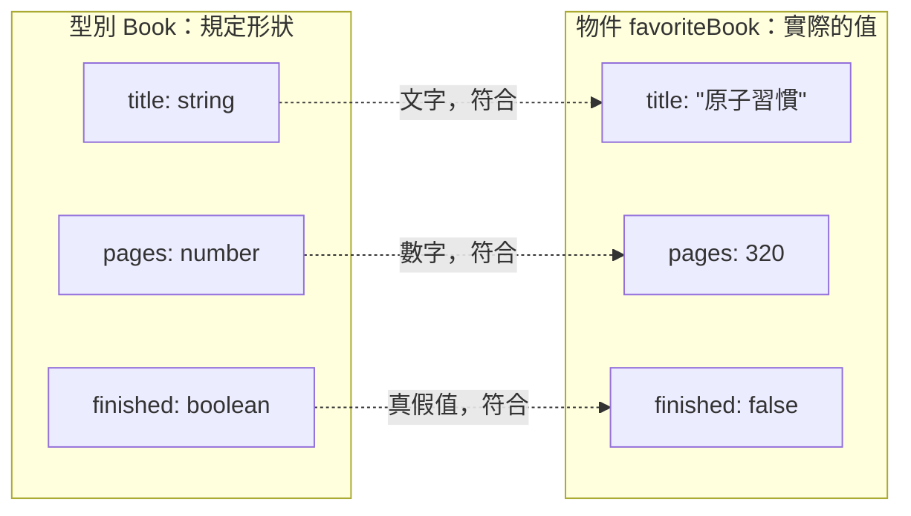
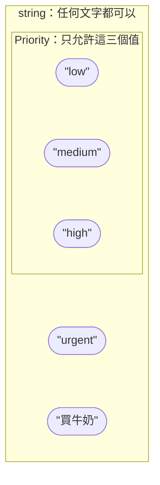
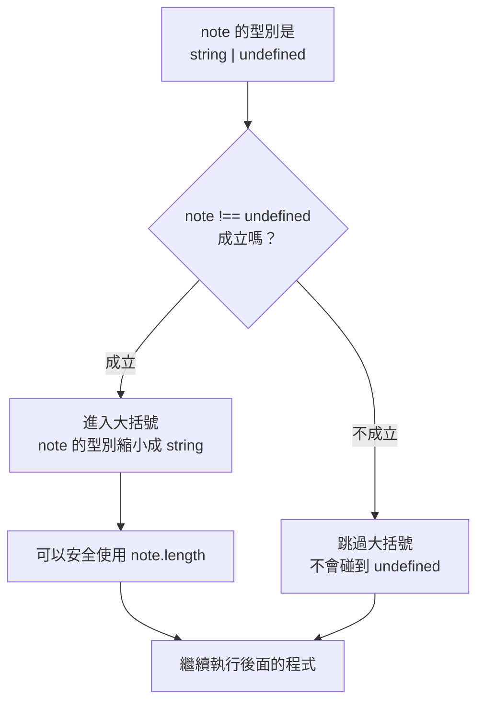

# Day 02 — 型別系統

> 第 1 週｜基礎｜必修約 60 分鐘，加練可到 3 小時

## 學習目標

完成今天的課程後，你能夠：

- 用物件型別描述「一筆資料有哪些屬性」，並用 `type` 幫這個形狀取名字。
- 用 union 與 literal type 把一個值限制在幾個選項之內。
- 用選用屬性、`undefined`、`null` 表達「可能沒有值」。
- 用 `if` 做型別縮小：先檢查，再使用可能沒有值的資料。
- 宣告陣列、用索引取出元素，並說出取出來的型別為什麼多了 `undefined`。

## 時間分配

| 區塊 | 內容                   | 時間        |
| ---- | ---------------------- | ----------- |
| 必修 | 觀念說明＋圖解         | 20 分鐘     |
| 必修 | 逐步解說（範例 01–05） | 20 分鐘     |
| 必修 | 練習 01、02            | 20 分鐘     |
| 加練 | 練習 03、延伸挑戰      | 30–120 分鐘 |

## 觀念說明

### 1. 物件型別：把相關的值組在一起

Day 01 用三個獨立的變數描述一件待辦事項。變數一多，就很難看出哪幾個是同一組。物件（object）把相關的值組成一個值，裡面每一項叫做屬性（property），由名稱和值組成。

物件型別（object type）規定一個物件要有哪些屬性、每個屬性是什麼型別。用 `type` 可以幫這個形狀取名字，這個名字叫做型別別名（type alias）：

```text
type Book = {
│    │
│    └─ 型別的名稱，用 PascalCase：每個字的開頭都大寫
└─ 關鍵字：幫一個型別取名字

  title: string;
  │      │
  │      └─ 這個屬性的型別
  └─ 屬性的名稱

  pages: number;
  finished: boolean;
};
```

這張圖說明宣告物件時，TypeScript 怎麼拿型別逐一核對每個屬性：



重點：

- 型別是「規定」，物件是「照規定做出來的值」。同一個型別可以做出很多個物件。
- 少一個屬性、多一個屬性、屬性的型別不對，`bun check` 都會回報錯誤。
- 讀取屬性用點號：`favoriteBook.title`。

### 2. `type` 與 `interface`

描述物件形狀還有第二種寫法，叫做介面（interface）：

```ts
type Book = {
  title: string;
  pages: number;
};

interface Author {
  name: string;
  country: string;
}
```

用這兩種寫法做出來的物件，使用上沒有差別。差別在它們能描述的範圍，本課程依此分工：

| 寫法        | 能描述什麼                            | 本課程用在哪裡                    |
| ----------- | ------------------------------------- | --------------------------------- |
| `type`      | 物件形狀，也能幫下一節的 union 取名字 | 資料的形狀、union                 |
| `interface` | 只能描述物件形狀                      | 類別要遵守的合約，Day 09 才會用到 |

今天只要認得 `interface` 的寫法就好。接下來幾天的資料型別一律用 `type`。

### 3. Union 與 literal type：列出允許的值

聯集型別（union type，以下直接稱 union）用 `|` 把幾個型別接起來，意思是「其中任何一種都可以」：

```ts
type ProductCode = string | number; // a string OR a number
```

字面值型別（literal type）是「只允許某一個值」的型別。例如型別 `"high"` 只接受 `"high"` 這段文字，其他文字都不行。

把幾個 literal type 用 `|` 接起來，就得到一份「允許的值」清單：

```ts
type Priority = "low" | "medium" | "high";
```

可以把型別想成一個集合。這張圖說明 `string` 這個集合裝著所有文字，`Priority` 只圈出其中三個：



重點：

- `Priority` 型別的變數只能放內圈的三個值。`"urgent"` 是文字，但不在內圈，所以會被擋下來。
- 打錯字也會被擋下來，例如把 `"medium"` 打成 `"midium"`。型別如果只寫 `string`，這種錯誤沒有人會發現。
- 選項固定的資料（優先度、尺寸、狀態）用 literal type 的 union，不要用 `string`。

### 4. 「可能沒有值」：`undefined`、`null` 與選用屬性

有些資料不一定存在，例如一部電影的觀後備註。TypeScript 有兩個值用來表示「沒有」：

| 值          | 意思           | 通常從哪裡來                                     |
| ----------- | -------------- | ------------------------------------------------ |
| `undefined` | 沒有值         | 程式語言自己給的：沒填的選用屬性、陣列裡空的位置 |
| `null`      | 刻意放的「空」 | 寫程式的人自己放的，或是來自外部的資料           |

這兩個值各自是一種型別。`string` 不包含它們，要用 union 明講才放得進去：

```ts
type Member = {
  name: string;
  nickname: string | null; // a string, or null when there is no nickname
};
```

在屬性名稱後面加 `?`，這個屬性就成為選用屬性（optional property），建立物件時可以不寫：

```ts
type Movie = {
  title: string;
  minutes: number;
  note?: string; // may be left out
};
```

讀取選用屬性時，拿到的型別是 `string | undefined`：有填就是文字，沒填就是 `undefined`。

### 5. 型別縮小：先檢查，再使用

型別是 `string | undefined` 的值不能直接當成 `string` 來用，因為它有可能是 `undefined`。做法是先用 `if` 檢查：

```text
if (note !== undefined) {
│   │    │   │          │
│   │    │   │          └─ 條件成立，才執行大括號裡的程式
│   │    │   └─ 比較的對象
│   │    └─ 「不等於」。「等於」寫成 ===
│   └─ 要檢查的值
└─ 關鍵字
```

TypeScript 看得懂這個檢查。進到大括號之後，它知道 `undefined` 已經被排除，型別就從 `string | undefined` 變成 `string`。這叫做型別縮小（narrowing）。這張圖說明檢查前後型別的變化：



重點：

- 縮小只在大括號裡面有效。離開大括號，型別又變回 `string | undefined`。
- 要分辨 `string | number` 這種 union，用 Day 01 學過的 `typeof`：`if (typeof code === "string") { ... }`。
- 今天只用最簡單的 `if`。`else`、其他比較運算、邏輯運算，Day 03 會完整說明。

### 6. 陣列型別與索引

陣列（array）是「排成一列的多個值」。在型別後面加 `[]` 就是陣列型別：`string[]` 是文字的陣列，`Book[]` 是 `Book` 物件的陣列。

陣列裡每個值都有一個編號，叫做索引（index）。索引從 0 開始：

```text
const titles: string[] = ["買牛奶", "寫作業", "運動"];

  索引（index）：  0 → "買牛奶"
                  1 → "寫作業"
                  2 → "運動"

  titles.length  →  3           一共有幾個值
  titles[0]      →  "買牛奶"     第一個值
  titles[2]      →  "運動"       最後一個值，索引是 length - 1
  titles[3]      →  undefined   這個位置是空的
```

TypeScript 不會去數陣列裡有幾個值，所以它無法保證某個索引上一定有東西。因此用索引取出來的型別是 `string | undefined`。這是 TypeScript 在提醒你：這個位置可能是空的。處理方式和選用屬性一樣，先用 `if` 檢查再使用：

```ts
const first = titles[0]; // string | undefined

if (first !== undefined) {
  console.log(first.length); // first is a string here
}
```

## 逐步解說

以下每一步對應 `examples/` 裡的一個檔案。請在專案根目錄執行指令。

### 步驟 1：物件型別

檔案：[`examples/01-object-types.ts`](examples/01-object-types.ts)

```bash
bun run day-02-type-system/examples/01-object-types.ts
```

1. `type Book = { ... }` 定義形狀。這一段不會印出任何東西，因為型別在執行前就被拿掉了。
2. `const favoriteBook: Book = { ... }` 照著形狀建立一個物件。
3. `favoriteBook.title` 用點號讀取屬性。`favoriteBook.pages + 1` 印出 `321`：TypeScript 知道 `pages` 是數字，所以可以做數字運算。
4. `console.log(favoriteBook)` 一次印出整個物件。
5. `favoriteBook.finished = true` 把屬性換成新的值。`const` 鎖住的是「`favoriteBook` 這個名字指向哪一個物件」，物件裡面的屬性仍然可以改。Day 04 會詳細說明。
6. `interface Author` 用另一種寫法描述形狀，建立物件的方式和 `type` 相同。
7. 檔案最後有三行被註解掉的程式。一次只拿掉一行開頭的 `//`，執行 `bun check day-02-type-system/examples/01-object-types.ts`，對照下表讀錯誤訊息。看完把 `//` 加回去，再試下一行。

   | 拿掉哪一行           | 錯誤代碼 | 意思                                 |
   | -------------------- | -------- | ------------------------------------ |
   | `missingProperty`    | `TS2741` | 少了必填的屬性 `finished`            |
   | `wrongType`          | `TS2322` | `pages` 應該是數字，卻給了文字       |
   | `favoriteBook.titel` | `TS2551` | 屬性名稱打錯，訊息還會建議正確的名稱 |

### 步驟 2：union 與 literal type

檔案：[`examples/02-union-literal.ts`](examples/02-union-literal.ts)

```bash
bun run day-02-type-system/examples/02-union-literal.ts
```

1. `let code: ProductCode = "A-100"` 之後執行 `code = 2024`。`ProductCode` 是 `string | number`，所以同一個變數先放文字、再放數字都合法。`typeof` 印出當下放的是哪一種。
2. `let cupSize: Size = "M"` 之後改成 `"L"`。`"L"` 在 `Size` 的清單裡，所以合法。
3. `Drink` 的 `size` 屬性使用 `Size` 型別。任何寫型別的地方都可以用 union。
4. `const fixedSize = "S"` 推論出來的型別是 `"S"`；`let anyText = "S"` 推論出來的型別是 `string`。`const` 不會變，TypeScript 可以把型別鎖在那一個值；`let` 之後可能會改，所以放寬成 `string`。
5. 最後一段的做法和 Day 01 的範例 04 相同：用 `// @ts-expect-error` 蓋住一個故意的錯誤，把 `"XL"` 指派給 `Size`。程式照樣跑完，最後一行印出了 `XL`。
6. 把 `// @ts-expect-error` 那一行刪掉，執行 `bun check day-02-type-system/examples/02-union-literal.ts`，會看到 `TS2322: Type '"XL"' is not assignable to type 'Size'.`。看完把那一行加回去。

### 步驟 3：選用屬性與型別縮小

檔案：[`examples/03-optional-narrowing.ts`](examples/03-optional-narrowing.ts)

```bash
bun run day-02-type-system/examples/03-optional-narrowing.ts
```

1. `Movie` 的 `note?: string` 是選用屬性。`withNote` 有寫備註，`withoutNote` 沒寫，兩個物件都合法。
2. 印出 `withoutNote.note` 得到 `undefined`。
3. 被註解掉的 `console.log(withNote.note.length)`：拿掉 `//` 再執行 `bun check`，會看到 `TS18048: 'withNote.note' is possibly 'undefined'.`。這個物件明明有填備註，但 TypeScript 只看型別，而型別說它可能沒有。看完把 `//` 加回去。
4. `if (withNote.note !== undefined) { ... }` 檢查之後，大括號裡就能使用 `.length`。`.length` 用在文字上是「有幾個字」。
5. `if (withoutNote.note === undefined) { ... }` 用 `===` 檢查「是不是 `undefined`」。
6. `Product` 的 `code` 是 `string | number`。`typeof pencil.code === "string"` 成立，大括號裡它被縮小成 `string`，可以用 `.length`。`typeof eraser.code === "number"` 成立，大括號裡可以做加法。
7. `Member` 的 `nickname` 是 `string | null`。`null` 的檢查方式和 `undefined` 相同，用 `===` 或 `!==`。

### 步驟 4：陣列與索引

檔案：[`examples/04-arrays.ts`](examples/04-arrays.ts)

```bash
bun run day-02-type-system/examples/04-arrays.ts
```

1. `const titles: string[] = [...]` 用中括號建立陣列，值與值之間用逗號分開。
2. `titles.length` 印出 `3`。
3. `titles[0]` 是第一個值 `買牛奶`。`titles[3]` 超出範圍，得到 `undefined`，程式不會因此中斷。
4. `first` 的型別是 `string | undefined`，所以先用 `if` 縮小，才使用 `first.length`。
5. 最後一個值的索引是 `titles.length - 1`。
6. `number[]` 與 `Book[]` 的用法完全相同。`books[1]` 取出來的型別是 `Book | undefined`，縮小之後才能讀 `secondBook.title`。
7. 檔案最後一行被註解掉的 `console.log(first.length)`：拿掉 `//` 再執行 `bun check day-02-type-system/examples/04-arrays.ts`，會看到 `TS18048: 'first' is possibly 'undefined'.`。看完把 `//` 加回去。

### 步驟 5：主線的起點 `Priority` 與 `Todo`

檔案：[`examples/05-todo.ts`](examples/05-todo.ts)

```bash
bun run day-02-type-system/examples/05-todo.ts
```

這個檔案把今天的內容組合起來，定義 Todo 主線專案的兩個型別。它們會一路用到 Day 07，名稱與屬性都不會變。

1. `type Priority = "low" | "medium" | "high"`：優先度只有三個選項，用 literal type 的 union。
2. `type Todo = { ... }`：Day 01 的幾個獨立變數，現在組成一個物件型別。

   | 屬性       | 型別       | 用途                         |
   | ---------- | ---------- | ---------------------------- |
   | `id`       | `number`   | 編號，用來分辨每一筆待辦事項 |
   | `title`    | `string`   | 標題                         |
   | `done`     | `boolean`  | 是否已完成                   |
   | `priority` | `Priority` | 優先度                       |

3. 建立三筆 `Todo`，再把它們放進 `todos`。`todos` 的型別是 `Todo[]`。
4. `todos[0]` 的型別是 `Todo | undefined`。縮小之後，用樣板字串把四個屬性排成一行印出來。
5. `todos[10]` 是空的位置，得到 `undefined`。
6. 檔案最後一行被註解掉的程式把 `priority` 寫成 `"urgent"`。拿掉 `//` 再執行 `bun check day-02-type-system/examples/05-todo.ts`，會看到 `TS2322: Type '"urgent"' is not assignable to type 'Priority'.`。看完把 `//` 加回去。

> ▶ 動畫演示：[`todos[0]` 的型別為什麼是 `Todo | undefined`，以及 `if` 檢查前後型別怎麼變化](https://vincentlin0619.github.io/ts-engineer-bootcamp/day-02/#anim-day02-index-narrowing)

## 規範重點

- **資料的形狀用 `type`，名稱用 PascalCase**，例如 `Todo`、`Priority`。看到大寫開頭就知道它是型別，不是變數。
- **選項固定就用 literal type 的 union，不要用 `string`**。`priority: Priority` 能擋下打錯的字，`priority: string` 擋不了。
- **陣列型別寫成 `Todo[]`，變數名稱用複數**，例如 `todos`、`titles`。讀程式的人看到複數就知道裡面有很多個。
- **「可能沒有」優先用選用屬性與 `undefined`**。`null` 留給外部資料本來就使用 `null` 的情況。只挑一種，檢查時就不必兩種都考慮。
- **先縮小再使用**。看到 `possibly 'undefined'` 的錯誤，用 `if` 檢查它，不要設法繞過檢查。
- **比較相等一律用 `===` 與 `!==`**。只有兩個等號的 `==` 會在比較前偷偷轉換型別，本課程不使用。

## 常見錯誤

| 錯誤訊息或現象                                                                                          | 原因                                               | 修法                                               |
| ------------------------------------------------------------------------------------------------------- | -------------------------------------------------- | -------------------------------------------------- |
| `TS2741: Property 'finished' is missing in type '...' but required in type 'Book'.`                     | 物件少寫了必填的屬性                               | 補上屬性；如果它本來就可以不填，把型別改成選用屬性 |
| `TS2353: Object literal may only specify known properties, and 'author' does not exist in type 'Book'.` | 物件多寫了型別裡沒有的屬性                         | 拿掉它，或把這個屬性加進型別                       |
| `TS2551: Property 'titel' does not exist on type 'Book'. Did you mean 'title'?`                         | 屬性名稱打錯                                       | 照訊息的建議修正                                   |
| `TS2322: Type '"urgent"' is not assignable to type 'Priority'.`                                         | 值不在 union 的清單裡                              | 改用清單裡的值，或把新選項加進型別                 |
| `TS2322: Type 'string' is not assignable to type 'Priority'.`                                           | 變數用 `let` 宣告又沒有標註，型別被推論成 `string` | 加上標註：`let level: Priority = "high"`           |
| `TS18048: 'first' is possibly 'undefined'.`                                                             | 直接使用可能是 `undefined` 的值                    | 先用 `if (first !== undefined)` 縮小               |
| 印出 `undefined`                                                                                        | 索引超出範圍，或讀了沒填的選用屬性                 | 確認索引從 0 開始，最後一個是 `length - 1`         |

## 練習

練習檔在 `exercises/`。每個檔案裡標著 `TODO` 的地方就是你要改的地方。

```bash
# 檢查你的答案：全部顯示 pass 就完成了
bun test day-02

# 今天會動到型別，所以也要確認沒有型別錯誤
bun check day-02-type-system
```

| 練習                                                         | 內容                                         | 類型 |
| ------------------------------------------------------------ | -------------------------------------------- | ---- |
| [`01-objects-arrays.ts`](exercises/01-objects-arrays.ts)     | 補完物件型別、建立物件與陣列、讀取屬性與索引 | 必修 |
| [`02-unions-narrowing.ts`](exercises/02-unions-narrowing.ts) | union、選用屬性、用 `if` 縮小後回傳          | 必修 |
| [`03-todo-data.ts`](exercises/03-todo-data.ts)               | 自己寫出 `Priority` 與 `Todo`，建立 `Todo[]` | 加練 |

函式要到 Day 03 才教，所以和 Day 01 一樣，函式的外殼已經寫好。今天有些題目要先用 `if` 檢查再 `return`。`return` 會交出結果並結束函式，它後面的程式不會再執行。寫法照著練習檔開頭的範例做就可以。

卡住超過 15 分鐘再看 `solutions/` 裡的參考解答。看完後把解答關掉，自己重寫一次。

### 延伸挑戰（加練）

1. 在 `examples/` 新增一個自己的檔案，定義 `Contact` 型別：姓名、電話、選用的 email。建立三筆資料放進 `Contact[]`，用索引一筆一筆印出姓名。
2. 把 `examples/05-todo.ts` 複製成一個新檔案，幫 `Todo` 加上選用屬性 `note?: string`，在其中一筆填上備註，然後用 `if` 縮小，印出備註有幾個字。
3. 故意寫出「常見錯誤」表格裡的每一種錯誤，用 `bun check` 確認錯誤訊息和表格相符，然後修好它。

## 自我檢查清單

- [ ] 我能用 `type` 定義一個物件型別，並建立符合它的物件。
- [ ] 我能說出本課程什麼時候用 `type`、什麼時候用 `interface`。
- [ ] 我能解釋 `"low" | "medium" | "high"` 比 `string` 好在哪裡。
- [ ] 我能說出選用屬性讀出來的型別是什麼。
- [ ] 我能解釋為什麼 `titles[0]` 的型別是 `string | undefined`，並用 `if` 縮小它。
- [ ] 我能不看範例，寫出 `Priority` 與 `Todo` 兩個型別。
- [ ] `bun test day-02` 全部通過。

## 下一課

[Day 03 — 流程控制與函式](../day-03-control-flow-functions/README.md)：今天定義了一筆 `Todo` 長什麼樣子，明天開始寫函式來處理它，例如把一筆 `Todo` 排成一行文字、數出完成了幾筆。
