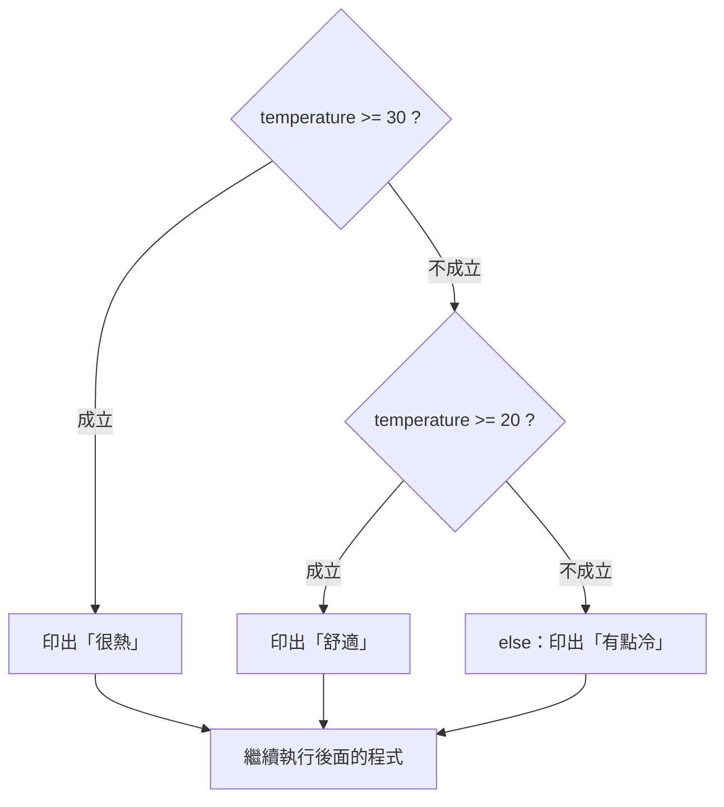
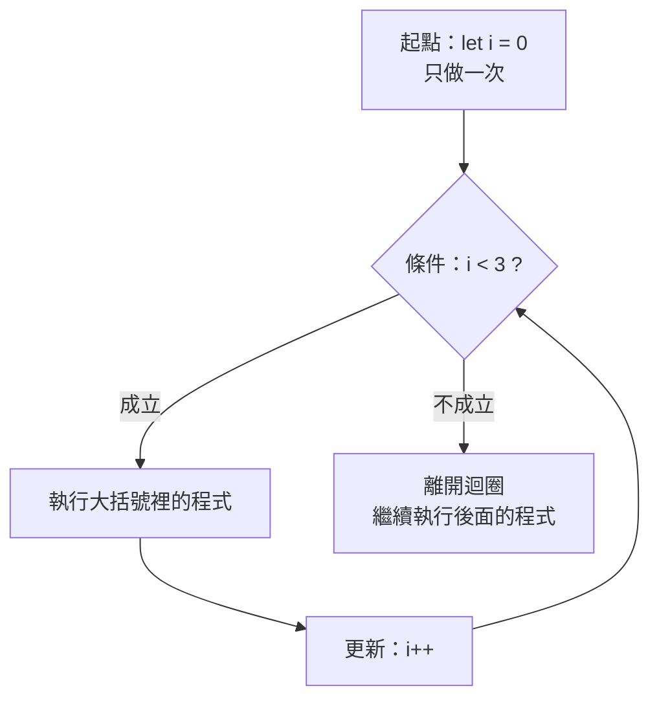
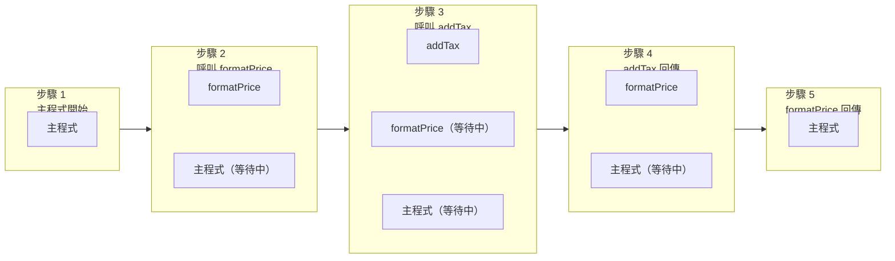

# Day 03 — 流程控制與函式

> 第 1 週｜基礎｜必修約 60 分鐘，加練可到 3 小時

## 學習目標

完成今天的課程後，你能夠：

- 用 `if`／`else`、比較運算與邏輯運算，讓程式依條件走不同的路。
- 用三元運算與 `switch`，把「依照值來選擇」寫得更精簡。
- 用 `for...of`、`for`、`while` 重複執行程式，並說出各自適合的情況。
- 自己寫出完整的函式：參數型別、回傳型別、預設參數，以及箭頭函式。
- 說明作用域與 call stack：變數在哪裡看得到、函式呼叫函式時發生了什麼事。

## 時間分配

| 區塊 | 內容                   | 時間        |
| ---- | ---------------------- | ----------- |
| 必修 | 觀念說明＋圖解         | 20 分鐘     |
| 必修 | 逐步解說（範例 01–05） | 20 分鐘     |
| 必修 | 練習 01、02            | 20 分鐘     |
| 加練 | 練習 03、延伸挑戰      | 30–120 分鐘 |

## 觀念說明

### 1. `if`／`else`：依條件走不同的路

Day 02 的 `if` 只有一條路：條件成立就執行，不成立就跳過。加上 `else`，條件不成立時也有事可做。要分成三條以上的路，中間用 `else if` 接下去：

```ts
if (temperature >= 30) {
  console.log("很熱");
} else if (temperature >= 20) {
  console.log("舒適");
} else {
  console.log("有點冷");
}
```

這張圖說明程式怎麼由上往下檢查條件：



重點：

- 整組 `if`／`else if`／`else` 只會執行其中一段。遇到第一個成立的條件就執行它，後面的不再檢查。
- 順序很重要。把 `>= 20` 寫在 `>= 30` 前面的話，31 度會先符合 `>= 20`，永遠到不了「很熱」。
- 最後的 `else` 接住所有剩下的情況。

### 2. 比較運算與邏輯運算

條件是一個 `boolean`。比較運算（comparison）拿兩個值來比，結果是 `true` 或 `false`：

| 運算子 | 意思 | 運算子 | 意思       |
| ------ | ---- | ------ | ---------- |
| `===`  | 等於 | `!==`  | 不等於     |
| `>`    | 大於 | `>=`   | 大於或等於 |
| `<`    | 小於 | `<=`   | 小於或等於 |

邏輯運算（logical operation）把幾個 `boolean` 組合成一個：

| 運算子 | 讀作 | 什麼時候是 `true`         | 範例                      |
| ------ | ---- | ------------------------- | ------------------------- |
| `&&`   | 而且 | 兩邊都是 `true`           | `age >= 18 && hasTicket`  |
| `\|\|` | 或者 | 至少一邊是 `true`         | `age < 12 \|\| age >= 65` |
| `!`    | 不是 | 把 `true` 與 `false` 對調 | `!done`                   |

### 3. 三元運算：二選一的值

三元運算（ternary operator）依條件從兩個值裡挑一個，結果可以直接放進變數：

```text
const mark = todo.done ? "x" : " ";
             │           │     │
             │           │     └─ 條件不成立時的值
             │           └─ 條件成立時的值
             └─ 條件
```

它只適合「二選一，而且兩邊都很短」的情況。超過兩個選項就改用 `if` 或 `switch`，不要把三元運算放進另一個三元運算裡。

### 4. `switch`：一個值對應多個選項

要判斷「同一個值等於 A、等於 B，還是等於 C」時，`switch` 比一長串 `else if` 清楚。它特別適合 Day 02 的 literal type union：

```ts
switch (todo.priority) {
  case "low":
    label = "低";
    break;
  case "medium":
    label = "中";
    break;
  case "high":
    label = "高";
    break;
}
```

- `case` 後面寫要比對的值，比對方式是 `===`。
- `break` 表示這一段結束，跳出 `switch`。漏寫的話程式會接著執行下一個 `case`，本專案的設定會把它當成錯誤回報。在函式裡通常直接用 `return` 取代 `break`。
- `default` 接住所有沒有列出來的值，作用和 `else` 相同。

### 5. 迴圈：重複做同一件事

迴圈（loop）讓一段程式重複執行。三種寫法的差別在「怎麼決定要跑幾圈」：

| 寫法       | 怎麼決定圈數           | 什麼時候用                 |
| ---------- | ---------------------- | -------------------------- |
| `for...of` | 陣列有幾個值就跑幾圈   | 走過陣列的每一個值，最常用 |
| `for`      | 用計數器數到指定的數字 | 需要知道「第幾圈」或索引   |
| `while`    | 條件成立就繼續         | 事先不知道要跑幾圈         |

`for` 的小括號裡有三個部分，用分號隔開：

```text
for (let i = 0; i < 3; i++) {
     │          │      │
     │          │      └─ 更新：每一圈結束後執行。i++ 等同 i = i + 1
     │          └─ 條件：成立才跑下一圈
     └─ 起點：只在一開始執行一次
```

這張圖說明 `for` 迴圈的執行順序：



重點：

- 條件在每一圈「開始之前」檢查。一開始就不成立的話，大括號裡的程式一次都不會執行。
- `while` 的流程相同，只是沒有「起點」與「更新」兩格，要自己在大括號裡改變條件用到的變數。
- 條件永遠成立，迴圈就永遠不會停，這叫做無窮迴圈（infinite loop）。程式卡住時按 `Ctrl + C` 中斷。

> ▶ 動畫演示：[for...of 迴圈怎麼一筆一筆數出完成了幾件事](https://vincentlin0619.github.io/ts-engineer-bootcamp/day-03/#anim-day03-count-done)

### 6. 函式：幫一段程式取名字

函式（function）是「有名字、可以重複使用的一段程式」。它接收輸入，叫做參數（parameter）；交出一個輸出，叫做回傳值（return value）。前兩天的練習已經用過函式的外殼，今天把每個部分看清楚：

```text
function add(first: number, second: number): number {
│        │   │                               │
│        │   │                               └─ 回傳型別：交出來的值是什麼型別
│        │   └─ 參數：每個參數都標註型別，用逗號分開
│        └─ 函式名稱，用 camelCase
└─ 關鍵字

  return first + second;
  │
  └─ 交出結果，並且結束這個函式
}
```

定義函式不會執行任何東西。寫 `add(2, 3)` 才是呼叫（call）它：2 與 3 依序放進 `first` 與 `second`，整個 `add(2, 3)` 會變成回傳值 `5`。不交出任何值的函式，回傳型別寫 `void`。

箭頭函式（arrow function）是另一種寫法，把函式放進 `const`：

```text
const triple = (value: number): number => value * 3;
      │        │                │         │
      │        │                │         └─ 本體只有一個運算式時，它就是回傳值
      │        │                └─ 回傳型別
      │        └─ 參數
      └─ 函式名稱
```

本體超過一行時，箭頭後面改寫大括號與 `return`。兩種寫法的呼叫方式完全相同。本課程的分工：獨立存在、有名字的函式用 `function`；很短、要直接交給別的函式使用的，用箭頭函式。Day 04 會大量用到後者。

### 7. 預設參數

在參數後面寫 `= 值`，它就成為預設參數（default parameter）。呼叫時沒有傳這個值，就使用預設值：

```ts
function greet(name: string, greeting: string = "你好"): string {
  return `${greeting}，${name}`;
}
```

`greet("小明")` 得到 `你好，小明`；`greet("小明", "早安")` 得到 `早安，小明`。

### 8. 作用域：變數在哪裡看得到

作用域（scope）是「一個變數看得到的範圍」。規則有兩條：變數只存在於宣告它的那一對大括號裡面；裡面看得到外面，外面看不到裡面。函式、`if`、迴圈的大括號都算。

```text
const taxRate = 0.05;            ← 最外層：整個檔案都看得到 taxRate

function addTax(price: number): number {
  const tax = price * taxRate;   ← 函式裡面：看得到 price、tax 與外層的 taxRate
  return price + tax;
}

console.log(tax);                ← 錯誤：函式外面看不到 tax
```

因為有作用域，每個函式的變數互不干擾。兩個函式可以各自有一個叫 `total` 的變數。

### 9. Call stack：函式呼叫函式

函式裡面可以再呼叫別的函式。程式用一份叫做 call stack（呼叫堆疊）的清單，記住「現在執行到哪個函式，做完之後要回到哪裡」。呼叫函式時，把它疊到最上面；函式 `return` 時，把它從最上面拿走。

這張圖說明主程式呼叫 `formatPrice`、`formatPrice` 再呼叫 `addTax` 時，堆疊怎麼長高再縮回來：



重點：

- 只有最上面的函式正在執行，下面的都在等它回傳。
- 最後被呼叫的函式最先結束。
- `bun test` 失敗時印出的那幾行 `at ...`，就是出錯當下的 call stack，由上往下讀可以看出是誰呼叫了誰。

> ▶ 動畫演示：[call stack 怎麼長高，又怎麼一層一層縮回來](https://vincentlin0619.github.io/ts-engineer-bootcamp/day-03/#anim-day03-call-stack)

## 逐步解說

以下每一步對應 `examples/` 裡的一個檔案。請在專案根目錄執行指令。

### 步驟 1：條件判斷

檔案：[`examples/01-conditions.ts`](examples/01-conditions.ts)

```bash
bun run day-03-control-flow-functions/examples/01-conditions.ts
```

1. `score` 是 72，`score >= 60` 成立，所以執行 `if` 的大括號，印出 `及格`。`else` 那一段被跳過。
2. `temperature` 是 31，第一個條件就成立，印出 `很熱`，後面的 `else if` 與 `else` 不再檢查。把 31 改成 25 和 10 各執行一次，觀察走到哪一段。
3. 接下來六行比較運算各印出一個 `boolean`。先自己猜，再對照輸出：`true`、`false`、`false`、`true`、`true`、`false`。
4. 三行邏輯運算：`age >= 18 && hasTicket` 兩邊都成立，是 `true`。`age < 12 || age >= 65` 兩邊都不成立，是 `false`。`!hasTicket` 把 `true` 變成 `false`。
5. `if (!done)` 直接拿 `boolean` 當條件。`done` 是 `false`，`!done` 就是 `true`，所以印出 `還沒完成`。
6. `done ? "x" : " "` 是三元運算。`done` 是 `false`，所以 `mark` 是一個空白，印出 `[ ] 買牛奶`。最後一行用同樣的寫法從 `"及格"` 與 `"不及格"` 裡挑一個，印出 `72 分：及格`。

### 步驟 2：`switch`

檔案：[`examples/02-switch.ts`](examples/02-switch.ts)

```bash
bun run day-03-control-flow-functions/examples/02-switch.ts
```

1. 前半段用 `if`／`else if` 把 `todo.priority` 換成中文，印出 `高`。
2. 接著用 `switch` 做同一件事。`let label: string;` 先宣告、不給值，值在 `switch` 裡才指派。`todo.priority` 是 `"high"`，程式跳到 `case "high":`，執行到 `break` 後離開 `switch`。
3. 第二個 `switch` 把 `"low"` 與 `"medium"` 兩個 `case` 疊在一起，讓它們共用同一段程式。
4. 第三個 `switch` 比對的是一般的 `string`，可能的值列不完，所以用 `default` 接住其他情況，印出 `不認得的指令：sing`。
5. 檔案最後有三行被註解掉的程式。拿掉它們的 `//`，執行 `bun check day-03-control-flow-functions/examples/02-switch.ts`，會看到 `TS2678: Type '"urgent"' is not comparable to type 'Priority'.`。`Priority` 裡沒有 `"urgent"`，所以連 `case` 寫錯都會被抓出來。看完把 `//` 加回去。

### 步驟 3：迴圈

檔案：[`examples/03-loops.ts`](examples/03-loops.ts)

```bash
bun run day-03-control-flow-functions/examples/03-loops.ts
```

1. `for (const title of titles)`：`titles` 有三個值，大括號跑三圈，每一圈的 `title` 是下一個值。
2. `for (let i = 1; i <= 3; i++)`：`i` 從 1 開始，每圈加 1。`i` 變成 4 時條件不成立，迴圈結束。
3. 第三個迴圈把 `i` 當成索引。`titles[i]` 的型別是 `string | undefined`，要先縮小才能用。`for...of` 直接給你值，不必檢查，所以單純要走過陣列時優先用 `for...of`。
4. 累加：`total` 宣告在迴圈外面，每一圈加上一個值，結束後是 `105`。`total += value` 等同 `total = total + value`。
5. 收集：`longTasks` 一開始是空陣列。`push` 把一個值加到陣列的尾端，最後印出 `[ 60, 30 ]`。
6. `while (saved < 500)`：每一圈存 150 元。第 4 圈結束時 `saved` 是 600，條件不成立，迴圈結束。

### 步驟 4：函式、作用域與 call stack

檔案：[`examples/04-functions.ts`](examples/04-functions.ts)

```bash
bun run day-03-control-flow-functions/examples/04-functions.ts
```

1. `function add(...)` 只是定義。`add(2, 3)` 才是呼叫：`return` 交出 5，放進 `sum`。
2. `printLine` 的回傳型別是 `void`：它只負責印出文字，不交出任何值。
3. `double` 與 `triple` 都是箭頭函式，一個用大括號與 `return`，一個用單行的簡寫。
4. `greet("小明")` 沒有傳第二個值，`greeting` 使用預設值 `"你好"`。`greet("小明", "早安")` 使用傳進去的值。
5. `taxRate` 宣告在最外層，`addTax` 裡面看得到它。`tax` 宣告在 `addTax` 裡面，外面看不到。拿掉 `// console.log(tax);` 的 `//` 再執行 `bun check day-03-control-flow-functions/examples/04-functions.ts`，會看到 `TS2304: Cannot find name 'tax'.`。看完把 `//` 加回去。
6. 最後三行示範 call stack。輸出的縮排越深，代表堆疊越高。對照「觀念說明」的 call stack 圖：`formatPrice` 要等 `addTax` 回傳，才繼續執行自己剩下的程式。

   ```text
   主程式開始
     進入 formatPrice
       進入 addTax
       離開 addTax
     離開 formatPrice
   含稅 105 元
   主程式結束
   ```

### 步驟 5：主線的第一批函式

檔案：[`examples/05-todo.ts`](examples/05-todo.ts)

```bash
bun run day-03-control-flow-functions/examples/05-todo.ts
```

這個檔案替 Day 02 的 `Todo` 型別寫出三個輔助函式。它們的名稱與型別在之後幾天會繼續沿用。

1. `priorityLabel(priority: Priority): string` 用 `switch` 把優先度換成中文。每個 `case` 都直接 `return`，所以不需要 `break`。三個值都處理到了，TypeScript 因此知道這個函式一定會回傳文字。
2. `formatTodo(todo: Todo): string` 用三元運算決定方框裡是 `x` 還是空白，呼叫 `priorityLabel` 取得中文，再用樣板字串組成一行。這裡的 call stack 和步驟 4 的形狀相同：主程式 → `formatTodo` → `priorityLabel`。
3. `countDone(todos: Todo[]): number` 用 `for...of` 走過每一筆，`todo.done` 是 `true` 就把計數加 1。
4. 檔案最後用迴圈對每一筆呼叫 `formatTodo`，再印出統計。已完成的那一筆印成 `[x] #2 寫作業（優先度：中）`，最後一行是 `已完成 1 / 3 筆`。

## 規範重點

- **`boolean` 直接當條件**。寫 `if (todo.done)` 與 `if (!todo.done)`，不要寫 `if (todo.done === true)`。
- **`if` 一律加大括號**，即使裡面只有一行。之後要加第二行時不會出錯。
- **走過陣列優先用 `for...of`**。需要索引才用 `for`，不知道圈數才用 `while`。
- **函式名稱用動詞開頭的 camelCase**，例如 `formatTodo`、`countDone`。回傳 `boolean` 的函式用 `is`、`has`、`can` 開頭，例如 `isValidTitle`。
- **參數型別與回傳型別都要寫**。回傳型別是你對這個函式的承諾，本體寫錯時 TypeScript 會立刻指出來。
- **一個函式只做一件事**。`priorityLabel` 負責翻譯，`formatTodo` 負責排版。函式短，才容易看懂、容易測試。

## 常見錯誤

| 錯誤訊息或現象                                                                                 | 原因                                          | 修法                                                   |
| ---------------------------------------------------------------------------------------------- | --------------------------------------------- | ------------------------------------------------------ |
| `TS2366: Function lacks ending return statement and return type does not include 'undefined'.` | 有的路徑沒有 `return`，例如只在 `if` 裡面回傳 | 補上 `else`，或在函式最後加上 `return`                 |
| `TS2554: Expected 2 arguments, but got 1.`                                                     | 呼叫函式時少傳了值                            | 補上那個值，或幫參數設定預設值                         |
| `TS2345: Argument of type 'string' is not assignable to parameter of type 'number'.`           | 傳進去的值型別不對                            | 傳對的型別，或先用 `Number(...)` 轉換                  |
| `TS2304: Cannot find name 'tax'.`                                                              | 在作用域外面使用變數                          | 用 `return` 把值交出來，或把宣告移到外層               |
| `TS7029: Fallthrough case in switch.`                                                          | `case` 的結尾少了 `break` 或 `return`         | 補上 `break` 或 `return`                               |
| 程式跑不停，也沒有輸出                                                                         | 無窮迴圈：`while` 的條件永遠成立              | 按 `Ctrl + C` 中斷，檢查迴圈裡有沒有更新條件用到的變數 |
| 迴圈少跑或多跑一圈                                                                             | 條件的 `<` 與 `<=` 用錯                       | 把起點與終點的數字代進條件算一次                       |

## 練習

練習檔在 `exercises/`。從今天起，函式的本體完全由你自己寫：把每個函式裡的 `throw new Error(...)` 換成你的程式。

```bash
# 檢查你的答案：全部顯示 pass 就完成了
bun test day-03
```

| 練習                                                       | 內容                                           | 類型 |
| ---------------------------------------------------------- | ---------------------------------------------- | ---- |
| [`01-conditions.ts`](exercises/01-conditions.ts)           | `if`／`else`、邏輯運算、三元運算、`switch`     | 必修 |
| [`02-loops-functions.ts`](exercises/02-loops-functions.ts) | `for`、`for...of`、`while`、箭頭函式、預設參數 | 必修 |
| [`03-todo-helpers.ts`](exercises/03-todo-helpers.ts)       | 自己寫出主線的三個函式，再加兩個統計函式       | 加練 |

卡住超過 15 分鐘再看 `solutions/` 裡的參考解答。看完後把解答關掉，自己重寫一次。

### 延伸挑戰（加練）

1. 把 `examples/05-todo.ts` 複製成一個新檔案，新增函式 `printOpenTodos(todos: Todo[]): void`，只印出還沒完成的事項。
2. 用兩層 `for` 迴圈印出九九乘法表。外層的計數器從 1 數到 9，內層也是。
3. 預習窮盡檢查（exhaustiveness check）。在新檔案裡，替 `priorityLabel` 的 `switch` 加上這一段：

   ```ts
   default: {
     const unreachable: never = priority;
     return unreachable;
   }
   ```

   `never` 是「不可能有任何值」的型別。三個 `case` 都處理完之後，`priority` 已經沒有剩下的可能，所以這一段可以通過檢查。接著幫 `Priority` 加上第四個值 `"urgent"`，執行 `bun check`，讀讀看 TypeScript 怎麼指出你漏掉的那個值。這個技巧 Day 14 會正式介紹，現在看不懂沒關係。

## 自我檢查清單

- [ ] 我能說出 `if`／`else if`／`else` 的檢查順序，以及順序為什麼重要。
- [ ] 我能算出含有 `&&`、`||`、`!` 的條件是 `true` 還是 `false`。
- [ ] 我能說出 `for...of`、`for`、`while` 各自適合的情況。
- [ ] 我能自己寫出一個函式，包含參數型別、回傳型別與預設參數。
- [ ] 我能解釋為什麼函式外面看不到函式裡面宣告的變數。
- [ ] 我能畫出「A 呼叫 B，B 呼叫 C」時 call stack 的變化。
- [ ] 我能說出 `priorityLabel`、`formatTodo`、`countDone` 各自接收什麼、回傳什麼。
- [ ] `bun test day-03` 全部通過。

## 下一課

[Day 04 — 陣列操作與不可變性](../day-04-arrays-immutability/README.md)：今天用迴圈一筆一筆處理陣列，明天改用 `map`、`filter` 等陣列方法把同樣的事寫成一行，並學會在不改動原始資料的前提下更新資料。
