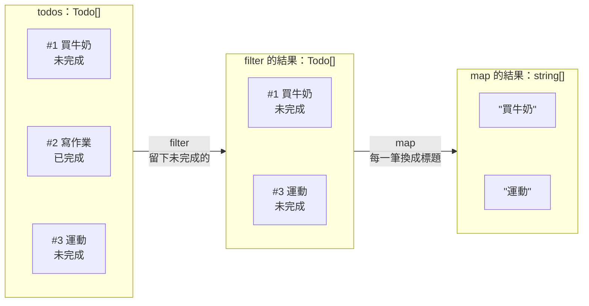
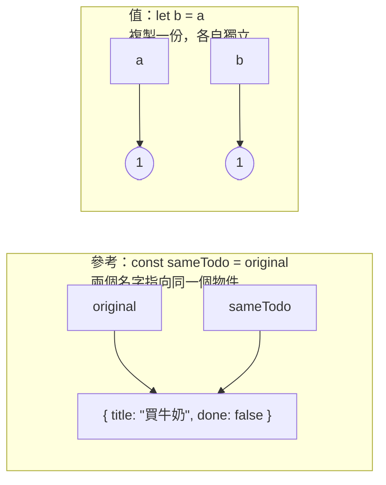
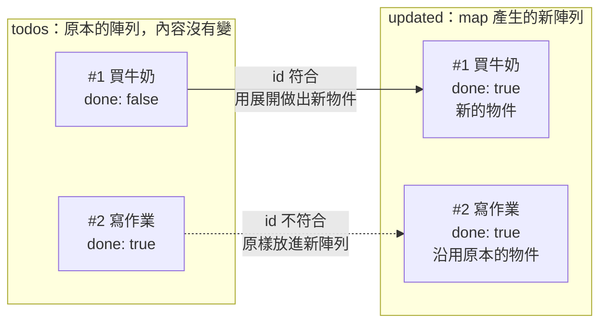

# Day 04 — 陣列操作與不可變性

> 第 1 週｜基礎｜必修約 60 分鐘，加練可到 3 小時

## 學習目標

完成今天的課程後，你能夠：

- 用 `map`、`filter`、`find`、`some`、`every`、`reduce` 取代手寫的迴圈。
- 說出「值」與「參考」的差別，並預測改動一個物件會影響到誰。
- 用展開與解構來複製、合併、拆開陣列與物件。
- 用不可變更新來新增、修改、移除資料，而不動到原本的陣列與物件。
- 用 `readonly` 讓 TypeScript 攔下不小心的修改，並用 `toSorted` 排序。

## 時間分配

| 區塊 | 內容                   | 時間        |
| ---- | ---------------------- | ----------- |
| 必修 | 觀念說明＋圖解         | 20 分鐘     |
| 必修 | 逐步解說（範例 01–05） | 20 分鐘     |
| 必修 | 練習 01、02            | 20 分鐘     |
| 加練 | 練習 03、延伸挑戰      | 30–120 分鐘 |

## 觀念說明

### 1. 陣列方法：把迴圈濃縮成一句話

Day 03 用「迴圈加 `push`」從一個陣列算出另一個陣列。這件事太常做，所以陣列內建了一組方法（method）。方法是「屬於某個值的函式」，用點號呼叫，例如 `todos.filter(...)`。

這些方法都接收一個函式當作參數，然後對陣列裡的每個值呼叫它一次。這種「交給別人去呼叫的函式」叫做回呼函式（callback），通常寫成箭頭函式：

```text
const openTodos = todos.filter((todo) => !todo.done);
                  │     │       │        │
                  │     │       │        └─ 回傳值：true 代表留下這一筆
                  │     │       └─ 參數：目前輪到的那一筆，型別由 TypeScript 推論
                  │     └─ 方法名稱
                  └─ 陣列
```

| 方法     | 回呼函式要回傳什麼 | 方法的結果                     | 用途                 |
| -------- | ------------------ | ------------------------------ | -------------------- |
| `map`    | 換成的新值         | 長度相同的新陣列               | 把每一筆換成別的東西 |
| `filter` | `boolean`          | 只留下 `true` 那幾筆的新陣列   | 篩選                 |
| `find`   | `boolean`          | 第一筆符合的值，或 `undefined` | 找出其中一筆         |
| `some`   | `boolean`          | `boolean`：至少一筆符合        | 問「有沒有」         |
| `every`  | `boolean`          | `boolean`：全部符合            | 問「是不是全部」     |
| `reduce` | 新的累計值         | 最後的累計值                   | 加總、統計           |

`find` 可能找不到，所以結果的型別是 `Todo | undefined`，使用前要先縮小，和 Day 02 用索引取值一樣。

`reduce` 帶著一個累計值走過整個陣列。以 `minutes.reduce((total, value) => total + value, 0)` 為例，最後的 `0` 是累計值的起點，`minutes` 是 `[15, 60, 30]`：

| 第幾圈 | `total`（累計值） | `value`（目前的值） | 回傳的新累計值        |
| ------ | ----------------- | ------------------- | --------------------- |
| 1      | 0                 | 15                  | 15                    |
| 2      | 15                | 60                  | 75                    |
| 3      | 75                | 30                  | 105，也就是最後的結果 |

### 2. 串接：`filter` 之後接 `map`

`filter` 與 `map` 的結果都是陣列，所以後面可以直接再呼叫一個方法。這張圖說明「取出未完成事項的標題」怎麼分成兩步：



重點：

- 每一步都產生新的陣列，`todos` 本身沒有變。
- `filter` 改變筆數，不改變型別；`map` 改變型別，不改變筆數。
- 由左到右讀，就是資料經過的順序：`todos.filter(...).map(...)`。

> ▶ 動畫演示：[`filter` 一筆一筆決定留下誰，`map` 再把留下的每一筆換成標題](https://vincentlin0619.github.io/ts-engineer-bootcamp/day-04/#anim-day04-filter-map)

### 3. 值與參考

為什麼要強調「原本的沒有變」？因為物件與陣列在指派時不會被複製。

- `number`、`string`、`boolean`：指派時複製一份值，兩個變數各自獨立。
- 物件與陣列：指派時只複製「指向那個物件的參考（reference）」，兩個名字指向同一個物件。

這張圖比較這兩種情況：



重點：

- 透過 `sameTodo` 改屬性，`original` 也跟著變，因為它們是同一個物件。
- 把物件傳進函式，傳的也是參考。函式裡面改了它，函式外面的物件就被改了。
- `const` 只保證名字不會改指向別的物件，不保證物件的內容不變。
- 用 `===` 比較兩個物件，比的是「是不是同一個物件」，不是內容是否相同。

很多難找的 bug 都來自這裡：程式的某個角落改了物件，另一個角落的資料跟著變了，卻看不出是誰改的。

> ▶ 動畫演示：[兩個名字指向同一個物件，以及展開 `...` 怎麼做出真正的副本](https://vincentlin0619.github.io/ts-engineer-bootcamp/day-04/#anim-day04-reference)

### 4. 展開與解構

展開（spread）用 `...` 把陣列的每個值，或物件的每個屬性，放進一個新的陣列或物件：

```ts
const copiedTitles = [...titles]; // a new array with the same items
const withExtra = [...titles, "倒垃圾"]; // the old items, then one more

const copiedTodo = { ...original }; // a new object with the same properties
const finished = { ...original, done: true }; // the same, but `done` replaced
```

寫在展開後面的屬性會蓋掉展開進來的同名屬性。「複製一份，只改其中一項」就是這樣寫。展開可以連用，後面的蓋掉前面的：`{ ...original, ...changes }`。

解構（destructuring）的方向相反：把物件的屬性或陣列的值一次取出來，放進變數：

```ts
const { title, priority } = original; // by property name
const [first, ...rest] = titles; // by position, `rest` collects what is left
```

`first` 的型別是 `string | undefined`，原因和用索引取值相同：陣列可能是空的。

### 5. 不可變更新

不可變（immutable）的意思是「建立之後就不再修改」。要改資料時不去動原本的陣列或物件，而是做出一份新的。三種操作各有固定的寫法：

| 操作 | 不可變的寫法                                                             | 取代哪一種直接修改    |
| ---- | ------------------------------------------------------------------------ | --------------------- |
| 新增 | `[...todos, newTodo]`                                                    | `todos.push(newTodo)` |
| 移除 | `todos.filter((todo) => todo.id !== id)`                                 | 從陣列裡刪掉那一筆    |
| 修改 | `todos.map((todo) => (todo.id === id ? { ...todo, done: true } : todo))` | `todo.done = true`    |

這張圖說明用 `map` 修改 `id` 為 1 的那一筆之後，新舊兩個陣列的關係：



重點：

- `todos` 與它裡面的物件完全沒有變。還拿著 `todos` 的其他程式不會受到影響。
- 要改的那一筆用展開做出新的物件。沒改的直接沿用，不必複製。
- 資料只會在你明確做出新版本的地方改變，出問題時容易追查。Day 05 的 CRUD 函式全部採用這種寫法。

### 6. `readonly` 與 `toSorted`

「不要改」只靠自己小心並不可靠，可以請 TypeScript 把關：

- `readonly Todo[]` 是唯讀陣列。`push`、`sort` 這類會改動陣列的方法在這個型別上不存在，一呼叫就回報錯誤。`map`、`filter` 等不改動陣列的方法照常可用。
- 函式的參數寫成 `readonly Todo[]`，是對呼叫者的承諾：我不會改你的陣列。一般的 `Todo[]` 可以傳給它，反過來則不行。
- 在屬性前面加 `readonly`，例如 `readonly id: number`，這個屬性就只能讀取，不能重新指派。

`readonly` 和其他型別標註一樣，只在 `bun check` 時有作用，執行時並不存在。

排序有兩個方法。`sort` 會直接重排原本的陣列，`toSorted` 則回傳一個排好的新陣列。本課程一律用 `toSorted`。它接收一個比較用的函式：`a - b` 由小排到大，`b - a` 由大排到小。

```ts
const ascending = scores.toSorted((a, b) => a - b);
```

## 逐步解說

以下每一步對應 `examples/` 裡的一個檔案。請在專案根目錄執行指令。

### 步驟 1：陣列方法

檔案：[`examples/01-array-methods.ts`](examples/01-array-methods.ts)

```bash
bun run day-04-arrays-immutability/examples/01-array-methods.ts
```

1. 開頭先用 Day 03 的「迴圈加 `push`」取出所有標題，當作對照。
2. `todos.map((todo) => todo.title)` 得到相同的結果，只要一行。箭頭函式的參數 `todo` 不必標註型別，TypeScript 從 `todos` 推論出它是 `Todo`。
3. `filter` 留下 `!todo.done` 為 `true` 的兩筆，所以印出 `2`。
4. `filter` 後面接 `map`，得到 `[ "買牛奶", "運動" ]`。
5. `find` 找出 `id` 為 2 的那一筆。結果可能是 `undefined`，所以先縮小再印出標題。找 `id` 為 99 的找不到，印出 `undefined`。
6. `some` 印出 `true`：至少有一筆的優先度是 `"high"`。`every` 印出 `false`：不是每一筆都完成了。
7. `reduce` 把 `[15, 60, 30]` 加總成 `105`。
8. 最後一行印出 `todos.length` 與 `minutes`，確認原本的兩個陣列都沒有變。

### 步驟 2：值與參考

檔案：[`examples/02-value-vs-reference.ts`](examples/02-value-vs-reference.ts)

```bash
bun run day-04-arrays-immutability/examples/02-value-vs-reference.ts
```

1. `let b = a` 複製了數字。把 `b` 改成 2 之後，`a` 還是 1，印出 `1 2`。
2. `const sameTodo = original` 沒有複製物件。執行 `sameTodo.done = true` 之後，`original.done` 也印出 `true`。
3. `original === sameTodo` 是 `true`，因為它們是同一個物件。`lookalike` 的內容完全相同，卻是另外建立的物件，所以 `original === lookalike` 是 `false`。
4. 陣列也一樣：對 `sameTitles` 呼叫 `push`，`titles` 也多了一個值。
5. `markDone(homework)` 在函式裡改了 `todo.done`，函式外面的 `homework.done` 變成 `true`。函式拿到的是同一個物件，不是複本。

### 步驟 3：展開與解構

檔案：[`examples/03-spread-destructuring.ts`](examples/03-spread-destructuring.ts)

```bash
bun run day-04-arrays-immutability/examples/03-spread-destructuring.ts
```

1. `[...titles]` 做出一個新陣列。對 `copiedTitles` 呼叫 `push`，`titles` 仍然只有兩個值。
2. `[...titles, "倒垃圾"]` 在尾端多放一個值。`[...titles, ...weekend]` 把兩個陣列接起來。
3. `{ ...original }` 做出內容相同的新物件，所以 `copiedTodo === original` 是 `false`。
4. `{ ...original, done: true }` 複製之後蓋掉 `done`。印出 `false true`：原本的沒變，新的變了。
5. `const { title, priority } = original` 一次取出兩個屬性，印出 `買牛奶 high`。
6. `const [first, ...rest] = everything` 取出第一個值，剩下的收進 `rest`。

### 步驟 4：不可變更新、`readonly` 與 `toSorted`

檔案：[`examples/04-immutable-updates.ts`](examples/04-immutable-updates.ts)

```bash
bun run day-04-arrays-immutability/examples/04-immutable-updates.ts
```

1. `todos` 的型別是 `readonly Todo[]`，裡面有兩筆資料。
2. 新增、移除、修改各用一行做出新陣列，三個新陣列的長度印出來是 `3 1 2`。
3. `updated[0]` 的 `done` 是 `true`，而 `todos[0]` 的 `done` 仍然是 `false`。原本的資料沒有被動到。
4. `updated[1] === todos[1]` 是 `true`：沒改的那一筆，在兩個陣列裡是同一個物件。
5. `toSorted` 排出由小到大、由大到小兩個新陣列，`scores` 自己的順序沒有變。
6. `Member` 的 `id` 是 `readonly` 屬性。`member.name` 可以改，`member.id` 不行。
7. 檔案最後有三行被註解掉的程式。一次只拿掉一行開頭的 `//`，執行 `bun check day-04-arrays-immutability/examples/04-immutable-updates.ts`，對照下表。看完把 `//` 加回去，再試下一行。

   | 拿掉哪一行             | 錯誤訊息                                                              |
   | ---------------------- | --------------------------------------------------------------------- |
   | `todos.push(jogging);` | `TS2339: Property 'push' does not exist on type 'readonly Todo[]'.`   |
   | `scores.sort();`       | `TS2339: Property 'sort' does not exist on type 'readonly number[]'.` |
   | `member.id = 2;`       | `TS2540: Cannot assign to 'id' because it is a read-only property.`   |

### 步驟 5：主線改用陣列方法

檔案：[`examples/05-todo.ts`](examples/05-todo.ts)

```bash
bun run day-04-arrays-immutability/examples/05-todo.ts
```

1. `priorityLabel` 與 `formatTodo` 和 Day 03 完全相同。
2. `countDone` 改用 `filter(...).length`，一行就取代了迴圈與計數器。參數型別從 `Todo[]` 改成 `readonly Todo[]`，呼叫的方式不變。
3. `getOpenTodos` 與 `getTitles` 各自包裝一個陣列方法。把它們接起來用：`getTitles(getOpenTodos(todos))` 印出 `[ "買牛奶", "運動" ]`。
4. `getStats` 回傳一個 `TodoStats` 物件，裡面是總數、已完成、未完成三個數字。
5. `toggleDone(todo: Todo): Todo` 用展開複製一份，並把 `done` 換成相反的值。傳進去的物件不會被改。
6. `todos.map((todo) => (todo.id === 1 ? toggleDone(todo) : todo))` 是「修改陣列裡的某一筆」的不可變寫法。
7. 最後兩行是證明：原本的陣列已完成 1 筆，新的陣列已完成 2 筆。

## 規範重點

- **能用陣列方法就不寫迴圈**。`map`、`filter` 這些名字直接說出意圖，讀的人不必看完整個迴圈才知道在做什麼。
- **回呼函式用箭頭函式，參數用單數名詞**。寫 `todos.map((todo) => ...)`，不要寫 `(t) => ...` 或 `(x) => ...`。
- **不修改傳進來的參數**。函式要改資料時，回傳新的陣列或物件，並把陣列參數標成 `readonly`。
- **排序用 `toSorted`，不用 `sort`**。
- **`reduce` 一定要給起始值**。少了它，遇到空陣列時程式會在執行中出錯。
- **串接太長就拆開**。超過兩三個方法時，把中間的結果放進有名字的變數。

## 常見錯誤

| 錯誤訊息或現象                                                                                          | 原因                                     | 修法                                   |
| ------------------------------------------------------------------------------------------------------- | ---------------------------------------- | -------------------------------------- |
| `TS2339: Property 'push' does not exist on type 'readonly Todo[]'.`                                     | 對唯讀陣列呼叫會改動它的方法             | 改用展開做出新陣列                     |
| `TS4104: The type 'readonly Todo[]' is 'readonly' and cannot be assigned to the mutable type 'Todo[]'.` | 把唯讀陣列傳給參數型別是 `Todo[]` 的函式 | 把那個函式的參數改成 `readonly Todo[]` |
| `TS18048: 'found' is possibly 'undefined'.`                                                             | 直接使用 `find` 的結果                   | 先用 `if (found !== undefined)` 縮小   |
| `TS2322: Type 'void[]' is not assignable to type 'string[]'.`                                           | 箭頭函式用了大括號，卻沒有寫 `return`    | 加上 `return`，或拿掉大括號            |
| `TypeError: reduce of empty array with no initial value`                                                | `reduce` 沒有給起始值，陣列又剛好是空的  | 補上第二個參數，例如 `0`               |
| 改了一個變數，另一個變數的內容也跟著變                                                                  | 兩個名字指向同一個物件或陣列             | 先用展開做出新的，再改新的那一份       |
| 排序之後，原本陣列的順序也變了                                                                          | 用了 `sort`                              | 改用 `toSorted`                        |

## 練習

練習檔在 `exercises/`。把每個函式裡的 `throw new Error(...)` 換成你的程式。

```bash
# 檢查你的答案：全部顯示 pass 就完成了
bun test day-04
```

| 練習                                                           | 內容                                               | 類型 |
| -------------------------------------------------------------- | -------------------------------------------------- | ---- |
| [`01-array-methods.ts`](exercises/01-array-methods.ts)         | `map`、`filter`、`find`、`some`、`every`、`reduce` | 必修 |
| [`02-immutable-updates.ts`](exercises/02-immutable-updates.ts) | 展開、解構、不可變的新增／移除／修改、`toSorted`   | 必修 |
| [`03-todo-updates.ts`](exercises/03-todo-updates.ts)           | `toggleDone`，以及 Todo 的篩選、統計、排序         | 加練 |

今天的測試除了檢查結果，也會檢查你有沒有改到傳進去的陣列與物件。

卡住超過 15 分鐘再看 `solutions/` 裡的參考解答。看完後把解答關掉，自己重寫一次。

### 延伸挑戰（加練）

1. 回到 Day 03 的 `exercises/02-loops-functions.ts`，把 `keepPassing` 與 `countLongTitles` 改用陣列方法重寫，然後確認 `bun test day-03` 仍然全部通過。
2. 把 `examples/05-todo.ts` 複製成一個新檔案，新增 `renameTodo(todo: Todo, title: string): Todo` 與 `removeDone(todos: readonly Todo[]): Todo[]`。兩個函式都不可以改動傳進來的資料。
3. 用 `reduce` 寫出另一個版本的 `countDone`，再和 `filter(...).length` 的版本比一比，哪一個比較容易讀懂。

## 自我檢查清單

- [ ] 我能說出 `map`、`filter`、`find`、`some`、`every`、`reduce` 各自回傳什麼。
- [ ] 我能解釋為什麼 `const sameTodo = original` 之後改 `sameTodo`，`original` 也會變。
- [ ] 我能用展開複製陣列與物件，並在複製時換掉其中一個屬性。
- [ ] 我能不用 `push`、不直接改屬性，完成新增、移除、修改一筆資料。
- [ ] 我能說出參數型別寫成 `readonly Todo[]` 向呼叫者承諾了什麼。
- [ ] 我能解釋 `toggleDone` 為什麼回傳新物件，而不是直接改 `todo.done`。
- [ ] `bun test day-04` 全部通過。

## 下一課

[Day 05 — CRUD（一）：記憶體版](../day-05-crud-in-memory/README.md)：今天學會在不改動原始資料的前提下新增、修改、移除，明天把這些寫法整理成一組 CRUD 函式，做出第一版可以互動的 Todo App。
