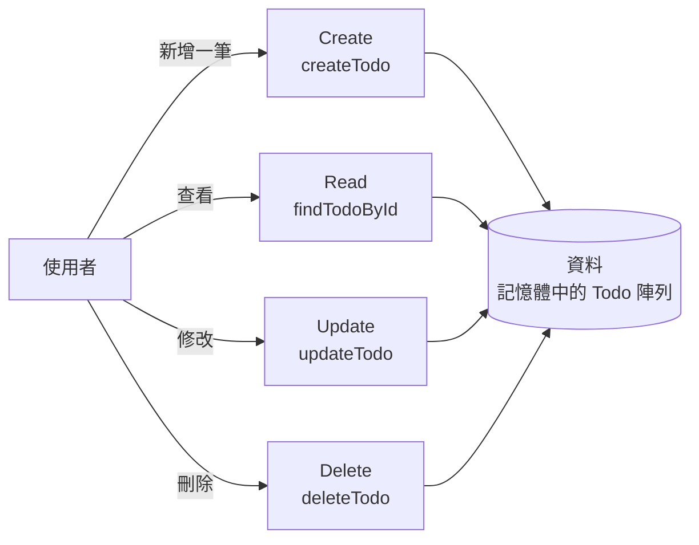
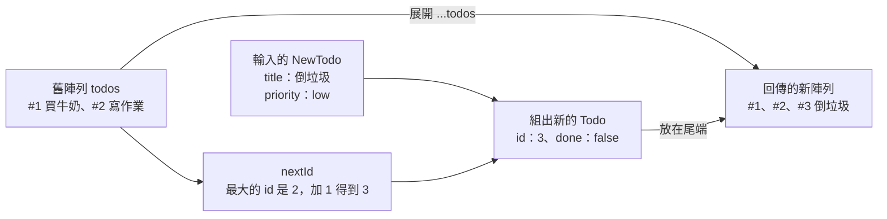
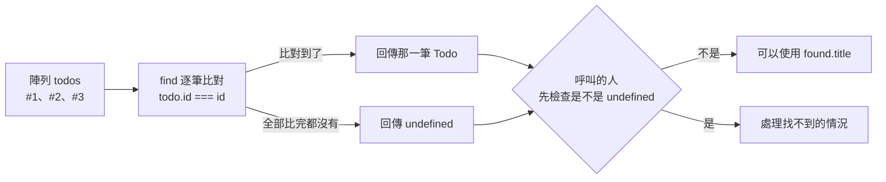
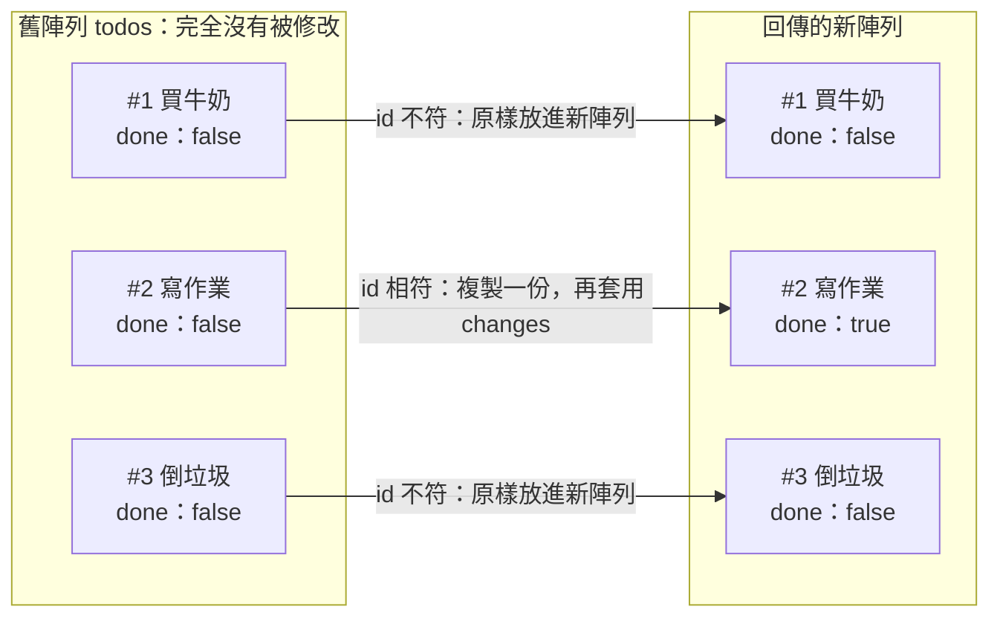
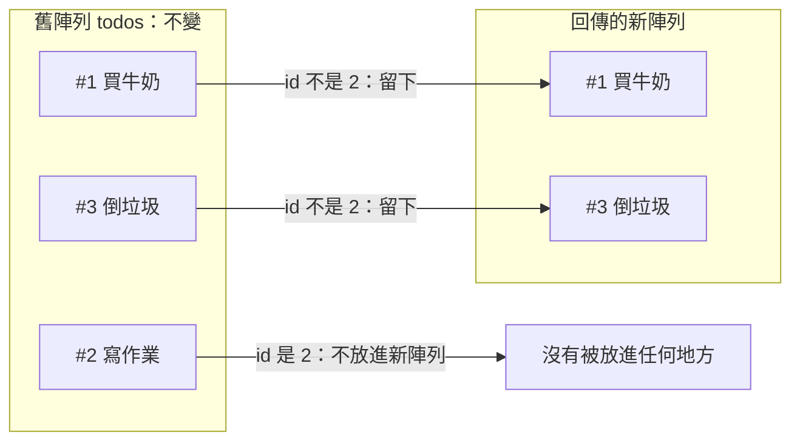
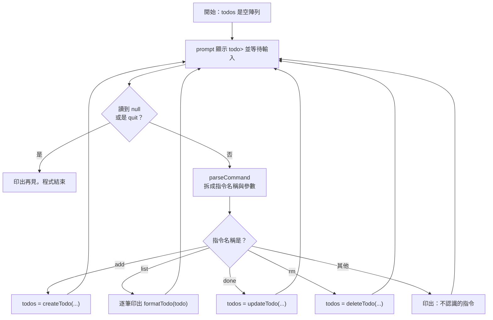

# Day 05 — CRUD（一）：記憶體版

> 第 1 週｜基礎｜必修約 60 分鐘，加練可到 3 小時

## 學習目標

完成今天的課程後，你能夠：

- 說出 CRUD 四個字母各代表什麼，並在日常使用的 App 裡指出對應的操作。
- 寫出 `createTodo`、`findTodoById`、`updateTodo`、`deleteTodo` 四個函式，而且都不修改傳入的陣列。
- 用「目前最大的 `id` 加 1」產生新的 `id`，並說出為什麼不能用「筆數加 1」。
- 處理 `Todo | undefined`：先檢查，再使用。
- 用 `prompt()` 做出一個讀指令、改資料、再讀下一個指令的互動式 CLI。

## 時間分配

| 區塊 | 內容                   | 時間        |
| ---- | ---------------------- | ----------- |
| 必修 | 觀念說明＋圖解         | 20 分鐘     |
| 必修 | 逐步解說（範例 01–05） | 20 分鐘     |
| 必修 | 練習 01、02            | 20 分鐘     |
| 加練 | 練習 03、延伸挑戰      | 30–120 分鐘 |

## 今天的 Todo 進度

到昨天為止，主線只有 `Todo` 型別，加上幾個「讀資料、算結果」的輔助函式。今天補齊新增、讀取、更新、刪除四個函式，再用 `prompt()` 包成一個可以打指令操作的程式。

資料只放在記憶體（memory）裡的一個陣列，程式一結束就消失。Day 11 會把它存進檔案。

## 觀念說明

### 1. CRUD 是什麼

幾乎所有 App 對資料做的事，都可以歸類成四種操作。把四個英文字的開頭字母合起來，就是 CRUD：

| 字母 | 英文   | 中文 | 通訊軟體       | 購物網站     | 今天的函式     |
| ---- | ------ | ---- | -------------- | ------------ | -------------- |
| C    | Create | 新增 | 送出一則訊息   | 加入購物車   | `createTodo`   |
| R    | Read   | 讀取 | 查看聊天紀錄   | 查看購物車   | `findTodoById` |
| U    | Update | 更新 | 編輯送出的訊息 | 修改商品數量 | `updateTodo`   |
| D    | Delete | 刪除 | 收回一則訊息   | 移除一項商品 | `deleteTodo`   |

下面這張圖說明四種操作和資料的關係：使用者的每個動作都會變成其中一種操作，四種操作面對的是同一份資料。



重點：

- 四種操作裡只有 Read 不會改變資料，其他三種都會。
- 今天資料放在陣列裡。之後換成檔案（Day 11）、資料庫（Day 12）、HTTP API（Day 13），做的仍然是這四件事。

### 2. 資料放在一個變數裡，函式回傳新陣列

今天的「資料庫」就是一個 `Todo[]` 變數。五個函式的第一個參數都是 `readonly Todo[]`：函式只讀取它，不修改它，需要改變時回傳一個新陣列（Day 04 的不可變更新）。

```ts
function nextId(todos: readonly Todo[]): number;
function createTodo(todos: readonly Todo[], input: NewTodo): Todo[];
function findTodoById(todos: readonly Todo[], id: number): Todo | undefined;
function updateTodo(
  todos: readonly Todo[],
  id: number,
  changes: TodoChanges,
): Todo[];
function deleteTodo(todos: readonly Todo[], id: number): Todo[];
```

既然函式不修改原本的陣列，呼叫的人就要自己把結果接回變數：

```text
todos = createTodo(todos, { title: "買牛奶", priority: "high" });
  │         │        │                    │
  │         │        │                    └─ 這次操作需要的資料
  │         │        └─ 目前的陣列：函式只讀取，不修改
  │         └─ 回傳一個新陣列
  └─ 把新陣列接回同一個變數，它才成為「目前的資料」
```

所以存放資料的變數要用 `let` 宣告。忘了寫 `todos =`，資料就不會變。

### 3. Create：先產生 `id`，再放到尾端

每一筆資料需要一個不重複的 `id`（識別碼），之後才能指定「要改哪一筆、要刪哪一筆」。`id` 由 `createTodo` 產生，所以呼叫的人只需要提供 `NewTodo`，也就是標題和優先度。

這張圖說明 `createTodo(todos, { title: "倒垃圾", priority: "low" })` 的資料流向：



重點：

- `nextId` 用迴圈找出目前最大的 `id`，再加 1。空陣列時最大值當作 0，所以第一筆的 `id` 是 1。
- 不能用 `todos.length + 1`。有 #1、#2 兩筆時刪掉 #1，剩下一筆，`length + 1` 會算出 2，和現有的 #2 重複。
- `done` 固定從 `false` 開始，不讓呼叫的人決定。

### 4. Read：找不到時回傳 `undefined`

`findTodoById` 用 Day 04 學過的 `find`。要找的 `id` 不一定存在，所以回傳型別是 `Todo | undefined`。

這張圖說明讀取的兩種結果，以及呼叫的人該做什麼：



重點：

- 回傳型別把「可能找不到」寫進了函式的簽名，呼叫的人不可能忘記這件事。
- 沒檢查就使用，`bun check` 會回報 `TS18048: 'found' is possibly 'undefined'.`
- 用 `if` 排除 `undefined` 之後，TypeScript 就知道剩下的一定是 `Todo`（Day 02 的型別縮小）：

```ts
const found = findTodoById(todos, 2);
if (found === undefined) {
  console.log("找不到 id 為 2 的待辦事項");
} else {
  console.log(found.title); // here `found` is a Todo
}
```

### 5. Update：舊陣列不動，回傳新陣列

`updateTodo` 的第三個參數 `TodoChanges` 每個屬性都是選用的，只需要傳入「想改的那幾個」。

這張圖說明 `updateTodo(todos, 2, { done: true })` 之後，舊陣列和新陣列各自的內容：



重點：

- 舊陣列裡的 #2 仍然是 `done: false`。被修改的是「複製出來的那一份」。
- 沒有任何一筆的 `id` 相符時，新陣列的內容和舊陣列一樣。
- 整個函式只有一行，拆開來看：

```text
todos.map((todo) => (todo.id === id ? { ...todo, ...changes } : todo))
                           │              │          │            │
                           │              │          │            └─ id 不符：原樣放回去
                           │              │          └─ 再蓋上要改的屬性
                           │              └─ 先複製這一筆的所有屬性
                           └─ 這一筆是要改的那一筆嗎？
```

### 6. Delete：只留下 `id` 不同的

刪除不需要「拿掉」任何東西。用 `filter` 建一個新陣列，只放進 `id` 不相同的那幾筆就好。

這張圖說明 `deleteTodo(todos, 2)` 的資料流向：



重點：

- 條件寫的是「要留下誰」：`todo.id !== id`。寫成 `===` 會變成只留下要刪的那一筆。
- 舊陣列仍然有三筆。只要還有變數指向它，原本的資料就在。

### 7. 互動式 CLI：`prompt()` 與指令迴圈

CLI（command-line interface，命令列介面）是在終端機裡用文字操作的程式。`prompt()` 會顯示一段提示文字，等使用者輸入一行，再把那一行當成回傳值。

`prompt()` 的回傳型別是 `string | null`。讀不到內容時回傳 `null`，有兩種情況：使用者沒打字就按 Enter，或是用管線送進來的輸入已經讀完。所以使用前同樣要先檢查。

讀到的一行文字要先拆成「指令名稱」和「參數」。今天會用到三個字串方法：

| 方法                | 做什麼                                    | 範例                                  |
| ------------------- | ----------------------------------------- | ------------------------------------- |
| `trim()`            | 去掉前後的空白                            | `"  list  ".trim()` 是 `"list"`       |
| `indexOf(" ")`      | 回傳第一個空白的位置，找不到時回傳 `-1`   | `"add 買牛奶".indexOf(" ")` 是 `3`    |
| `slice(start, end)` | 複製字串的一段，位置從 0 算起，不含 `end` | `"add 買牛奶".slice(0, 3)` 是 `"add"` |

```text
"add 買牛奶 和雞蛋"
 └┬┘│└─────┬─────┘
  │ │      └─ 參數：slice(spaceIndex + 1)，從空白的下一個字到最後
  │ └─ 第一個空白：indexOf(" ") 回傳它的位置 3
  └─ 指令名稱：slice(0, spaceIndex)
```

這張圖說明整個 CLI 的運作方式：同一段流程不斷重複，直到讀到 `quit` 或沒有輸入為止。



重點：

- 迴圈每跑一圈就處理一個指令。會改資料的指令都是 `todos = ...`，把新陣列接回變數。
- `prompt()` 和 `console.log()` 只出現在迴圈裡。CRUD 函式本身不讀輸入、不印東西，只負責資料。

## 逐步解說

以下每一步對應 `examples/` 裡的一個檔案。請在專案根目錄執行指令。

今天還沒教模組，一個檔案沒辦法使用另一個檔案的程式。所以每個範例都把需要的型別與函式**重新寫一次**，這個重複是刻意的，明天就會解決它。

### 步驟 1：Create 與 Read

檔案：[`examples/01-create-read.ts`](examples/01-create-read.ts)

```bash
bun run day-05-crud-in-memory/examples/01-create-read.ts
```

1. `NewTodo` 只有 `title` 和 `priority`。`id` 與 `done` 由 `createTodo` 決定。
2. `nextId(empty)` 印出 `1`：空陣列時迴圈一次都沒跑，`maxId` 維持 0。
3. 連續呼叫兩次 `createTodo`，每次都把上一次的結果傳進去。印出的 `0 1 2` 是三個陣列各自的長度，證明前面的陣列沒有被修改。
4. `afterDelete` 模擬「#1 已被刪除，只剩 #2」的情況：`length + 1` 算出重複的 `2`，`nextId` 算出安全的 `3`。
5. `findTodoById(two, 2)` 的結果先用 `if` 檢查才使用，印出 `找到了：寫作業`。
6. `findTodoById(two, 99)` 找不到，印出 `undefined`。

### 步驟 2：Update 與 Delete

檔案：[`examples/02-update-delete.ts`](examples/02-update-delete.ts)

```bash
bun run day-05-crud-in-memory/examples/02-update-delete.ts
```

1. `updateTodo(todos, 2, { done: true })` 之後，先印新陣列的 #2（`done: true`），再印舊陣列的 #2（仍是 `done: false`）。
2. 接下來三行用 `===` 比較參考（Day 04）：兩個陣列不是同一個（`false`）；沒改的 #1 在兩個陣列裡是同一個物件（`true`）；改過的 #2 是新物件（`false`）。
3. `changes` 可以一次放多個屬性：`{ title: "倒垃圾與回收", priority: "high" }`。
4. `deleteTodo(todos, 2)` 之後，新陣列的 `id` 是 `[ 1, 3 ]`，舊陣列的長度仍是 `3`。
5. 最後兩行用不存在的 `id` 99 呼叫，兩個函式都回傳長度 `3` 的陣列，沒有任何改變。

### 步驟 3：把五個函式放在一起

檔案：[`examples/03-todo-store.ts`](examples/03-todo-store.ts)

```bash
bun run day-05-crud-in-memory/examples/03-todo-store.ts
```

1. 五個函式都在同一個檔案裡。`formatTodo` 把一筆資料轉成一行文字，`printTodos` 印出整份清單。
2. `let todos: Todo[] = []` 是唯一存放資料的變數。之後每一行 `todos = ...` 都在把新陣列接回去。
3. 依序做 Create、Read、Update、Delete，每一步之後印出清單，對照前面的四張資料流向圖。
4. 刪除 #1 之後再新增，新的一筆是 #4，不是 #3：`nextId` 看的是最大的 `id`，不是筆數。
5. 最後一段只寫了 `deleteTodo(todos, 2);`，沒有 `todos =`。清單印出來仍是三筆，回傳的新陣列沒有人接住，就這樣消失了。

### 步驟 4：`prompt()` 與拆解指令

檔案：[`examples/04-prompt-commands.ts`](examples/04-prompt-commands.ts)

先自己輸入：看到問題後打字、按 Enter，輸入 `quit` 結束。再用管線（pipe）把事先寫好的答案送進去，`printf` 印出的每一行會依序成為一次 `prompt()` 的回傳值：

```bash
# Type the answers yourself
bun run day-05-crud-in-memory/examples/04-prompt-commands.ts

# Send prepared answers through a pipe
printf '小明\nadd 買牛奶 和雞蛋\nlist\nquit\n' | bun run day-05-crud-in-memory/examples/04-prompt-commands.ts
```

1. `prompt("你叫什麼名字？")` 的結果是 `string | null`，所以先用 `if` 處理 `null`。
2. `parseCommand` 依序使用 `trim()`、`indexOf(" ")`、`slice()`。沒有空白時（`spaceIndex === -1`），整行都是指令名稱，參數是空字串。
3. `while (running)` 迴圈：讀到 `null` 或指令名稱是 `quit`，就把 `running` 改成 `false`，迴圈在下一次檢查條件時結束。
4. 用管線執行時，輸入的文字不會顯示在畫面上，所以每一行會是「提示文字」緊接著「程式的輸出」。

### 步驟 5：完整的 Todo CLI

檔案：[`examples/05-todo-cli.ts`](examples/05-todo-cli.ts)

先自己操作一次，試試每個指令，再用管線輸入驗證：

```bash
# Type the commands yourself
bun run day-05-crud-in-memory/examples/05-todo-cli.ts

# Send prepared commands through a pipe
printf 'add 買牛奶\nlist\nquit\n' | bun run day-05-crud-in-memory/examples/05-todo-cli.ts
```

用管線執行的那一行會印出：

```text
Todo CLI：add <標題>、list、done <id>、rm <id>、quit
todo> 已新增：買牛奶
todo> [ ] #1 買牛奶（優先度：中）
todo> 再見！
```

1. 第 1 部分是從範例 03 **複製過來**的型別與 CRUD 函式，一個字都沒改。
2. 第 2 部分是範例 04 的 `parseCommand`，同樣是複製的。
3. 第 3 部分是指令迴圈，結構和前面的流程圖一致：讀一行、檢查 `null`、拆解、用 `switch` 分派。
4. `add` 固定用 `"medium"` 當優先度。標題是空字串時只印出用法，不新增。
5. `done` 與 `rm` 先用 `findTodoById` 確認那一筆存在，找到才改資料，找不到就印出提示。這裡就是 `Todo | undefined` 的實際用途。
6. `Number("abc")` 的結果是 `NaN`，它不等於任何 `id`，所以亂打的參數會自然走到「找不到」那一邊。
7. 輸入 `quit`，或是輸入讀完了，迴圈結束並印出 `再見！`。重新執行程式，資料會從空的開始。

## 規範重點

- **不修改的陣列參數寫成 `readonly Todo[]`**。這樣函式裡一寫 `todos.push(...)`，`bun check` 就會擋下來，不必靠自己記得。
- **函式回傳新資料，不修改傳入的資料**。呼叫的人手上的舊陣列永遠可信，出錯時比較容易找出是哪一步造成的。
- **「可能沒有」要寫進回傳型別**：`Todo | undefined`。不要回傳一筆假資料，也不要假裝一定找得到。
- **`id` 由負責新增的函式產生**。呼叫的人只提供 `NewTodo`，就不可能傳進重複的 `id`。
- **函式名稱用「動詞＋名詞」**：`createTodo`、`findTodoById`、`updateTodo`、`deleteTodo`。看名字就知道是哪一種 CRUD 操作。
- **資料操作與輸入輸出分開**。CRUD 函式裡不呼叫 `prompt()` 或 `console.log()`，這樣同一組函式之後可以直接搬到測試、檔案版、API 版使用。

## 常見錯誤

| 錯誤訊息或現象                                                                                          | 原因                                           | 修法                                       |
| ------------------------------------------------------------------------------------------------------- | ---------------------------------------------- | ------------------------------------------ |
| `TS18048: 'found' is possibly 'undefined'.`                                                             | 沒檢查就使用 `findTodoById` 的結果             | 先用 `if (found === undefined)` 處理找不到 |
| `TS18047: 'line' is possibly 'null'.`                                                                   | 沒檢查就使用 `prompt()` 的結果                 | 先用 `if (line === null)` 處理沒有輸入     |
| `TS2339: Property 'push' does not exist on type 'readonly Todo[]'.`                                     | 對 `readonly` 陣列呼叫會修改它的方法           | 用展開建立新陣列：`[...todos, todo]`       |
| `TS4104: The type 'readonly Todo[]' is 'readonly' and cannot be assigned to the mutable type 'Todo[]'.` | 把 `readonly` 的參數直接當成 `Todo[]` 回傳     | 回傳一份複本：`return [...todos];`         |
| 呼叫了 `deleteTodo`，清單卻沒變                                                                         | 沒有把回傳的新陣列接回變數                     | 寫成 `todos = deleteTodo(todos, id);`      |
| 新增的 `id` 和現有的重複                                                                                | 用 `todos.length + 1` 當 `id`                  | 改用 `nextId(todos)`                       |
| 用管線輸入時，最後一個指令沒有執行                                                                      | 最後一行結尾沒有 `\n`，`prompt()` 讀不到那一行 | `printf` 的每個指令後面都加上 `\n`         |
| 沒打字按了 Enter，程式就結束                                                                            | `prompt()` 回傳 `null`，範例把 `null` 當成結束 | 這是預期行為；重新執行即可                 |

## 練習

練習檔在 `exercises/`。每個檔案裡標著 `TODO` 的地方就是你要改的地方。

```bash
# 檢查你的答案：全部顯示 pass 就完成了
bun test day-05
```

| 練習                                                   | 內容                                         | 類型 |
| ------------------------------------------------------ | -------------------------------------------- | ---- |
| [`01-create-read.ts`](exercises/01-create-read.ts)     | 書單的 Create 與 Read：產生 `id`、處理找不到 | 必修 |
| [`02-update-delete.ts`](exercises/02-update-delete.ts) | 書單的 Update 與 Delete：不修改原陣列        | 必修 |
| [`03-todo-commands.ts`](exercises/03-todo-commands.ts) | 把 Todo CLI 的指令處理寫成可以測試的函式     | 加練 |

練習 01、02 把資料從待辦事項換成書單，做法和範例相同。請自己寫，不要從範例複製貼上。

卡住超過 15 分鐘再看 `solutions/` 裡的參考解答。看完後把解答關掉，自己重寫一次。

### 延伸挑戰（加練）

1. 幫 `examples/05-todo-cli.ts` 加上 `undo <id>` 指令，把一筆待辦事項改回未完成。
2. 加上 `rename <id> <新標題>` 指令。提示：參數 `"2 新的標題"` 可以再交給 `parseCommand` 拆一次。
3. 現在輸入 `done`（後面沒有 `id`）會印出不通順的訊息。讓它改印 `用法：done <id>`。
4. 數一數今天的 `examples/` 裡 `type Todo` 總共被寫了幾次。如果要幫 `Todo` 加一個屬性，得改幾個檔案？帶著這個問題進入 Day 06。

## 自我檢查清單

- [ ] 我能說出 C、R、U、D 各代表什麼，並各舉一個日常 App 的例子。
- [ ] 我能解釋為什麼新的 `id` 要用「最大的 `id` 加 1」。
- [ ] 我能說出 `findTodoById` 的回傳型別為什麼是 `Todo | undefined`，以及使用前要做什麼。
- [ ] 我能解釋 `updateTodo` 執行之後，舊陣列和新陣列各自的內容。
- [ ] 我知道為什麼要寫 `todos = deleteTodo(todos, id)`，只寫 `deleteTodo(todos, id)` 會怎樣。
- [ ] 我能用 `printf '...' | bun run ...` 把指令送進 CLI。
- [ ] `bun test day-05` 全部通過。

## 下一課

[Day 06 — 模組、錯誤處理與測試](../day-06-modules-errors-testing/README.md)：今天同一組 CRUD 函式被複製到好幾個檔案，明天用模組讓它們只寫一次，並加上錯誤處理與自動測試。
