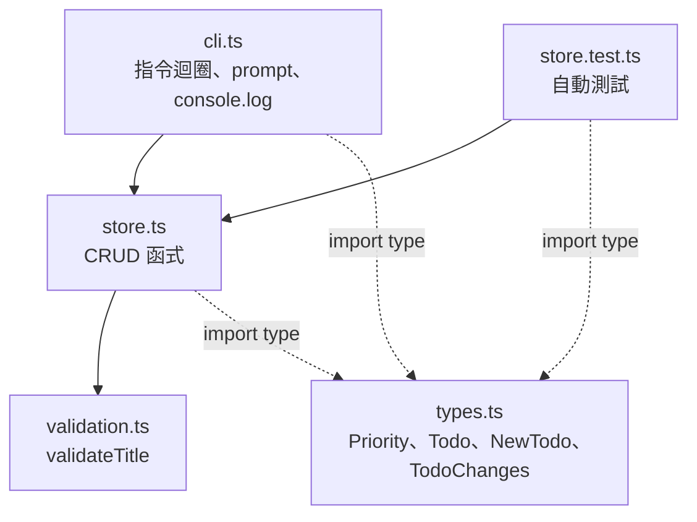
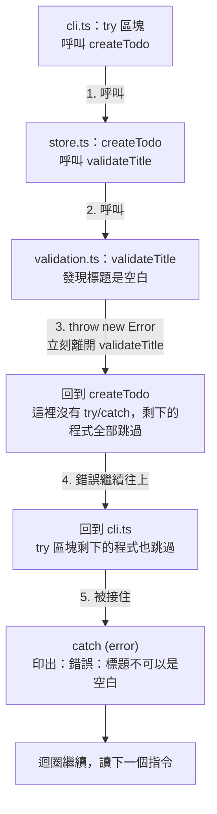
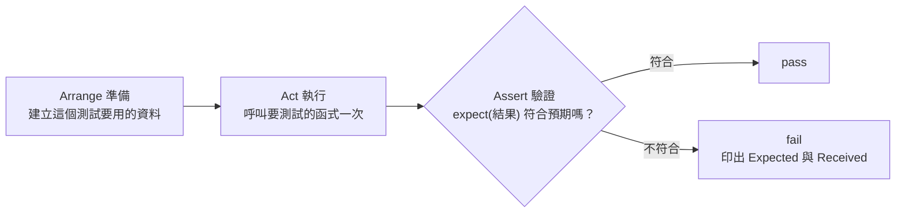

# Day 06 — 模組、錯誤處理與測試

> 第 1 週｜基礎｜必修約 60 分鐘，加練可到 3 小時

## 學習目標

完成今天的課程後，你能夠：

- 用 `export` 與 `import` 讓一個檔案使用另一個檔案的程式，並分辨 `import` 與 `import type`。
- 把一個大檔案拆成幾個各有職責的模組，並說出它們誰依賴誰。
- 用 `throw` 回報「做不下去」的情況，用 `try`／`catch`／`finally` 處理它。
- 安全地讀取 `catch` 裡型別是 `unknown` 的錯誤。
- 用 `bun:test` 寫測試，包含「應該丟出錯誤」的情況。

## 時間分配

| 區塊 | 內容                            | 時間        |
| ---- | ------------------------------- | ----------- |
| 必修 | 觀念說明＋圖解                  | 25 分鐘     |
| 必修 | 逐步解說（範例 01–03、`todo/`） | 20 分鐘     |
| 必修 | 練習 01、02                     | 15 分鐘     |
| 加練 | 練習 03、延伸挑戰               | 30–120 分鐘 |

## 今天的 Todo 進度

昨天的 CLI 是一個大檔案，裡面的 CRUD 函式是從別的範例複製來的。今天把它拆成 `examples/todo/` 裡的四個模組，CRUD 函式只寫一次，再加上一份自動測試。

行為有兩個改變：標題要先通過 `validateTitle` 的檢查；`updateTodo` 與 `deleteTodo` 找不到 `id` 時改成丟出錯誤，不再安靜地回傳內容相同的陣列。

## 觀念說明

### 1. 模組：用 `export` 把名字開放出去

模組（module）就是一個檔案。檔案裡宣告的東西預設只有這個檔案自己能用，前面加上 `export` 才開放給其他檔案：

```ts
export const TAX_RATE = 0.05; // other files can import this

function roundToInteger(amount: number): number {
  return Math.round(amount); // no export: private to this file
}

export function priceWithTax(price: number): number {
  return roundToInteger(price * (1 + TAX_RATE));
}
```

沒有 `export` 的 `roundToInteger` 是這個檔案的內部細節。之後想改寫它，不必擔心影響到別的檔案。

### 2. `import` 與 `import type`

另一個檔案用 `import` 指名要拿哪些東西：

```text
import { formatPrice, TAX_RATE } from "./01-price-utils.ts";
  │              │                        │
  │              │                        └─ 從哪個檔案拿：相對於目前檔案的路徑，要寫 .ts
  │              └─ 要拿哪些名字：對方必須有 export
  └─ 關鍵字
```

型別在執行前會被整個拿掉（Day 01），所以匯入型別時要多寫一個 `type`，讓人和工具都看得出「這一行執行時不存在」：

| 寫法                      | 匯入的是什麼              | 執行時還在嗎 |
| ------------------------- | ------------------------- | ------------ |
| `import { priceWithTax }` | 值：函式、常數            | 在           |
| `import type { Product }` | 型別：`type`、`interface` | 不在         |

用 `import { Product }` 匯入型別，`bun check` 會回報 `TS1484`，要求改成 `import type`。

### 3. 把一個檔案拆成模組

拆檔案的原則是「一個模組負責一件事」。下面這張圖是今天 `examples/todo/` 的相依關係：箭頭從「使用的人」指向「被使用的檔案」，虛線代表只匯入型別。



重點：

- `store.ts` 同時被 `cli.ts` 和 `store.test.ts` 使用。同一份函式，寫一次，用兩次。
- 箭頭只往下走，沒有繞回來。`types.ts` 不依賴任何人，所以最不容易被別人的修改影響。
- `cli.ts` 是進入點（entry point），也就是你用 `bun run` 執行的那個檔案。其他模組只有定義，單獨執行不會印出任何東西。

### 4. `throw`：回報「做不下去」

函式有時沒辦法完成工作，例如要它用空白標題建立待辦事項。這時沒有合理的值可以回傳，就用 `throw` 丟出一個錯誤（error）：

```text
throw new Error("標題不可以是空白");
  │    │    │            │
  │    │    │            └─ 訊息：給人看的說明，之後用 error.message 讀出來
  │    │    └─ Error：內建的錯誤物件
  │    └─ new：建立一個物件。先照抄，Day 08 會解釋
  └─ throw：立刻離開目前的函式，後面的程式都不執行
```

「回傳 `undefined`」和「丟出錯誤」的分工：

| 情況                         | 做法              | 例子                             |
| ---------------------------- | ----------------- | -------------------------------- |
| 「沒有」是一種正常的答案     | 回傳 `undefined`  | `findTodoById`：查了，沒有這一筆 |
| 呼叫的人要求做一件做不到的事 | `throw new Error` | `deleteTodo`：要刪的那一筆不存在 |

### 5. `try`／`catch`／`finally`：錯誤往上找人處理

錯誤被丟出後，會沿著 call stack（Day 03）一層一層往上，直到遇到 `try`／`catch`。沿途沒有 `try`／`catch` 的函式都會被直接跳出。完全沒有人接住時，程式會中斷。

```ts
try {
  // code that might throw
} catch (error) {
  // runs only when something inside `try` threw
} finally {
  // always runs, with or without an error
}
```

這張圖說明在 CLI 輸入 `add`（沒有標題）時，錯誤怎麼從最深的函式回到 `catch`：



重點：

- 步驟 1、2 是一般的函式呼叫，往下走。步驟 3 之後是錯誤往上走。
- `createTodo` 完全不用寫錯誤處理。錯誤會自己穿過它。
- 在哪一層 `catch`，由「誰知道該怎麼處理」決定。這裡只有 CLI 知道要把訊息印給使用者看。

### 6. `catch` 拿到的是 `unknown`

JavaScript 的 `throw` 可以丟出任何值，不一定是 `Error` 物件。所以 `catch (error)` 裡的 `error` 型別是 `unknown`：「不知道是什麼，使用前必須先檢查」。直接寫 `error.message` 會得到 `TS18046: 'error' is of type 'unknown'.`

用 `instanceof Error` 檢查它是不是 `Error` 物件，TypeScript 就會在那個分支裡把型別縮小成 `Error`：

```ts
function errorMessage(error: unknown): string {
  if (error instanceof Error) {
    return error.message; // here `error` is an Error
  }
  return String(error);
}
```

### 7. 輸入驗證

驗證（validation）是在資料進入系統時檢查一次，不合格就拒絕。這樣系統內部的資料永遠是合格的，後面的程式不必到處重複檢查。

`validateTitle` 做三件事：整理（去掉前後空白）、檢查（空白或超過 100 個字就 `throw`）、**回傳整理過的值**。呼叫的人要使用回傳值，存進去的才會是 `"買牛奶"`，不是 `"  買牛奶 "`。

### 8. 用 `bun:test` 寫測試

測試（test）是一段會自動檢查「另一段程式的結果對不對」的程式。你這幾天執行的 `bun test day-NN` 就是在跑測試，今天換你寫。

```text
test("空陣列時回傳 1", () => {
  │         │            │
  │         │            └─ 測試內容：一個函式，裡面寫檢查的步驟
  │         └─ 測試名稱：寫出「什麼情況下，應該怎樣」
  └─ 從 "bun:test" 匯入。describe("名稱", ...) 則用來把相關的測試分成一組
```

這張圖說明每個測試都長一樣的三個步驟，稱為 Arrange-Act-Assert：



重點：

- 三個步驟用空行隔開，讀的人一眼就能分辨「準備了什麼、做了什麼、檢查什麼」。
- 一個測試只檢查一種情況。失敗時，看測試名稱就知道是哪裡壞了。

常用的比對方法：

| 寫法                              | 檢查什麼                               |
| --------------------------------- | -------------------------------------- |
| `expect(value).toBe(1)`           | 是不是同一個值。用在數字、文字、真假值 |
| `expect(value).toEqual([...])`    | 內容是否相同。用在物件與陣列           |
| `expect(value).toBeUndefined()`   | 是不是 `undefined`                     |
| `expect(() => fn()).toThrow("…")` | 呼叫時會丟出錯誤，而且訊息包含這段文字 |

`toThrow` 要傳入一個箭頭函式。這樣是由 `expect` 去呼叫它，才接得住錯誤。直接寫 `expect(fn())`，錯誤在 `expect` 開始之前就丟出來了。

## 逐步解說

以下每一步對應 `examples/` 裡的檔案。請在專案根目錄執行指令。

### 步驟 1：`export` 與 `import`

檔案：[`examples/01-price-utils.ts`](examples/01-price-utils.ts)、[`examples/02-import.ts`](examples/02-import.ts)

```bash
bun run day-06-modules-errors-testing/examples/01-price-utils.ts
bun run day-06-modules-errors-testing/examples/02-import.ts
```

1. 第一個指令什麼都不會印。`01-price-utils.ts` 只有定義，沒有任何一行在「使用」它們。
2. `02-import.ts` 的 `import type { Product }` 匯入型別，`import { formatPrice, priceWithTax, TAX_RATE }` 匯入值。兩行的來源是同一個檔案。
3. `priceWithTax(65)` 算出 `68`：`65 * 1.05` 是 `68.25`，由沒有匯出的 `roundToInteger` 四捨五入。`02-import.ts` 用得到結果，但碰不到 `roundToInteger` 本身。
4. 照著檔案最後的說明，把 `roundToInteger` 加進 `import` 清單再執行 `bun check`，會看到 `TS2459`。看完記得改回來。

### 步驟 2：`throw` 與 `try`／`catch`／`finally`

檔案：[`examples/03-throw-catch.ts`](examples/03-throw-catch.ts)

```bash
bun run day-06-modules-errors-testing/examples/03-throw-catch.ts
```

1. `parseQuantity` 把文字轉成 1 到 99 的整數。不合格時 `throw new Error(...)`，訊息寫明哪裡不合格。
2. `orderLine` 呼叫 `parseQuantity`，自己沒有 `try`／`catch`。
3. `printOrder("牛奶", "2")`：一切順利，印出 `orderLine` 裡的那行訊息、`成功`、`處理結束`。
4. `printOrder("牛奶", "很多")`：`parseQuantity` 丟出錯誤。注意 `orderLine` 裡的那行訊息**沒有印出來**，因為錯誤直接穿過了它。`catch` 印出 `失敗：...`，接著 `finally` 仍然印出 `處理結束`。
5. 三筆訂單處理完後印出 `三筆訂單都處理完了`，證明錯誤被接住之後程式繼續執行。
6. 最後兩行示範 `errorMessage`：傳入 `Error` 物件時取出訊息，傳入一段文字時用 `String(...)` 轉換。
7. 把檔案最後一行的 `//` 拿掉再執行。沒有人接住錯誤，程式中斷，並印出錯誤訊息與丟出錯誤的行號。看完把 `//` 加回去。

### 步驟 3：把 Todo 拆成模組

檔案：[`types.ts`](examples/todo/types.ts)、[`validation.ts`](examples/todo/validation.ts)、[`store.ts`](examples/todo/store.ts)

1. `types.ts` 只有四個 `export type`，沒有任何 `import`。
2. `validation.ts` 匯出 `validateTitle`。`MAX_TITLE_LENGTH` 沒有 `export`，是這個模組的內部細節。
3. `store.ts` 開頭兩行 `import`：型別來自 `types.ts`，`validateTitle` 來自 `validation.ts`。
4. `createTodo` 存進去的是 `validateTitle(input.title)` 的回傳值。標題不合格時錯誤會從這裡往上丟。
5. `findTodoById` 沒有變，找不到仍然回傳 `undefined`。
6. `updateTodo` 與 `deleteTodo` 開頭多了一段檢查：找不到 `id` 就 `throw new Error(...)`。
7. 對照昨天的 `05-todo-cli.ts`：型別與五個函式現在各只存在一份。

### 步驟 4：第一份測試

檔案：[`examples/todo/store.test.ts`](examples/todo/store.test.ts)

```bash
bun test day-06-modules-errors-testing/examples/todo
```

1. 檔名以 `.test.ts` 結尾，`bun test` 才會把它當成測試檔。
2. 第一個測試用註解標出 Arrange、Act、Assert。之後的測試省略註解，但仍然用空行分成三段。
3. `sampleTodos()` 是函式，每次呼叫都產生一份新資料，測試之間不會互相影響。
4. 「不修改傳入的陣列」這類測試，把 Day 05 的規則變成每次都會自動檢查的事。
5. 「丟出錯誤」的測試都寫成 `expect(() => ...).toThrow("訊息")`。
6. 故意弄壞一次：把 `store.ts` 裡 `nextId` 的 `return maxId + 1;` 改成 `+ 2`，重跑測試。失敗的測試會列出 `Expected` 與 `Received`，還有是哪一行的 `expect`。看完改回來。

### 步驟 5：會處理錯誤的 CLI

檔案：[`examples/todo/cli.ts`](examples/todo/cli.ts)

```bash
# Type the commands yourself
bun run day-06-modules-errors-testing/examples/todo/cli.ts

# Send prepared commands through a pipe
printf 'add 買牛奶\nadd\ndone 9\ndone abc\ndone 1\nlist\nquit\n' | bun run day-06-modules-errors-testing/examples/todo/cli.ts
```

用管線執行的那一行會印出：

```text
Todo CLI：add <標題>、list、done <id>、rm <id>、quit
todo> 已新增：買牛奶
todo> 錯誤：標題不可以是空白
todo> 錯誤：找不到 id 為 9 的待辦事項
todo> 錯誤：id 必須是正整數，收到的是「abc」
todo> 已完成 id 為 1 的待辦事項
todo> [x] #1 買牛奶（優先度：中）
todo> 再見！
```

1. 檔案開頭用 `import` 取得 CRUD 函式，不再有複製的程式。
2. `parseId` 是另一個輸入驗證：不是正整數就丟出錯誤。
3. `switch` 的每個 `case` 只寫「一切順利時要做什麼」，沒有任何 `if` 在檢查失敗。
4. 三種不同來源的錯誤（`validateTitle`、`updateTodo`、`parseId`）都在同一個 `catch` 裡處理：印出 `錯誤：` 加上訊息。
5. `try`／`catch` 放在迴圈**裡面**，所以一個指令失敗後，迴圈會繼續讀下一個指令。

## 規範重點

- **`import` 路徑寫出 `.ts` 副檔名**，例如 `"./store.ts"`。看到路徑就知道確切是哪個檔案。
- **只匯入型別時用 `import type`**。讀程式的人一眼就知道這一行在執行時不存在。
- **只 `export` 別的檔案需要的東西**。匯出的越少，之後能放心修改的就越多。
- **匯出的函式寫出參數型別與回傳型別**。別的檔案只看這一行簽名，就知道怎麼使用。
- **檔名用 kebab-case；測試檔與被測試的檔案同名**，再加上 `.test.ts`：`store.ts` 對應 `store.test.ts`。
- **`throw` 一律丟 `Error` 物件，訊息要說明哪裡不對**。寫 `找不到 id 為 9 的待辦事項`，不要只寫 `錯誤`。
- **不要寫空的 `catch`**。接住錯誤卻什麼都不做，問題會消失得無影無蹤，之後非常難找。
- **測試名稱寫「情況＋預期結果」**，例如「找不到 id 時丟出錯誤」。

## 常見錯誤

| 錯誤訊息或現象                                                                                                      | 原因                                              | 修法                                      |
| ------------------------------------------------------------------------------------------------------------------- | ------------------------------------------------- | ----------------------------------------- |
| `TS2459: Module '"./01-price-utils.ts"' declares 'roundToInteger' locally, but it is not exported.`                 | 想匯入的名字沒有 `export`                         | 在宣告前加上 `export`，或改用有匯出的名字 |
| `TS1484: 'Product' is a type and must be imported using a type-only import when 'verbatimModuleSyntax' is enabled.` | 用 `import` 匯入型別                              | 改成 `import type { Product }`            |
| `TS2307: Cannot find module './01-price-util.ts' or its corresponding type declarations.`                           | 路徑或檔名打錯                                    | 核對相對路徑與檔名                        |
| `TS18046: 'error' is of type 'unknown'.`                                                                            | 在 `catch` 裡直接使用 `error.message`             | 先用 `error instanceof Error` 檢查        |
| 程式中斷，印出 `error: ...` 與行號                                                                                  | 丟出的錯誤沒有被任何 `catch` 接住                 | 在知道怎麼處理的那一層加上 `try`／`catch` |
| `toThrow` 的測試失敗，錯誤直接印出來                                                                                | 寫成 `expect(fn())`，函式在 `expect` 之前就執行了 | 包成箭頭函式：`expect(() => fn())`        |
| 兩個內容相同的陣列，`toBe` 卻說不相等                                                                               | `toBe` 比較的是參考（Day 04）                     | 改用 `toEqual` 比較內容                   |
| `import` 某個檔案之後，程式開始等待輸入                                                                             | 匯入了進入點（例如 `cli.ts`），它的迴圈跟著執行   | 只從「只有定義」的模組匯入                |

## 練習

練習檔在 `exercises/`。每個檔案裡標著 `TODO` 的地方就是你要改的地方。

```bash
# 檢查你的答案：全部顯示 pass 就完成了
bun test day-06
```

`bun test day-06` 也會執行 `examples/todo/store.test.ts`。它測試的是範例程式，一開始就會通過；練習的測試要等你作答後才會通過。

| 練習                                           | 內容                                                     | 類型 |
| ---------------------------------------------- | -------------------------------------------------------- | ---- |
| [`01-cart.ts`](exercises/01-cart.ts)           | 補上 `export` 與 `import`，完成購物車計算（共兩個檔案）  | 必修 |
| [`02-score.ts`](exercises/02-score.ts)         | 驗證輸入、`throw`、`try`／`catch`、`unknown` 的錯誤      | 必修 |
| [`03-todo-safe.ts`](exercises/03-todo-safe.ts) | 匯入 `examples/todo/` 的模組，做出不會丟錯誤的 Todo 指令 | 加練 |

練習 01 要改兩個檔案：先在 [`01-cart-pricing.ts`](exercises/01-cart-pricing.ts) 補上 `export`，再到 `01-cart.ts` 寫 `import`。

卡住超過 15 分鐘再看 `solutions/` 裡的參考解答。看完後把解答關掉，自己重寫一次。

### 延伸挑戰（加練）

1. 在 `examples/todo/store.test.ts` 的 `updateTodo` 那一組加一個測試：一次修改 `title` 與 `priority`。照 Arrange-Act-Assert 分成三段。
2. 先寫測試、再寫程式：在 `store.test.ts` 為還不存在的 `clearDone(todos: readonly Todo[]): Todo[]`（刪除所有已完成的待辦事項）寫兩個測試，確認測試失敗，再到 `store.ts` 實作它，直到測試通過。
3. 幫 `examples/todo/cli.ts` 加上 `rename <id> <新標題>` 指令。不合格的標題應該自動顯示成 `錯誤：...`，不需要多寫任何檢查。

## 自我檢查清單

- [ ] 我能說出 `export`、`import`、`import type` 各自的用途。
- [ ] 我能看著 `examples/todo/` 說出每個檔案負責什麼、誰匯入誰。
- [ ] 我能解釋錯誤被 `throw` 之後，哪些程式會被跳過、在哪裡被接住。
- [ ] 我能說出什麼時候回傳 `undefined`，什麼時候 `throw`。
- [ ] 我知道 `catch (error)` 的 `error` 為什麼是 `unknown`，以及怎麼安全地讀出訊息。
- [ ] 我能寫出一個 Arrange-Act-Assert 的測試，以及一個 `toThrow` 的測試。
- [ ] `bun test day-06` 全部通過。

## 下一課

[Day 07 — TypeScript 設計規範（一）＋第 1 週複習](../day-07-ts-conventions-1/README.md)：今天的程式已經照著一套規範在寫，明天把這些規範一條一條講清楚，並回顧第 1 週學過的所有內容。
