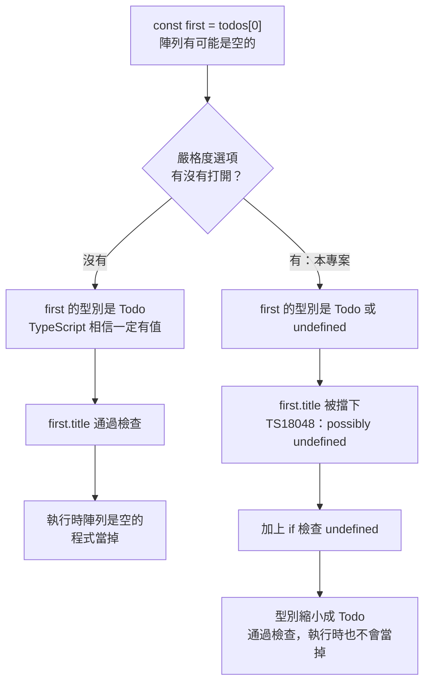
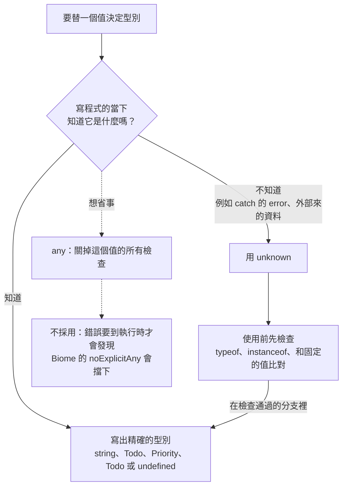

# Day 07 — TypeScript 設計規範（一）＋第 1 週複習

> 第 1 週｜基礎｜必修約 60 分鐘，加練可到 3 小時

## 學習目標

完成今天的課程後，你能夠：

- 說出 `tsconfig.json` 裡每個嚴格度選項擋下的是哪一種錯誤。
- 依照命名規範，替變數、函式、型別、常數、檔案取名字。
- 在 `any`、`unknown`、精確的型別之間做出正確的選擇，並用檢查取代 `as` 與 `!`。
- 用 `readonly` 與 `as const` 表達「這份資料不會被修改」。
- 執行 `bunx biome check` 與 `bun fmt`，並讀懂一則 lint 診斷訊息。

## 時間分配

| 區塊 | 內容                   | 時間        |
| ---- | ---------------------- | ----------- |
| 必修 | 觀念說明＋圖解         | 15 分鐘     |
| 必修 | 逐步解說（範例 01–05） | 15 分鐘     |
| 必修 | 練習 01、02            | 20 分鐘     |
| 必修 | 第 1 週複習與自我測驗  | 10 分鐘     |
| 加練 | 練習 03、延伸挑戰      | 30–120 分鐘 |

## 今天的 Todo 進度

主線今天不增加功能。Day 06 的 `examples/todo/` 其實已經照著一套規範在寫，今天把這套規範逐條講清楚。

接著用同樣的規範，把一份寫得很隨便的 Todo 報表程式整理乾淨（步驟 5），並在練習 03 修正一份不合規範的 Todo store。

## 觀念說明

### 1. 規範由三個工具把關

規範（convention）是一群人約定好的寫法。它讓每個檔案讀起來都像同一個人寫的，也讓工具能替你抓出問題。這個專案有三個工具，各管一件事：

| 工具       | 指令               | 檢查什麼                           | 會不會改檔案              |
| ---------- | ------------------ | ---------------------------------- | ------------------------- |
| TypeScript | `bun check`        | 型別：值和型別對不對得上           | 不會                      |
| Biome      | `bunx biome check` | 寫法：命名、`any`、`!`、可疑的程式 | 不會                      |
| 排版工具   | `bun fmt`          | 排版：縮排、換行、引號、分號       | 會；加 `--check` 就只檢查 |

檢查寫法的工具通稱 linter，它回報的問題叫做 lint 診斷（diagnostic）。

### 2. strict：`tsconfig.json` 的嚴格度選項

根目錄的 `tsconfig.json` 打開了下面這些檢查。你在前六天遇到的許多錯誤訊息，就是它們擋下來的：

| 選項                                        | 擋下什麼                                      | 錯誤代碼  |
| ------------------------------------------- | --------------------------------------------- | --------- |
| `strict`                                    | 一次打開一整組檢查，最常遇到的是下面三個      |           |
| `strict` 之一：`noImplicitAny`              | 參數沒寫型別，被悄悄當成 `any`                | `TS7006`  |
| `strict` 之一：`strictNullChecks`           | 把可能是 `undefined` 或 `null` 的值直接拿來用 | `TS18048` |
| `strict` 之一：`useUnknownInCatchVariables` | 沒檢查就使用 `catch` 的 `error`               | `TS18046` |
| `noUncheckedIndexedAccess`                  | 把 `todos[0]` 當成一定有值                    | `TS2532`  |
| `noImplicitReturns`                         | 函式有一條路忘了 `return`                     | `TS7030`  |
| `noFallthroughCasesInSwitch`                | `case` 忘了 `break`，接著執行到下一個 `case`  | `TS7029`  |
| `noImplicitOverride`                        | 和類別的繼承有關，Day 10 才會用到             |           |

同一區塊的 `skipLibCheck` 不是嚴格度檢查，它只是讓 TypeScript 略過套件自帶的型別檔，檢查得快一點。

這張圖說明用索引取出 `todos[0]` 再讀它的 `title`，在有沒有嚴格檢查的情況下，各會發生什麼事：



重點：

- 嚴格檢查不會讓程式「多出」錯誤。錯誤本來就在，它只是把發現的時間從「執行時」提前到「寫程式時」。
- 每一則嚴格檢查的錯誤，都對應一種真的會發生的執行時問題。

### 3. 命名規範

| 對象                   | 寫法          | 例子                                  |
| ---------------------- | ------------- | ------------------------------------- |
| 變數、函式、參數、屬性 | camelCase     | `maxId`、`createTodo`、`todo.title`   |
| 型別、介面、類別       | PascalCase    | `Todo`、`NewTodo`、`TodoChanges`      |
| 模組最上層的固定值     | CONSTANT_CASE | `MAX_TITLE_LENGTH`、`PRIORITY_LABELS` |
| 檔名                   | kebab-case    | `todo-report.ts`、`store.test.ts`     |

名稱的內容也有規範：函式用動詞開頭（`findTodoById`、`validateTitle`）；真假值讀起來像是非題（`done`、`isValid`）；不用看不出意思的縮寫，寫 `priority`，不要寫 `p`。

### 4. `any`、`unknown` 與精確的型別

`any` 的意思是「不要檢查這個值」，任何操作都會通過。`unknown` 的意思是「我不知道這是什麼」，任何操作都要先檢查才會通過。兩者都能接受任何值，安全程度完全相反。

這張圖是替一個值決定型別時的判斷流程：



重點：

- 絕大多數情況你都知道型別，直接寫出來。
- 真的不知道才用 `unknown`，而且它只是中繼站：檢查之後就會變成精確的型別。
- `any` 還會擴散：從 `any` 讀出來的東西也是 `any`，一路把檢查關掉。

### 5. `readonly` 與 `as const`：這份資料不會變

`readonly` 寫在型別裡，表示「不可以透過這個名字修改它」。最常用在陣列參數（Day 04、Day 05）：`todos: readonly Todo[]` 是對呼叫者的承諾。

`as const` 寫在值的後面，一次做兩件事：把每個屬性變成 `readonly`，並保留每個值最精確的型別。

```ts
const PRIORITY_LABELS = { low: "低", medium: "中", high: "高" } as const;
// every property is readonly; the type of `low` is "低", not string

const PRIORITIES = ["low", "medium", "high"] as const;
// each item is "low" | "medium" | "high", not string
```

少了 `as const`，`["low", "medium", "high"]` 的型別只是 `string[]`，裡面的值就不能直接當成 `Priority` 使用。

### 6. 為什麼避免 `as` 與 `!`

兩者都是在對 TypeScript 說「相信我」，而且都不會做任何檢查：

| 寫法               | 你在宣稱什麼                 | 宣稱錯了會怎樣                     | 改成                             |
| ------------------ | ---------------------------- | ---------------------------------- | -------------------------------- |
| `text as Priority` | 這段文字一定是三種優先度之一 | 錯的值一路流進系統，很久之後才出事 | 和允許的值比對，不符合就 `throw` |
| `todos[0]!`        | 這個值一定不是 `undefined`   | 執行時當掉                         | 用 `if` 檢查 `undefined`         |

`as const` 是例外：它沒有宣稱任何未經證實的事，只是請 TypeScript 把型別看得更精確。

### 7. 回傳型別，以及 `type` 與 `interface`

**匯出的函式要寫出回傳型別。** 理由有兩個。第一，別的模組只讀這一行簽名就知道怎麼用。第二，函式內容寫錯時，錯誤會出現在函式本身，不會跑到遠處呼叫它的地方。檔案內部的小函式和箭頭函式可以交給型別推論。

**描述資料的形狀用 `type`，`interface` 留給「合約」。** 兩者都能描述物件（Day 02），但 `type` 還能表達 union，例如 `type Priority = "low" | "medium" | "high"`。本課程的約定是：資料一律用 `type`；`interface` 只用來規定「一個類別必須提供哪些方法」，Day 09 才會出場。一件事只有一種寫法，讀的人就不必猜。

## 逐步解說

以下每一步對應 `examples/` 裡的檔案。請在專案根目錄執行指令。

範例裡故意放的錯誤都壓在 `// @ts-expect-error` 或 `// biome-ignore` 註解下面，所以整個專案的檢查仍然會通過。請照著步驟**一次拿掉一行**註解、觀察訊息、再放回去。

### 步驟 1：嚴格度選項擋下什麼

檔案：[`examples/01-strict-options.ts`](examples/01-strict-options.ts)

```bash
bun run day-07-ts-conventions-1/examples/01-strict-options.ts
bun check day-07-ts-conventions-1/examples/01-strict-options.ts
```

1. 第 1 段：`titleLength(title)` 的參數沒寫型別。執行結果是 `3` 和 `undefined`，傳入數字 `42` 完全沒被攔下。拿掉註解會看到 `TS7006`。
2. 第 2 段：`find` 的結果直接使用。這次剛好找得到所以印出 `買牛奶`，但 TypeScript 不接受「剛好」，回報 `TS18048`。
3. 第 3 段：`todos[0].title` 回報 `TS2532`。下一行 `todos[9]` 印出 `undefined`，這就是這個選項在防的事。
4. 第 4 段：`priorityLabel` 忘了處理 `"low"`，執行時印出 `undefined`。拿掉註解會看到 `TS7030`。
5. 第 5 段：`catch` 裡的 `error.message` 回報 `TS18046`，和 Day 06 學的一樣。

### 步驟 2：`any`、`unknown` 與第一則 lint 診斷

檔案：[`examples/02-any-vs-unknown.ts`](examples/02-any-vs-unknown.ts)

```bash
bun run day-07-ts-conventions-1/examples/02-any-vs-unknown.ts
```

1. `titleLengthLoose(value: any)` 裡把 `title` 打成 `titel`。`bun check` 沒有任何意見，執行時才出錯，印出一則 `undefined is not an object` 的訊息。
2. `titleLength(value: Todo)` 用了精確的型別。同樣的錯字在這裡會是 `TS2551`，還會提示正確的名稱。
3. `describeValue(value: unknown)` 用 `typeof` 與 `instanceof` 檢查。每個 `if` 裡面，`value` 都有了精確的型別。
4. 最後一段：`unknown` 的值可以存任何東西，但沒檢查就讀 `.length` 會是 `TS18046`。

接著讀一則 Biome 的診斷。把檔案裡 `// biome-ignore ...` 那一行刪掉，然後執行：

```bash
bunx biome check day-07-ts-conventions-1/examples/02-any-vs-unknown.ts
```

你會看到下面的訊息（這裡省略了前後幾行程式碼）：

```text
day-07-ts-conventions-1/examples/02-any-vs-unknown.ts:18:34 lint/suspicious/noExplicitAny ━━━━━━━━

  × Unexpected any. Specify a different type.

  > 18 │ function titleLengthLoose(value: any): number {
       │                                  ^^^

  i any disables many type checking rules. Its use should be avoided.

  i Replace any with a specific type. If the type is not known, use unknown and narrow it before using the value.
```

第一行是位置與規則，拆開來看：

```text
day-07-ts-conventions-1/examples/02-any-vs-unknown.ts:18:34 lint/suspicious/noExplicitAny
│                                                     │  │  │
│                                                     │  │  └─ 規則名稱：可以拿去搜尋
│                                                     │  └─ 第 34 個字
│                                                     └─ 第 18 行
└─ 哪一個檔案
```

1. `×` 開頭的那一行是問題本身。`×` 代表 error，`!` 代表 warning，`i` 代表補充說明。
2. `>` 標出有問題的那一行，`^^^` 標出確切的位置。
3. 最後兩段 `i` 說明為什麼這是問題，以及建議怎麼改：換成精確的型別，不知道型別就用 `unknown`。

看完把那一行註解加回去。`biome-ignore` 後面必須寫出規則名稱與理由；在自己的程式裡，正確的做法是修掉問題，不是加上這行註解。

### 步驟 3：`readonly`、`as const`，以及取代 `as` 與 `!`

檔案：[`examples/03-readonly-as-const.ts`](examples/03-readonly-as-const.ts)

```bash
bun run day-07-ts-conventions-1/examples/03-readonly-as-const.ts
```

1. `PRIORITY_LABELS` 是加了 `as const` 的對照表。`PRIORITY_LABELS[priority]` 用變數裡的名稱讀取屬性，取代一長串 `if`。
2. `LIMITS.maxTitleLength = 5` 被 `TS2540` 擋下。但程式照樣印出 `5`：`readonly` 是 `bun check` 在把關，`bun run` 不管。這再次說明為什麼要先通過檢查再執行。
3. `PRIORITIES` 加了 `as const`，迴圈裡的 `priority` 可以直接傳給 `priorityLabel`。沒加的 `loosePriorities` 則是 `TS2345`。
4. `parsePriority` 示範取代 `as` 的做法：比對之後，TypeScript 知道 `text` 是 `Priority`，可以直接回傳；不符合就 `throw`。
5. `firstTitle` 示範取代 `!` 的做法：先把 `todos[0]` 存進變數，檢查 `undefined`，再使用。空陣列時印出 `（沒有待辦事項）`，不會當掉。

### 步驟 4：`bun fmt` 自動排版

排版不需要用人工維持。打開 [`examples/05-print-report.ts`](examples/05-print-report.ts)，隨意破壞它的排版：刪掉幾個縮排、把兩行併成一行、拿掉幾個分號。然後執行：

```bash
bun fmt --check day-07-ts-conventions-1   # only reports: 1 file needs formatting
bun fmt day-07-ts-conventions-1           # rewrites the file
bun fmt --check day-07-ts-conventions-1   # reports that all files are formatted
```

1. `--check` 只回報哪些檔案的排版不符，不會修改。
2. 不加 `--check` 就直接把檔案改寫成標準排版，並列出改了哪些檔案。
3. 排版交給工具之後，就沒有人需要討論「要不要加分號」這類問題。

### 步驟 5：重構前後對照

重構（refactor）是「不改變程式的行為，只改善它的寫法」。下面是一份能跑、但到處違反規範的程式，編號標出八個問題：

```ts
// todo_report.ts                                       (1)
type todo = { title: string; done: boolean; priority: string }; // (2)

let labels = { low: "低", medium: "中", high: "高" }; // (3)
let max = 3; // (4)

// (5)
export function get_open(list: any, p) {
  let out = [];
  for (const t of list) {
    if (!t.done && t.priority == p) {
      out.push(t);
    }
  }
  return out;
}

export function first_title(list: todo[]) {
  return list[0]!.title; // (6)
}

export function label(p: string) {
  return labels[p as "low"]; // (7)
}

export function report(list: todo[]) {
  while (list.length > max) {
    list.pop(); // (8) removes the last item of the caller's array
  }
  return list.map((t) => `${t.title}（${label(t.priority)}）`);
}
```

| #   | 問題                            | 規範                                                           | 修正後                                                              |
| --- | ------------------------------- | -------------------------------------------------------------- | ------------------------------------------------------------------- |
| 1   | 檔名 `todo_report.ts`           | 檔名用 kebab-case                                              | `todo-report.ts`                                                    |
| 2   | `type todo`、`priority: string` | 型別用 PascalCase；能精確就不要寬鬆                            | `type Todo`、`priority: Priority`                                   |
| 3   | `let labels`                    | 預設用 `const`；固定的對照表用 CONSTANT_CASE 加 `as const`     | `const PRIORITY_LABELS = { ... } as const`                          |
| 4   | `let max = 3`                   | 名稱要說明內容                                                 | `const MAX_REPORT_LINES = 3`                                        |
| 5   | `get_open(list: any, p)`        | 動詞開頭的 camelCase；不用 `any`；寫出參數與回傳型別；用 `===` | `findOpenTodos(todos: readonly Todo[], priority: Priority): Todo[]` |
| 6   | `list[0]!.title`                | 不用 `!`                                                       | 檢查 `undefined`，回傳型別寫成 `string \| undefined`                |
| 7   | `labels[p as "low"]`            | 不用 `as`                                                      | 參數型別改成 `Priority`，就不需要轉型                               |
| 8   | `list.pop()`                    | 不修改傳入的陣列                                               | 參數加上 `readonly`，另外建立新陣列                                 |

修正後的版本是 [`examples/04-todo-report.ts`](examples/04-todo-report.ts)，由 [`examples/05-print-report.ts`](examples/05-print-report.ts) 匯入並執行：

```bash
bun run day-07-ts-conventions-1/examples/05-print-report.ts
```

1. 逐一對照表格的八列與 `04-todo-report.ts`，確認每個問題是怎麼修的。
2. `firstTitle([])` 印出 `undefined`，沒有當掉（問題 6）。
3. `buildReport(todos)` 只回傳三行，而最後印出的 `todos.length` 仍是 `4`：呼叫者的陣列沒有被動到（問題 8）。

## 規範重點

今天的觀念說明本身就是規範。這裡整理成一份可以對照的清單：

- **不用 `any`**。知道型別就寫出來，不知道就用 `unknown` 再檢查。為什麼：`any` 會讓型別檢查在那個值上完全失效。
- **不用 `as`（`as const` 除外）、不用 `!`**。改用比對與 `if` 檢查。為什麼：它們只是宣稱，不會驗證，錯了要到執行時才知道。
- **不會修改的陣列參數加 `readonly`，固定的資料加 `as const`**。為什麼：把「不會變」交給工具保證，不靠記憶。
- **匯出的函式寫出參數型別與回傳型別**。為什麼：簽名就是給其他模組看的說明書。
- **資料的形狀用 `type`，`interface` 留給合約**。為什麼：一件事只有一種寫法。
- **命名**：變數與函式 camelCase，型別 PascalCase，模組層級的固定值 CONSTANT_CASE，檔名 kebab-case。
- **不要為了讓檢查通過而加上 `@ts-expect-error` 或 `biome-ignore`**。課程裡的這些註解只用來示範錯誤。
- **交出程式之前跑三個檢查**：`bun check`、`bunx biome check .`、`bun fmt`。根目錄的 `bun run verify` 會一次跑完。

## 常見錯誤

| 錯誤訊息或現象                                                                         | 原因                                   | 修法                                    |
| -------------------------------------------------------------------------------------- | -------------------------------------- | --------------------------------------- |
| `TS7006: Parameter 'title' implicitly has an 'any' type.`                              | 參數沒寫型別                           | 補上參數型別                            |
| `TS2532: Object is possibly 'undefined'.`                                              | 用索引讀陣列後直接使用                 | 先存進變數，檢查 `undefined` 再用       |
| `TS7030: Not all code paths return a value.`                                           | 函式有一條路沒有 `return`              | 補上那一條路，並寫出回傳型別            |
| `TS2540: Cannot assign to 'low' because it is a read-only property.`                   | 修改了 `readonly` 或 `as const` 的資料 | 不要修改，改成建立新的值                |
| `TS2345: Argument of type 'string' is not assignable to parameter of type 'Priority'.` | 值的型別被推論成寬鬆的 `string`        | 來源加上 `as const`，或先用檢查函式確認 |
| `TS2578: Unused '@ts-expect-error' directive.`                                         | 下一行已經沒有錯誤，註解卻還留著       | 刪掉那一行註解                          |
| Biome：`suppressions/unused`                                                           | `biome-ignore` 的下一行已經沒有問題    | 刪掉那一行註解                          |
| Biome：`lint/style/useNamingConvention`                                                | 名稱的大小寫不符合規範                 | 依訊息的建議改名                        |
| `bun fmt --check` 顯示 `1 file needs formatting`                                       | 排版和標準不同                         | 執行 `bun fmt`                          |

## 練習

今天的練習都是「修正不合規範的程式」。每個檔案用 `PROBLEM n` 標出問題，做法寫在檔案開頭：一次處理一個問題，刪掉壓住錯誤的註解，讀檢查工具的訊息，再把程式修好。

```bash
# 修正的過程中，隨時用這兩個指令看還剩哪些問題
bunx biome check day-07-ts-conventions-1/exercises
bun check day-07-ts-conventions-1/exercises

# 檢查你的答案：全部顯示 pass 就完成了
bun test day-07
```

| 練習                                                       | 內容                                     | 類型 |
| ---------------------------------------------------------- | ---------------------------------------- | ---- |
| [`01-naming-readonly.ts`](exercises/01-naming-readonly.ts) | 命名、`as const`、`readonly`、回傳型別   | 必修 |
| [`02-any-unknown.ts`](exercises/02-any-unknown.ts)         | 把 `any`、`!`、`as` 換成精確的型別與檢查 | 必修 |
| [`03-todo-store.ts`](exercises/03-todo-store.ts)           | 修正一份不合規範的 Todo store            | 加練 |

和前幾天不同，這些檔案一開始就能執行，所以作答前有一部分測試會通過。全部通過，而且上面兩個檢查指令都沒有回報任何問題，才算完成。

卡住超過 15 分鐘再看 `solutions/` 裡的參考解答。看完後把解答關掉，自己重寫一次。

### 延伸挑戰（加練）

1. 在 `examples/01-strict-options.ts` 加上第 6 段，示範 `noFallthroughCasesInSwitch`：寫一個忘了 `break` 的 `switch`。你會需要同時壓住 TypeScript 的 `TS7029` 與 Biome 的 `noFallthroughSwitchClause`：`biome-ignore` 緊貼在 `case` 的上一行，`@ts-expect-error` 放在它的上面。
2. 回頭讀 Day 05 的 `examples/05-todo-cli.ts`，找出三個「今天學的規範在那裡已經被遵守」的地方。
3. 對整個專案執行 `bun run verify`，確認四項檢查全部通過。

## 第 1 週複習

| Day | 主題                 | 你學會的                                                                          | Todo 主線                                  |
| --- | -------------------- | --------------------------------------------------------------------------------- | ------------------------------------------ |
| 01  | 環境、變數與基本型別 | `bun run` 與 `bun check`、`const`／`let`、三種基本型別、樣板字串、讀型別錯誤      | —                                          |
| 02  | 型別系統             | 物件與陣列型別、`type`、選用屬性、union、literal type、`undefined`、型別縮小      | 定義 `Todo` 與 `Priority`                  |
| 03  | 流程控制與函式       | `if`／`switch`、迴圈、函式、參數與回傳型別、作用域、call stack                    | `formatTodo`、`priorityLabel`、`countDone` |
| 04  | 陣列操作與不可變性   | `map`／`filter`／`find`／`reduce`、展開與解構、值與參考、`readonly`               | `toggleDone`、篩選與統計                   |
| 05  | CRUD（一）：記憶體版 | CRUD 四種操作、產生 `id`、處理 `Todo \| undefined`、`prompt()`                    | 五個 CRUD 函式與互動式 CLI                 |
| 06  | 模組、錯誤處理與測試 | `export`／`import`／`import type`、`throw`、`try`／`catch`、`unknown`、`bun:test` | 拆成模組，加上驗證與測試                   |

### 自我測驗

先自己回答，再展開答案對照。答不出來的題目，回到對應的那一天重讀。

1. `bun run` 會檢查型別嗎？（Day 01）
2. `type Priority = "low" | "medium" | "high"` 比直接用 `string` 好在哪裡？（Day 02）
3. 只看簽名 `findTodoById(todos: readonly Todo[], id: number): Todo | undefined`，你能知道哪三件事？（Day 03、05）
4. `todos.push(todo)` 和 `[...todos, todo]` 差在哪裡？（Day 04）
5. 為什麼新的 `id` 不能用 `todos.length + 1`？（Day 05）
6. `import { Todo }` 和 `import type { Todo }` 差在哪裡？（Day 06）
7. 同樣是「找不到」，什麼時候回傳 `undefined`，什麼時候 `throw`？（Day 06）
8. `catch (error)` 的 `error` 是什麼型別？怎麼安全地讀出訊息？（Day 06）
9. `any` 和 `unknown` 都能接受任何值，差別是什麼？（Day 07）
10. `as const` 對一個物件做了哪兩件事？（Day 07）

<details>
<summary>展開答案</summary>

1. 不會。`bun run` 只執行，`bun check` 才檢查型別。
2. 只接受這三個值，打錯字會在檢查時被擋下；用 `string` 的話任何文字都會通過。
3. 需要一個陣列和一個數字；函式不會修改那個陣列；結果可能找不到，使用前要先檢查。
4. `push` 修改原本的陣列，所有指向它的變數都會看到變化；展開會建立新陣列，原本的不變。
5. 刪除過資料之後，筆數會小於最大的 `id`，算出來的號碼會和現有的重複。要用「最大的 `id` 加 1」。
6. 前者匯入值，執行時存在；後者只匯入型別，執行前會被拿掉。型別要用 `import type` 匯入。
7. 「沒有」是正常答案時回傳 `undefined`，例如查詢；呼叫的人要求做一件做不到的事時 `throw`，例如刪除不存在的資料。
8. `unknown`。先用 `error instanceof Error` 檢查，通過之後才讀 `error.message`。
9. `any` 關掉檢查，怎麼用都通過；`unknown` 要求先檢查，沒檢查就不能用。
10. 把每個屬性變成 `readonly`，並保留每個值最精確的型別。

</details>

## 自我檢查清單

- [ ] 我能說出 `noImplicitAny`、`strictNullChecks`、`noUncheckedIndexedAccess`、`noImplicitReturns` 各擋下什麼。
- [ ] 我知道變數、型別、常數、檔名各用哪一種命名方式。
- [ ] 我能解釋 `any` 和 `unknown` 的差別，以及什麼時候該用 `unknown`。
- [ ] 我能說出 `as` 與 `!` 的風險，並用比對和 `if` 檢查取代它們。
- [ ] 我知道 `as const` 做了什麼，以及什麼時候該加。
- [ ] 我讀得懂一則 Biome 診斷：檔案、行號、規則名稱、建議。
- [ ] 自我測驗的十題我都答得出來。
- [ ] `bunx biome check day-07-ts-conventions-1` 與 `bun check day-07-ts-conventions-1` 沒有回報任何問題。
- [ ] `bun test day-07` 全部通過。

## 下一課

[Day 08 — 物件導向（一）：類別與封裝](../day-08-oop-classes/README.md)：第 1 週的 `Todo` 是一筆單純的資料，任何函式都能修改它。明天把資料和操作它的方法包進同一個類別，讓 `Todo` 自己保證內容永遠合格。
