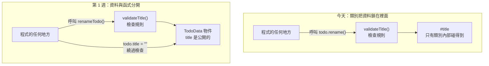
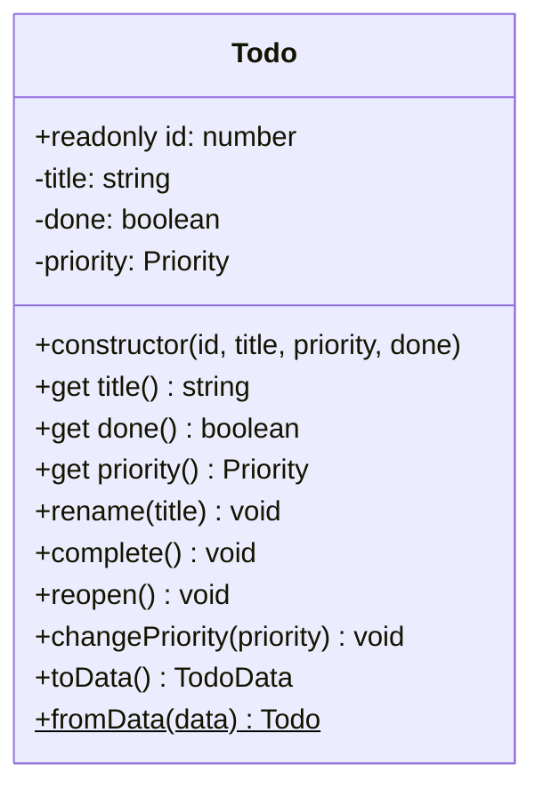
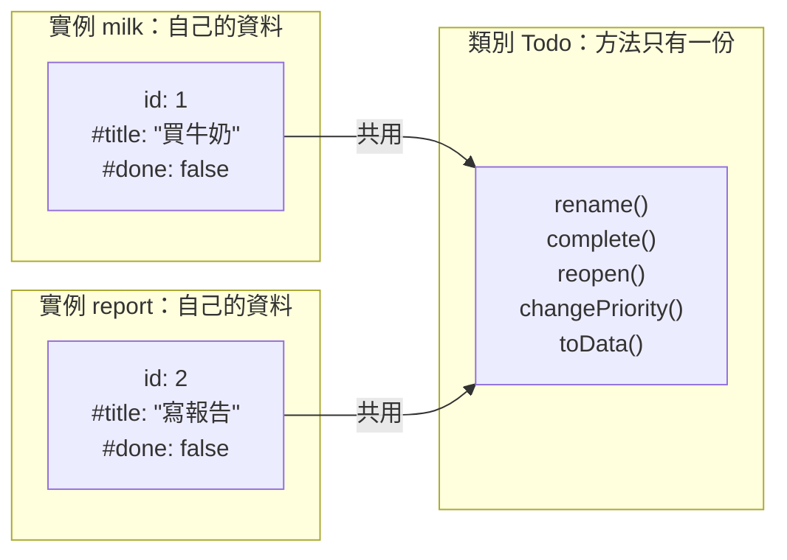
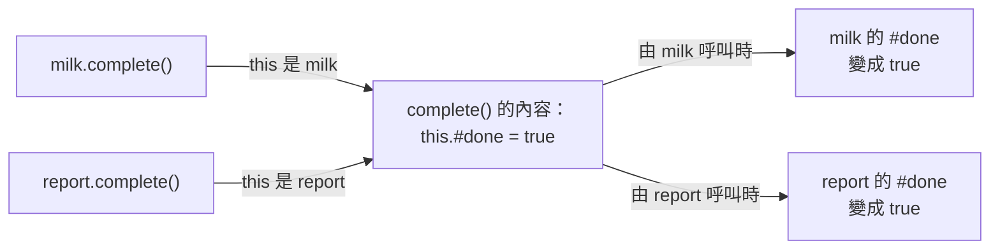
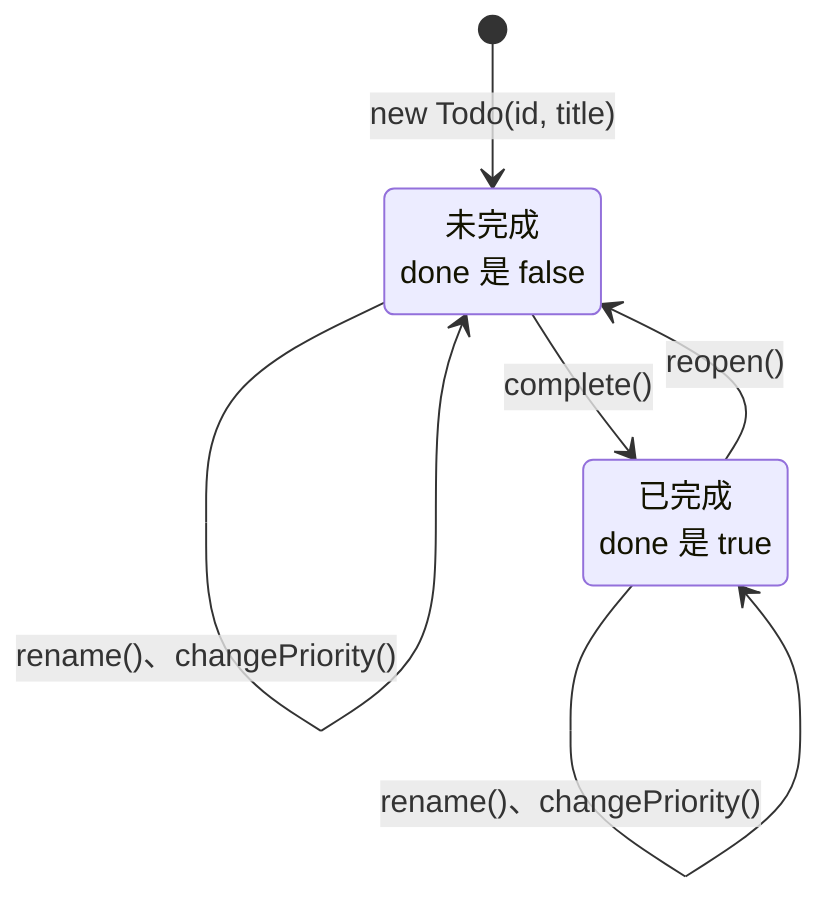

# Day 08 — 物件導向（一）：類別與封裝

> 第 2 週｜物件導向｜必修約 60 分鐘，加練可到 3 小時

## 學習目標

完成今天的課程後，你能夠：

- 說出類別解決了第 1 週「資料與函式分開」的什麼問題。
- 用 `class` 寫出有屬性、建構子、方法的類別，並用 `new` 建立實例。
- 說出方法裡的 `this` 指向誰。
- 用 `#` 私有成員、getter、`readonly` 把資料鎖在類別裡，並說出 `#` 與 `private` 的差別。
- 在建構子驗證資料，讓不合規則的物件無法被建立；用 `static` 寫出不需要實例的方法。

## 時間分配

| 區塊 | 內容                   | 時間        |
| ---- | ---------------------- | ----------- |
| 必修 | 觀念說明＋圖解         | 20 分鐘     |
| 必修 | 逐步解說（範例 01–05） | 20 分鐘     |
| 必修 | 練習 01、02            | 20 分鐘     |
| 加練 | 練習 03、延伸挑戰      | 30–120 分鐘 |

## 今天的 Todo 進度

第 1 週結束時，一筆待辦事項是純資料（`Todo` 型別），規則寫在 `validation.ts` 與 `store.ts` 的函式裡。今天把純資料型別改名為 `TodoData`，把 `Todo` 這個名字交給新的類別：標題規則搬進類別，由建構子與 `rename()` 把關。

主線程式從今天起放在 [`examples/todo/`](examples/todo/)，今天只有一個檔案 `todo.ts`。CRUD 的部分先放著，明天用 Repository 接回來。

## 觀念說明

### 1. 為什麼需要類別

第 1 週的寫法是「資料一邊、函式一邊」。「標題不可以是空的」這條規則寫在 `validateTitle()` 裡，但資料本身是公開的物件，任何一行程式都可以繞過函式直接改它。

類別（class）把資料和守護資料的函式放在同一個地方，並且把資料鎖起來，只留下幾個會檢查規則的入口。這種做法叫做封裝（encapsulation）。

下圖比較兩種寫法中，「改標題」有哪些路可以走：



重點：

- 第 1 週有兩條路，其中一條不經過檢查。規則有沒有被遵守，要靠每個寫程式的人自律。
- 類別只留下一條路。規則由類別自己保證，不靠自律。
- 型別只能保證 `title` 是 `string`，不能保證它「不是空字串」。這種規則要靠封裝來守。

### 2. 類別、建構子、實例

類別是藍圖；照著藍圖用 `new` 做出來的物件叫做實例（instance）。建構子（constructor）在每次 `new` 的時候執行一次，負責把這個實例的資料準備好。

```text
class Todo {
  id: number;                              ← 屬性（property）：每個實例各自擁有的資料
  title: string;

  constructor(id: number, title: string) { ← 建構子：new 的時候執行一次
    this.id = id;                          ← this：正在被建立的那個實例
    this.title = title;
  }

  describe(): string {                     ← 方法（method）：屬於類別的函式
    return `#${this.id} ${this.title}`;
  }
}

const milk = new Todo(1, "買牛奶");
              │   │        │
              │   │        └─ 交給建構子的值
              │   └─ 類別名稱，用 PascalCase
              └─ new：建立一個實例，並執行建構子
```

今天主線要完成的 `Todo` 類別，全貌如下圖：



重點：

- 上半格是資料，下半格是能對它做的事。
- `+` 代表公開，`-` 代表私有。圖裡的 `-title` 在程式裡寫成 `#title`（第 5 節說明）。
- 有底線的 `fromData` 是 `static` 方法（第 6 節說明）。

### 3. 每個實例有自己的資料，方法只有一份

`new` 兩次就有兩個實例。它們的資料各自獨立，改其中一個不會影響另一個；方法則定義在類別上，所有實例共用同一份。

下圖是 `milk` 與 `report` 兩個實例和類別之間的關係：



重點：

- 資料跟著實例走：有幾個實例，就有幾份 `#title`、`#done`。
- 方法跟著類別走：不管建立幾個實例，`complete()` 都只有一份。

### 4. `this`：點號左邊的那個實例

方法只有一份，那 `complete()` 怎麼知道要改哪一個實例？答案是 `this`。呼叫 `milk.complete()` 時，方法裡的 `this` 就是點號左邊的 `milk`。

下圖是同一個方法被兩個不同的實例呼叫時發生的事：



重點：

- 同一段程式 `this.#done = true`，改到誰由「誰呼叫」決定。
- 在類別裡讀寫自己的屬性一定要寫 `this.`，只寫 `done = true` 是錯的。
- 在建構子裡，`this` 是正在被建立的那個新實例。

> ▶ 動畫演示：[兩個 `Todo` 實例在記憶體裡，`milk.complete()` 的 `this` 指向誰、改到誰](https://vincentlin0619.github.io/ts-engineer-bootcamp/day-08/#anim-day08-this-instances)

### 5. 封裝：`#` 私有成員與 getter

名稱前面加 `#` 的成員是私有的（private）：只有這個類別內部的程式碼可以讀寫，外面連讀都不行。方法也可以加 `#`，變成只給類別內部呼叫的私有方法。

外面需要讀取時，提供 getter。getter 是一個「用起來像屬性」的方法：呼叫時不加括號，而且因為沒有對應的寫入方式，外面只能讀、不能改。

```text
class Todo {
  #title: string;          ← 私有欄位：外面看不到

  get title(): string {    ← getter：外面寫 todo.title（不加括號）就會執行這裡
    return this.#title;
  }
}

todo.title          可以：經過 getter 讀取
todo.title = ""     錯誤 TS2540：只有 getter，不能指派
todo.#title         錯誤 TS18013：類別外面不能碰 # 成員
```

TypeScript 另外有一個 `private` 關鍵字，看起來做的是同一件事，實際上差很多：

| 比較       | `#title`        | `private title`                      |
| ---------- | --------------- | ------------------------------------ |
| 誰在把關   | JavaScript 本身 | 只有 TypeScript 的型別檢查           |
| 執行的時候 | 外面真的拿不到  | 就是一般屬性，拿得到                 |
| 能不能繞過 | 不能            | 能，例如 `@ts-expect-error` 或 `any` |
| 印出實例時 | 看不到          | 看得到                               |

本課程的私有成員一律用 `#`。Day 01 學過：型別在執行前會被整個拿掉。`private` 屬於型別，跟著一起消失；`#` 是語言本身的功能，執行時仍然有效。

### 6. `readonly` 與 `static`

`readonly` 屬性只能在宣告時或建構子裡指派，之後不能再改。適合「公開、但不該變」的資料，例如 `id`。

`static` 成員屬於類別本身，不屬於任何一個實例，要透過類別名稱使用：

```text
milk.toData()          實例方法：先有實例才能呼叫，點號左邊是實例
Todo.fromData(data)    static 方法：不需要實例，點號左邊是類別名稱
```

什麼時候用 `static`：這件事不需要、或還沒有實例可以用。`Todo.fromData(data)` 的工作是「從純資料建立一個實例」，呼叫時實例還不存在，所以它是 `static`。

### 7. 在建構子守住規則

「不管什麼時候，這個物件一定滿足的條件」叫做不變條件（invariant）。`Todo` 的不變條件是：標題去掉前後空白之後有 1–100 個字。

能設定標題的入口只有兩個：建構子與 `rename()`。兩個都呼叫 `validateTitle()`，驗證失敗就 `throw`。所以程式裡不可能存在標題不合規則的 `Todo`，拿到一個 `Todo` 就不必再檢查一次。

下圖是一個 `Todo` 實例從建立之後可能經歷的狀態：



重點：

- 狀態只能沿著箭頭走，每一個箭頭都是一個方法。外面沒有別的方式可以改變狀態。
- 沒有「標題不合規則」這個狀態：建構子驗證失敗會 `throw`，實例根本不會被建立出來。
- 對已完成的 `Todo` 再呼叫一次 `complete()` 不會出錯，狀態維持已完成。

## 逐步解說

以下每一步對應 `examples/` 裡的一個檔案。請在專案根目錄執行指令。

### 步驟 1：資料與函式分開的問題

檔案：[`examples/01-data-and-functions.ts`](examples/01-data-and-functions.ts)

```bash
bun run day-08-oop-classes/examples/01-data-and-functions.ts
```

1. `TodoData`、`validateTitle()`、`renameTodo()` 是第 1 週的寫法：純資料加上操作它的函式。
2. 經過 `renameTodo()` 改名時規則有效：前後空白被去掉，空白標題被擋下來。
3. `milk.title = ""` 直接改屬性，沒有任何東西攔住它，印出來的標題是空的。
4. 直接用 `{ ... }` 寫出 `broken` 這個物件，也一樣繞過了規則。
5. 最後一行是結論：兩個物件的型別都正確，規則卻被破壞了。

### 步驟 2：第一個類別

檔案：[`examples/02-first-class.ts`](examples/02-first-class.ts)

```bash
bun run day-08-oop-classes/examples/02-first-class.ts
```

1. `class Todo { ... }` 裡先宣告三個屬性，再寫建構子。建構子用 `this.id = id` 把參數存到實例上。
2. `complete()` 與 `describe()` 是方法，裡面用 `this` 讀寫自己的資料。
3. `new Todo(1, "買牛奶")` 與 `new Todo(2, "寫報告")` 建立兩個實例。
4. `milk.complete()` 之後，只有 `milk` 那一行多了 `x`，`report` 沒有變：資料各自獨立。
5. `milk.complete === report.complete` 印出 `true`：兩個實例用的是同一份方法。
6. `milk instanceof Todo` 印出 `true`。`instanceof` 用來檢查一個值是不是某個類別的實例（`Error` 也是類別，所以 `catch` 裡可以寫 `error instanceof Error`）。
7. 最後兩行顯示問題還在：屬性是公開的，`milk.title = ""` 照樣成功。

### 步驟 3：把資料鎖起來

檔案：[`examples/03-private-and-getters.ts`](examples/03-private-and-getters.ts)

```bash
bun run day-08-oop-classes/examples/03-private-and-getters.ts
```

1. `#title`、`#done` 改成私有欄位，`id` 加上 `readonly`，建構子改成先呼叫 `validateTitle()`。
2. `get title()` 與 `get done()` 讓外面可以讀。注意使用時寫 `milk.title`，沒有括號。
3. `new Todo(1, "  買牛奶  ")` 印出的標題沒有前後空白：建構子已經處理過。
4. `new Todo(2, "   ")` 與 `milk.rename("")` 都被擋下來，而且失敗之後 `milk.title` 仍是上一個合法的標題。
5. 檔案中段有三行被註解掉的程式。一次拿掉一行的 `//`，執行 `bun check day-08-oop-classes/examples/03-private-and-getters.ts`，對照錯誤代碼 `TS18013` 與 `TS2540`。看完把 `//` 加回去。
6. 最後比較 `KeywordSafe`（用 `private`）與 `HashSafe`（用 `#`）。把整個實例印出來時，前者看得到 `pin: "1234"`，後者看不到。
7. 最後一行用 `@ts-expect-error` 壓掉型別錯誤後，`keywordSafe.pin` 真的印出了 `1234`。這就是本課程選 `#` 的原因。

### 步驟 4：`static`

檔案：[`examples/04-static.ts`](examples/04-static.ts)

```bash
bun run day-08-oop-classes/examples/04-static.ts
```

1. `static readonly MAX_TITLE_LENGTH = 100` 是屬於類別的常數，用 `Todo.MAX_TITLE_LENGTH` 讀取。
2. `static #createdCount` 是私有的 static 欄位。建構子每執行一次就加 1，所以它記錄的是「整個類別一共建立了幾個實例」，輸出依序是 `0`、`1`、`2`。
3. `milk.toData()` 是實例方法，回傳一個純資料物件。
4. `Todo.fromData(data)` 是 static 方法，用純資料建立新的實例。`copy === milk` 是 `false`：內容相同，但是兩個不同的實例。
5. 把最後一行的 `//` 拿掉再執行 `bun check`，會看到 `TS2576`：static 成員不存在於實例上。

### 步驟 5：今天的 `Todo` 主線

檔案：[`examples/todo/todo.ts`](examples/todo/todo.ts)（類別本身）、[`examples/05-todo-class.ts`](examples/05-todo-class.ts)（使用它的程式）

```bash
bun run day-08-oop-classes/examples/05-todo-class.ts
```

先讀 `todo.ts`，再對照執行結果：

1. `validateTitle()` 沒有 `export`，只有同一個檔案裡的 `Todo` 類別用得到它。
2. 建構子的 `priority` 預設 `"medium"`、`done` 預設 `false`，所以 `new Todo(1, "  買牛奶  ")` 印出 `[ ] #1 買牛奶（優先度：中）`。標題前後的空白已被建構子去掉。這一行的格式和第 1 週的 `formatTodo` 相同。
3. `rename()`、`changePriority()`、`complete()`、`reopen()` 是改變狀態的唯一方式。
4. 空白標題在建構子與 `rename()` 都被擋下。`report` 改名失敗後印出來的內容和原本一樣。
5. `report.toData()` 印出純資料物件。類別的 `#` 欄位外面看不到，所以要存檔或傳給別人時，先用 `toData()` 轉成純資料。
6. `Todo.fromData(data)` 走的也是建構子，所以壞掉的資料（空標題）同樣進不來，印出 `還原失敗`。

## 規範重點

- **類別名稱用 PascalCase 的名詞**（`Todo`、`BankAccount`），**方法用 camelCase 的動詞**（`rename`、`complete`）。看名稱就知道哪個是東西、哪個是動作。
- **私有成員一律用 `#`**，不用 `private` 關鍵字。`#` 在執行時仍然有效，`private` 只存在於型別檢查。
- **欄位預設私有**。外面需要讀才加 getter；外面需要改才提供方法。公開的東西越少，之後能自由修改的地方越多。
- **用有名字的方法改變狀態**：寫 `complete()`、`rename(title)`，不要讓外面直接指派 `done` 或 `title`。方法名稱說明了意圖，也是檢查規則的地方。
- **不會變的屬性加 `readonly`**，例如 `id`。
- **規則在建構子檢查，不合就 `throw`**。不要先建立出不合規則的物件，再期待別人記得檢查。
- **方法一律寫出回傳型別**，沒有回傳值就寫 `void`。
- **一個檔案放一個主要的類別**，檔名用 kebab-case，例如 `todo.ts`。

## 常見錯誤

| 錯誤訊息或現象                                                                                           | 原因                                       | 修法                                |
| -------------------------------------------------------------------------------------------------------- | ------------------------------------------ | ----------------------------------- |
| `TS2663: Cannot find name 'done'.`                                                                       | 在方法裡讀寫屬性時漏了 `this.`             | 改成 `this.done`                    |
| `TS2564: Property 'title' has no initializer and is not definitely assigned in the constructor.`         | 宣告了屬性，建構子卻沒有指派               | 在建構子裡指派，或在宣告時給預設值  |
| `TS18013: Property '#title' is not accessible outside class 'Todo' because it has a private identifier.` | 在類別外面讀寫 `#` 成員                    | 讀取用 getter，修改用類別提供的方法 |
| `TS2540: Cannot assign to 'title' because it is a read-only property.`                                   | 對只有 getter 的屬性或 `readonly` 屬性指派 | 呼叫對應的方法，例如 `rename()`     |
| `TS6234: This expression is not callable because it is a 'get' accessor.`                                | 把 getter 當方法呼叫，寫成 `todo.title()`  | 拿掉括號：`todo.title`              |
| `TS2576: Property 'fromData' does not exist on type 'Todo'.`                                             | 用實例呼叫 static 成員                     | 改用類別名稱：`Todo.fromData(...)`  |
| `TS2348: Value of type 'typeof Todo' is not callable.`                                                   | 建立實例時漏了 `new`                       | 寫成 `new Todo(...)`                |

## 練習

練習檔在 `exercises/`。每個檔案裡標著 `TODO` 的地方就是你要改的地方。

```bash
# 檢查你的答案：全部顯示 pass 就完成了
bun test day-08
```

| 練習                                                 | 內容                                             | 類型 |
| ---------------------------------------------------- | ------------------------------------------------ | ---- |
| [`01-book.ts`](exercises/01-book.ts)                 | 屬性、建構子、方法、`this`                       | 必修 |
| [`02-bank-account.ts`](exercises/02-bank-account.ts) | `#` 私有欄位、getter、`readonly`、`static`、驗證 | 必修 |
| [`03-todo-list.ts`](exercises/03-todo-list.ts)       | 用 `TodoList` 類別管理一組主線的 `Todo`          | 加練 |

卡住超過 15 分鐘再看 `solutions/` 裡的參考解答。看完後把解答關掉，自己重寫一次。

### 延伸挑戰（加練）

1. 把 `examples/todo/todo.ts` 關掉，在 `examples/` 新增一個自己的檔案，只看第 2 節的類別圖重寫一次 `Todo` 類別，再用 `examples/05-todo-class.ts` 的內容驗證它。
2. 完成練習 02 之後，把 `#balance` 欄位改成 `private savedBalance`（類別裡用到的地方一起改），執行 `bun test day-08`，觀察哪一個測試失敗、為什麼。看完改回 `#balance`。
3. 故意寫出「常見錯誤」表格裡的每一種錯誤，用 `bun check` 確認錯誤訊息和表格相符，然後修好它。

## 自我檢查清單

- [ ] 我能說出「資料與函式分開」會有什麼問題，以及封裝怎麼解決它。
- [ ] 我能分辨類別與實例，並說出建構子什麼時候執行。
- [ ] 我能說出 `milk.complete()` 執行時 `this` 指向誰。
- [ ] 我能說出 `#` 與 `private` 的差別，以及本課程為什麼用 `#`。
- [ ] 我知道 getter 使用時不加括號，而且外面不能對它指派。
- [ ] 我能說出什麼情況該用 `static`，並用類別名稱呼叫它。
- [ ] 我能解釋為什麼「在建構子驗證」之後，拿到 `Todo` 就不必再檢查標題。
- [ ] `bun test day-08` 全部通過。

## 下一課

[Day 09 — 物件導向（二）：介面、抽象、多型](../day-09-oop-interfaces/README.md)：今天的 `Todo` 管好了「一筆」待辦事項，明天用介面定義「一群 `Todo` 存在哪裡、怎麼存取」的合約，把 CRUD 接回來。
