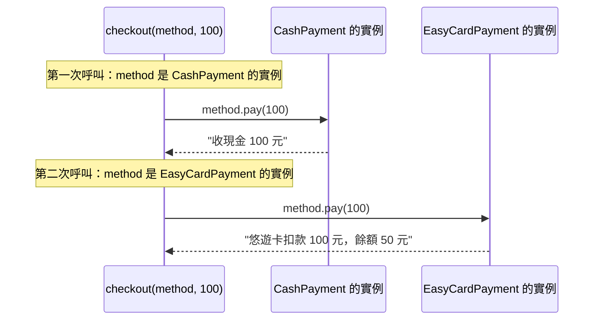
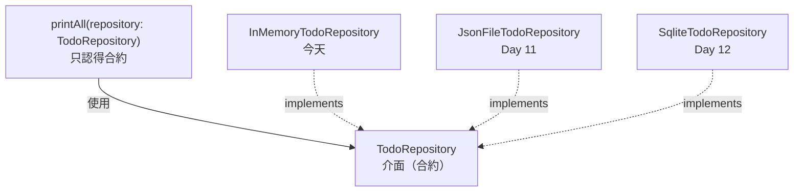
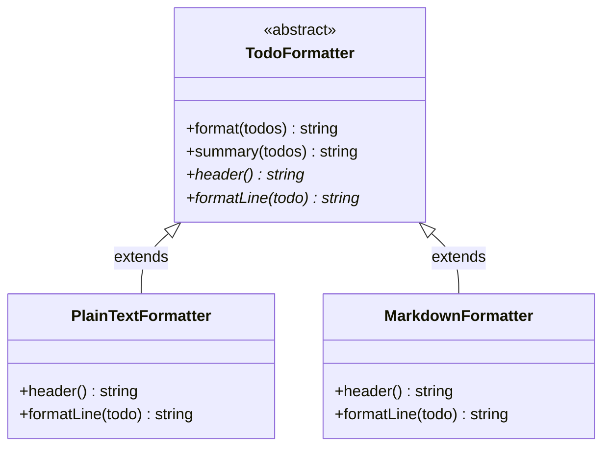
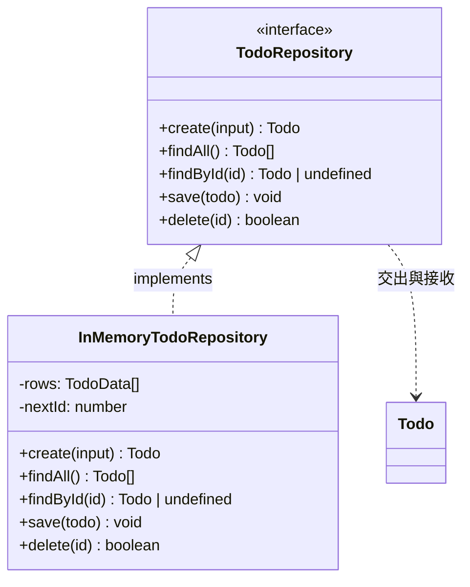
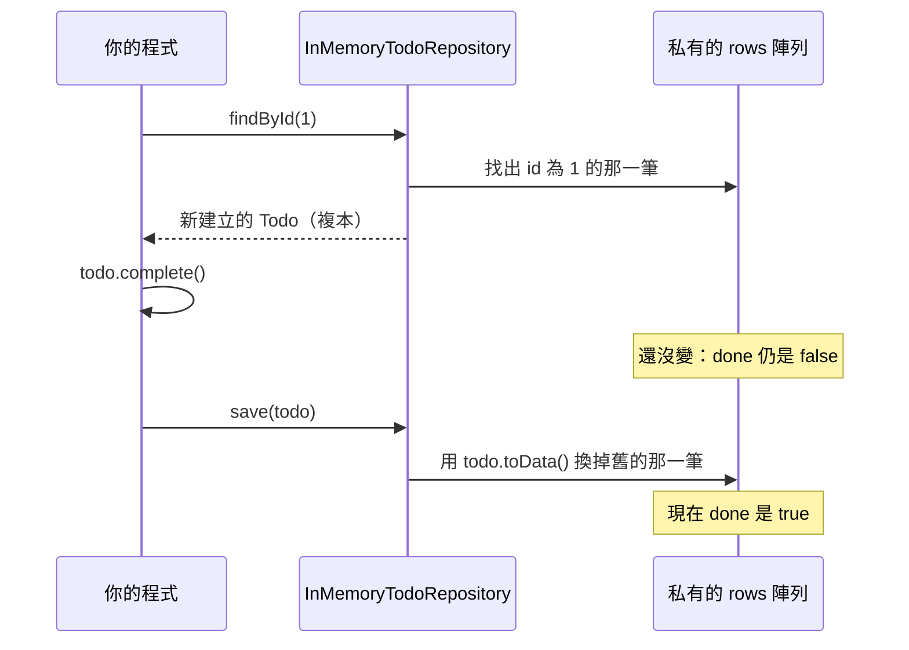

# Day 09 — 物件導向（二）：介面、抽象、多型

> 第 2 週｜物件導向｜必修約 60 分鐘，加練可到 3 小時

## 學習目標

完成今天的課程後，你能夠：

- 用 `interface` 寫出一份合約，並用 `implements` 讓類別遵守它。
- 說出什麼是多型：同一個呼叫，依實例所屬的類別執行不同的程式。
- 把參數與變數的型別寫成介面，而不是某一個特定的類別，並說出這樣做的好處。
- 用 `abstract class` 寫出樣板方法：流程固定、步驟交給子類別。
- 說出 `TodoRepository` 的五個方法各自對應 CRUD 的哪一個字母。

## 時間分配

| 區塊 | 內容                   | 時間        |
| ---- | ---------------------- | ----------- |
| 必修 | 觀念說明＋圖解         | 20 分鐘     |
| 必修 | 逐步解說（範例 01–04） | 20 分鐘     |
| 必修 | 練習 01、02            | 20 分鐘     |
| 加練 | 練習 03、延伸挑戰      | 30–120 分鐘 |

## 今天的 Todo 進度

昨天的 `Todo` 類別管好了「一筆」待辦事項，但第 1 週 `store.ts` 的 CRUD 函式還沒有接回來。今天用介面 `TodoRepository` 定義「一群 `Todo` 要怎麼存取」的合約，再寫第一個實作 `InMemoryTodoRepository`，把資料放在記憶體。

[`examples/todo/`](examples/todo/) 今天有三個檔案：昨天的 `todo.ts` 原封不動帶過來，加上 `todo-repository.ts`（合約）與 `in-memory-todo-repository.ts`（實作）。

## 觀念說明

### 1. 介面是一份合約

Day 02 用 `interface` 描述過物件的形狀。今天用它做另一件事：規定「一個類別必須提供哪些屬性與方法」。介面（interface）只說要有**什麼**，完全不說**怎麼做**。

類別用 `implements` 宣告自己遵守某份合約，TypeScript 就會逐項檢查：少一個方法、參數或回傳型別不符，`bun check` 都會報錯。

```text
interface PaymentMethod {            ← 合約：只列出「要有什麼」
  readonly name: string;
  pay(amount: number): string;       ← 只有簽名，沒有 { } 本體
}

class CashPayment implements PaymentMethod {
        │              │            └─ 要遵守的合約
        │              └─ implements：請 TypeScript 檢查這個類別有沒有做到
        └─ 類別名稱
  readonly name = "現金";

  pay(amount: number): string {      ← 「怎麼做」寫在類別裡
    return `收現金 ${amount} 元`;
  }
}
```

合約是最低要求。類別可以有合約以外的東西，例如 `EasyCardPayment` 多了 `#balance` 與 `topUp()`。

### 2. 多型：同一個呼叫，不同的行為

`CashPayment` 與 `EasyCardPayment` 都遵守 `PaymentMethod`，所以都有 `pay()`。同一行 `method.pay(100)`，實際執行哪一段程式，由 `method` 當下是哪個類別的實例決定。這叫做多型（polymorphism）。

下圖是同一個函式 `checkout(method, 100)` 被呼叫兩次的過程：



重點：

- `checkout()` 裡只有一行 `method.pay(amount)`，沒有任何 `if` 在判斷付款方式。
- 選擇執行哪一個 `pay()` 的不是呼叫的人，而是實例自己。
- 新增一種付款方式只要新增一個類別，`checkout()` 一個字都不用改。

### 3. 針對介面寫程式，不針對實作

把參數的型別寫成介面（`TodoRepository`），不要寫成某一個類別（`InMemoryTodoRepository`）。這樣函式只依賴合約，任何遵守合約的類別都可以傳進來，包括還沒寫出來的。

下圖顯示誰依賴誰。實線是「使用」，虛線是「實作」：



重點：

- 所有箭頭都指向介面。使用的人與實作的人互相不認識，只認識合約。
- 之後把儲存位置從記憶體換成檔案、再換成資料庫，`printAll()` 都不用改。
- 變數也一樣：寫 `const repository: TodoRepository = new InMemoryTodoRepository()`，整支程式只有 `new` 的那一處知道實作是誰。

### 4. 抽象類別與樣板方法

介面完全沒有程式碼。有時候幾個類別的**流程**一模一樣，只有其中幾個**步驟**不同，這時用抽象類別（abstract class）：把共用的流程寫好，不同的步驟留白，交給以它為基礎的類別補上。以它為基礎的類別叫做子類別（child class），它自己是父類別（parent class）。

```text
abstract class TodoFormatter {
   │
   └─ abstract：這個類別還沒寫完，不能直接 new

  format(todos: readonly Todo[]): string { ... }   ← 一般方法：有本體，子類別直接沿用
  abstract formatLine(todo: Todo): string;         ← 抽象方法：只有簽名，子類別一定要補上
}

class PlainTextFormatter extends TodoFormatter { ... }
                            │
                            └─ extends：以 TodoFormatter 為基礎往上蓋（先照抄，Day 10 會解釋）
```

`format()` 這種「流程寫在父類別、步驟交給子類別」的方法叫做樣板方法（template method）。今天的例子有兩個子類別：



重點：

- 斜體的 `header()` 與 `formatLine()` 是抽象方法，每個子類別各寫一份。
- `format()` 與 `summary()` 只寫一次，兩個子類別共用。「標題 → 每筆一行 → 統計」的順序由父類別決定，子類別改不了。
- 呼叫 `formatter.format(todos)` 時，裡面的 `this.formatLine(todo)` 會執行子類別的版本。這也是多型。

介面與抽象類別怎麼選：

| 比較         | `interface`                  | `abstract class`                   |
| ------------ | ---------------------------- | ---------------------------------- |
| 內容         | 只有宣告，沒有任何程式碼     | 可以有寫好的方法，也可以有抽象方法 |
| 執行的時候   | 不存在，和其他型別一樣被拿掉 | 存在，是真的類別                   |
| 一個類別可以 | `implements` 很多個          | 只能 `extends` 一個                |
| 什麼時候用   | 預設用這個                   | 幾個類別要共用同一段流程的程式碼時 |

### 5. 今天的主線：`TodoRepository`

Repository 是「負責存取某一種資料的物件」。`TodoRepository` 這份合約把第 1 週的 CRUD 函式整理成五個方法：

| CRUD | 第 1 週的函式                    | 今天的方法                              |
| ---- | -------------------------------- | --------------------------------------- |
| C    | `createTodo(todos, input)`       | `repository.create(input)`              |
| R    | `findTodoById(todos, id)`        | `repository.findById(id)`、`findAll()`  |
| U    | `updateTodo(todos, id, changes)` | 先改 `Todo`，再 `repository.save(todo)` |
| D    | `deleteTodo(todos, id)`          | `repository.delete(id)`，回傳是否有刪到 |

第 1 週要把 `todos` 陣列傳進每個函式，再接住回傳的新陣列。現在陣列收在 Repository 的私有欄位裡，外面只看得到五個方法。

下圖是合約與今天這個實作的關係：



重點：

- 介面 `TodoRepository` 沒有任何欄位：合約不關心資料放在哪裡。
- `InMemoryTodoRepository` 的 `#rows` 存的是純資料 `TodoData`，`#nextId` 負責產生從 1 開始遞增的 `id`。
- 合約只和 `Todo` 類別打交道。裡面用什麼格式存，是實作自己的事。

Repository 交出去的每一個 `Todo` 都是用 `Todo.fromData()` 新建立的**複本**。改了複本之後，要呼叫 `save()` 才會存回去：



重點：

- 「讀出來 → 修改 → `save()`」是固定的三個步驟。少了 `save()`，改到的只是手上的複本。
- 這和檔案、資料庫的行為一致：從資料庫讀出來的物件改了，資料庫不會自己跟著變。Day 11、Day 12 換實作時，使用方式完全相同。

## 逐步解說

以下每一步對應 `examples/` 裡的一個檔案。請在專案根目錄執行指令。

### 步驟 1：介面與 `implements`

檔案：[`examples/01-interface-implements.ts`](examples/01-interface-implements.ts)

```bash
bun run day-09-oop-interfaces/examples/01-interface-implements.ts
```

1. `interface PaymentMethod` 列出兩項要求：唯讀的 `name`，以及 `pay(amount)`。
2. `CashPayment` 與 `EasyCardPayment` 都寫了 `implements PaymentMethod`，各自用自己的方式做出 `pay()`。
3. 前三行輸出：現金直接收款；悠遊卡第一次扣款成功，第二次餘額不足。
4. `card` 的型別是 `EasyCardPayment`，所以可以呼叫合約以外的 `card.topUp(500)`。
5. `const method: PaymentMethod = card` 把同一個實例當成合約來看。透過 `method` 只能用合約列出的 `name` 與 `pay()`。把 `// method.topUp(100);` 的 `//` 拿掉再執行 `bun check`，會看到 `TS2339`。
6. `BrokenPayment` 少了 `pay()`。把它上面的 `// @ts-expect-error` 那一行刪掉再執行 `bun check`，會看到 `TS2420`，而且訊息指出缺的是 `pay`。看完把那一行加回去。

### 步驟 2：多型

檔案：[`examples/02-polymorphism.ts`](examples/02-polymorphism.ts)

```bash
bun run day-09-oop-interfaces/examples/02-polymorphism.ts
```

1. `checkout(method: PaymentMethod, amount)` 的參數型別是介面。函式本體只有一行，沒有判斷付款方式。
2. 前三行輸出來自同一個 `checkout()`，三種付款方式印出三種結果。
3. `const methods: PaymentMethod[]` 這個陣列同時放了三個不同類別的實例。`for...of` 迴圈裡同一行 `checkout(method, 100)` 依序執行三個不同的 `pay()`。悠遊卡這次餘額不足，信用卡的累計變成 200：每個實例記得自己的狀態。
4. `checkoutWithoutPolymorphism()` 是沒有多型的寫法：每種付款方式一個 `if` 分支。傳入它不認得的 `"line-pay"` 就失敗，要支援就得回來改這個函式。
5. 最後新增 `LinePayPayment` 類別，直接交給原本的 `checkout()` 就能用。

### 步驟 3：抽象類別

檔案：[`examples/03-abstract-class.ts`](examples/03-abstract-class.ts)

```bash
bun run day-09-oop-interfaces/examples/03-abstract-class.ts
```

1. `TodoFormatter` 的 `format()` 是樣板方法：先 `this.header()`，再對每一筆呼叫 `this.formatLine(todo)`，最後 `this.summary(todos)`。字串裡的 `\n` 是換行字元。
2. `abstract header()` 與 `abstract formatLine()` 只有簽名。`PlainTextFormatter` 與 `MarkdownFormatter` 各自補上這兩個方法，其他都沿用父類別。
3. 迴圈對兩個 formatter 呼叫同一個 `format(todos)`。輸出是兩段文字：標題與每一行的格式不同，最後一行 `共 2 筆，已完成 1 筆` 相同，因為它來自共用的 `summary()`。
4. 把最後一行的 `//` 拿掉再執行 `bun check`，會看到 `TS2511`：抽象類別不能直接 `new`。

### 步驟 4：今天的主線

檔案：[`examples/todo/todo-repository.ts`](examples/todo/todo-repository.ts)、[`examples/todo/in-memory-todo-repository.ts`](examples/todo/in-memory-todo-repository.ts)、[`examples/04-todo-repository.ts`](examples/04-todo-repository.ts)（使用它們的程式）

```bash
bun run day-09-oop-interfaces/examples/04-todo-repository.ts
```

先讀前兩個檔案，再對照執行結果：

1. `NewTodo` 沒有 `id`：`id` 由 Repository 產生。`create()` 兩次，印出 `新增：#1、#2`。
2. `printAll(repository: TodoRepository)` 針對介面寫，檔案裡只有 `new InMemoryTodoRepository()` 這一處提到實作。
3. `findById(2)` 找到 `寫報告`；`findById(99)` 回傳 `undefined`。
4. `milk.complete()` 之後再印一次，`#1` 仍然是 `[ ]`：改到的是複本。`repository.save(milk)` 之後才變成 `[x]`。
5. `delete(2)` 第一次回傳 `true`，第二次回傳 `false`。
6. 刪掉 `#2` 之後再新增，拿到的是 `#3`：`id` 不會重複使用。
7. 標題空白時 `create()` 丟出錯誤。規則仍然由 `Todo` 類別自己把關，Repository 不需要重寫一次。

## 規範重點

- **介面名稱用 PascalCase，不加 `I` 開頭**。寫 `TodoRepository`，不寫 `ITodoRepository`。使用的人不需要知道它是介面還是類別。
- **實作的名稱說明「怎麼做」**：`InMemoryTodoRepository`、`JsonFileTodoRepository`。合約的名稱說明「做什麼」，實作的名稱說明「用什麼方式」。
- **類別一定寫出 `implements`**。少了它，漏寫方法時錯誤會出現在很遠的呼叫處；寫了它，錯誤直接出現在類別上。
- **參數與變數的型別寫介面**，不寫具體的類別。只有 `new` 的那一行需要知道實作是誰。
- **預設用 `interface`**，確定有流程要共用時才用 `abstract class`。介面沒有程式碼，約束最少。
- **介面只放使用者需要的方法**。儲存用的欄位、輔助方法都留在實作裡，並且用 `#` 設為私有。
- **合約與實作分開放**：`todo-repository.ts` 只有型別，`in-memory-todo-repository.ts` 只有一個實作。之後每多一種實作就多一個檔案。

## 常見錯誤

| 錯誤訊息或現象                                                                                | 原因                                 | 修法                                             |
| --------------------------------------------------------------------------------------------- | ------------------------------------ | ------------------------------------------------ |
| `TS2420: Class 'X' incorrectly implements interface 'Y'.`                                     | 類別少了合約要求的屬性或方法         | 讀訊息的第二行，補上它說缺少的成員               |
| `TS2416: Property 'pay' in type 'X' is not assignable to the same property in base type 'Y'.` | 方法的參數或回傳型別和合約不同       | 把簽名改成和合約一致                             |
| `TS2339: Property 'topUp' does not exist on type 'PaymentMethod'.`                            | 透過介面型別的變數使用合約以外的成員 | 只用合約裡的成員，或把需要的方法加進合約         |
| `TS2693: 'PaymentMethod' only refers to a type, but is being used as a value here.`           | 對介面寫 `new` 或 `instanceof`       | 介面執行時不存在。`new` 與 `instanceof` 要用類別 |
| `TS2511: Cannot create an instance of an abstract class.`                                     | 直接 `new` 抽象類別                  | 改成 `new` 它的子類別                            |
| `TS2515: Non-abstract class 'X' does not implement inherited abstract member ...`             | 子類別漏寫抽象方法                   | 補上訊息指出的那個方法                           |
| 改了 `Todo`，`findAll()` 拿到的卻還是舊的                                                     | 忘了呼叫 `save()`，改到的只是複本    | 修改之後呼叫 `repository.save(todo)`             |

## 練習

練習檔在 `exercises/`。每個檔案裡標著 `TODO` 的地方就是你要改的地方。

```bash
# 檢查你的答案：全部顯示 pass 就完成了
bun test day-09
```

| 練習                                                                     | 內容                                                 | 類型 |
| ------------------------------------------------------------------------ | ---------------------------------------------------- | ---- |
| [`01-shapes.ts`](exercises/01-shapes.ts)                                 | 介面、`implements`、針對介面寫函式                   | 必修 |
| [`02-drink-recipe.ts`](exercises/02-drink-recipe.ts)                     | 抽象類別、樣板方法                                   | 必修 |
| [`03-recycle-bin-repository.ts`](exercises/03-recycle-bin-repository.ts) | 替主線的 `TodoRepository` 寫第二個實作：資源回收桶版 | 加練 |

卡住超過 15 分鐘再看 `solutions/` 裡的參考解答。看完後把解答關掉，自己重寫一次。

### 延伸挑戰（加練）

1. 在 `examples/03-abstract-class.ts` 新增第三個子類別 `NumberedFormatter`，每一行的格式是 `1. 買牛奶（已完成）`。提示：編號可以用 `todo.id`。
2. 在 `examples/02-polymorphism.ts` 新增一種你常用的付款方式，加進 `methods` 陣列，確認 `checkout()` 不用修改。
3. 把 `examples/todo/in-memory-todo-repository.ts` 關掉，只看第 5 節的類別圖與合約，自己重寫一次 `InMemoryTodoRepository`，再用 `examples/04-todo-repository.ts` 驗證。

## 自我檢查清單

- [ ] 我能說出介面規定了什麼、沒有規定什麼。
- [ ] 我能說出 `implements` 幫我檢查了什麼。
- [ ] 我能用自己的話解釋多型，並舉出今天的一個例子。
- [ ] 我能說出為什麼 `printAll()` 的參數型別要寫 `TodoRepository`，而不是 `InMemoryTodoRepository`。
- [ ] 我能分辨介面與抽象類別，並說出各自什麼時候用。
- [ ] 我能說出 `TodoRepository` 的五個方法分別對應 CRUD 的哪個字母。
- [ ] 我能解釋為什麼改完 `Todo` 之後要呼叫 `save()`。
- [ ] `bun test day-09` 全部通過。

## 下一課

[Day 10 — 物件導向（三）：繼承與組合、分層架構](../day-10-oop-composition-layers/README.md)：今天有了能存取資料的 Repository，明天在它上面加一層 `TodoService` 負責跨多筆資料的規則，再接上 CLI，組成完整的分層架構，並正式說明今天先照抄的 `extends`。
