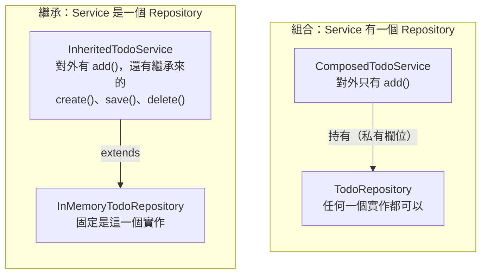
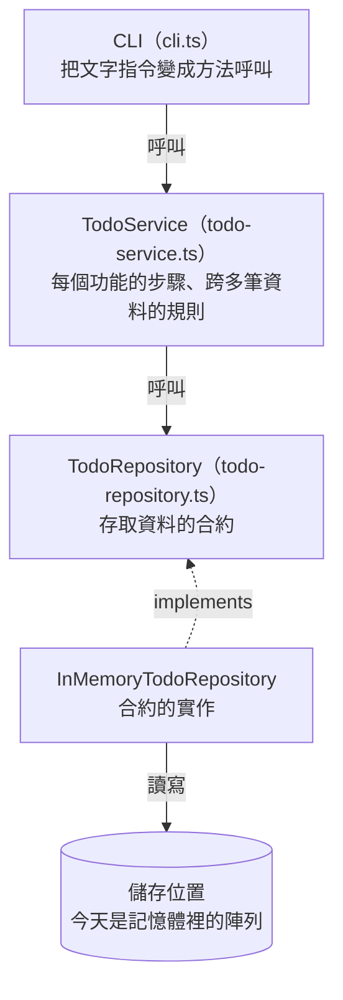
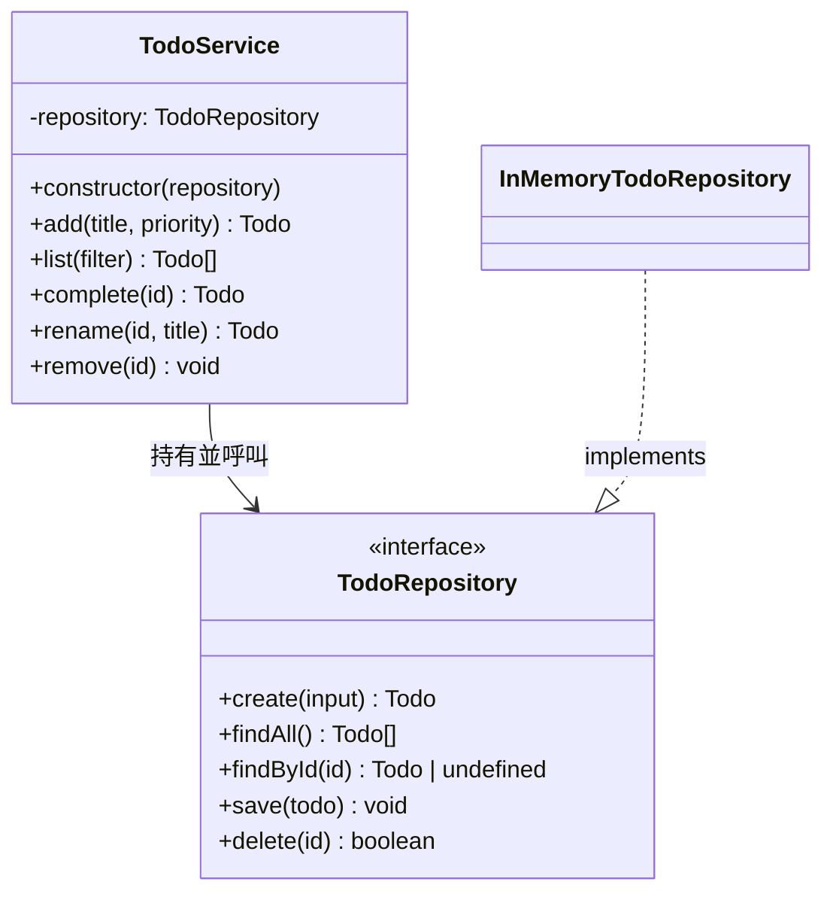
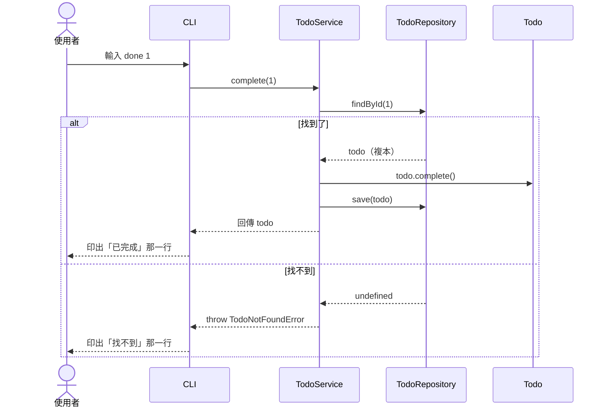

# Day 10 — 物件導向（三）：繼承與組合、分層架構

> 第 2 週｜物件導向｜必修約 60 分鐘，加練可到 3 小時

## 學習目標

完成今天的課程後，你能夠：

- 用 `extends`、`super`、`override` 寫出子類別，並說出三個關鍵字各自的作用。
- 說出繼承在什麼情況下會出問題，以及組合怎麼避開它。
- 寫出自訂錯誤類別，並在 `catch` 裡用 `instanceof` 分辨錯誤的種類。
- 畫出 CLI → Service → Repository 的分層，並說出相依方向為什麼只能由上往下。
- 用建構子注入把 Repository 交給 Service，並判斷一條規則該放在哪一層。

## 時間分配

| 區塊 | 內容                   | 時間        |
| ---- | ---------------------- | ----------- |
| 必修 | 觀念說明＋圖解         | 20 分鐘     |
| 必修 | 逐步解說（範例 01–05） | 20 分鐘     |
| 必修 | 練習 01、02            | 20 分鐘     |
| 加練 | 練習 03、延伸挑戰      | 30–120 分鐘 |

## 今天的 Todo 進度

昨天結束時有 `Todo`（一筆資料的規則）與 `TodoRepository`（存取資料），但沒有地方放「不能有兩筆未完成的同名待辦事項」這種規則，也沒有可以操作的介面。今天補上三個檔案：`errors.ts`（自訂錯誤類別）、`todo-service.ts`（Service：負責每個功能的步驟與這個 App 自己的規定）、`cli.ts`（互動式 CLI），組成完整的分層架構。

[`examples/todo/`](examples/todo/) 的另外三個檔案從昨天帶過來。其中只有 `todo.ts` 有改動：多了一行 `import`，標題不合規則時從丟出 `Error` 改成丟出 `ValidationError`。

## 觀念說明

### 1. 繼承：`extends`、`super`、`override`

繼承（inheritance）是「以一個既有的類別為基礎，寫出另一個類別」。新的類別叫子類別（child class），被當作基礎的叫父類別（parent class）。子類別自動擁有父類別所有的屬性與方法，再加上自己新增或改寫的部分。

```text
class VipMember extends Member {
        │          │       └─ 父類別：被繼承的那一個
        │          └─ extends：VipMember 擁有 Member 的所有屬性與方法
        └─ 子類別

  constructor(name: string, since: number) {
    super(name);              ← super(...)：執行父類別的建構子，必須寫在使用 this 之前
    this.since = since;
  }

  override describe(): string {             ← override：我是故意取代父類別的同名方法
    return `[VIP] ${super.describe()}`;     ← super.describe()：呼叫父類別原本的版本
  }
}
```

三個重點：

- **`super(...)`**：子類別有自己的建構子時，第一件事是呼叫 `super(...)`，讓父類別先把它那一部分的資料準備好。子類別沒寫建構子，就直接沿用父類別的。
- **`override`**：本專案的 `tsconfig.json` 開啟了 `noImplicitOverride`，取代父類別的方法時一定要寫 `override`。好處是父類別的方法之後改名或刪除時，子類別會立刻報錯，不會默默變成一個沒人呼叫的方法。昨天補上 `abstract` 方法時不用寫，因為那是把留白的地方填上，不是取代。
- **`#` 成員連子類別都碰不到**：父類別的 `#points` 只有父類別自己能讀寫，子類別要透過父類別公開的方法與 getter。

### 2. 繼承會出問題的地方，以及組合

繼承是「全部都拿」：子類別會得到父類別的每一個公開方法，不能只挑想要的，而且從此綁定在那一個父類別上。

假設想讓 Service 能存取資料，有兩種做法：繼承 Repository，或是用組合（composition），也就是把 Repository 放在自己的私有欄位裡。下圖並排比較兩者：



重點：

- 用繼承時，`add()` 會檢查規則，但繼承來的 `create()` 也是公開的，任何人都可以用它繞過規則。這和 Day 08 一開始「資料可以被直接修改」是同一種問題。
- 用繼承時，Service 永遠是 `InMemoryTodoRepository`，要換成檔案或資料庫就得重寫。用組合時持有的是介面，任何實作都能放進去。
- 判斷方式：「A **是一種** B」而且 B 的每個方法對 A 都合理，才用繼承（`ValidationError` 是一種 `Error`）。「A **需要用到** B」就用組合（Service 需要用到 Repository）。拿不定主意時選組合。

### 3. 自訂錯誤類別

到昨天為止所有錯誤都是 `Error`，接住之後只能靠比對訊息文字來分辨種類，訊息改一個字判斷就失效。自訂錯誤類別是繼承最適合的用途之一：

```ts
export class TodoNotFoundError extends Error {
  readonly id: number;

  constructor(id: number) {
    super(`找不到 id 為 ${id} 的待辦事項`); // Error's constructor stores the message
    this.name = "TodoNotFoundError";
    this.id = id;
  }
}
```

- 用 `error instanceof TodoNotFoundError` 分辨種類，不必看訊息文字。
- 錯誤可以帶資料：`error.id` 是數字，接住的人可以直接使用。
- 它仍然是 `Error`：有 `message`，可以 `throw`，`error instanceof Error` 也是 `true`。

### 4. 分層架構與相依方向

分層架構（layered architecture）把程式依「負責的事情」切成幾層，每一層只和緊鄰的下一層說話。下圖是今天完成的主線，箭頭代表「誰需要知道誰」：



重點：

- 相依方向只能由上往下：CLI 知道 Service，Service 知道 Repository 的合約。反過來不行，Service 裡不可以出現 `console.log` 或 `prompt`，Repository 不知道 Service 的存在。
- `implements` 的箭頭是往上指的：實作依賴合約，Service 也只依賴合約。所以更換最下面的實作，上面兩層都不用改。
- `Todo` 與 `errors.ts` 不在圖上：它們是每一層共用的語言，不依賴任何一層。

每一條規則放在「剛好看得到所需資料」的那一層：

| 規則                           | 放在哪裡      | 為什麼                                        | 丟出的錯誤          |
| ------------------------------ | ------------- | --------------------------------------------- | ------------------- |
| 標題去掉空白後要有 1–100 個字  | `Todo`        | 只看自己這一筆就能判斷                        | `ValidationError`   |
| 不能有兩筆未完成且標題相同     | `TodoService` | 要看過全部的待辦事項才能判斷                  | `ValidationError`   |
| 指定的 `id` 必須存在           | `TodoService` | Repository 只回報「沒有」，算不算錯由這層決定 | `TodoNotFoundError` |
| 使用者輸入的 `id` 必須是正整數 | CLI           | 這是「文字怎麼變成數字」的問題                | `ValidationError`   |

### 5. 建構子注入

`TodoService` 需要一個 Repository。它不自己 `new`，而是由外面透過建構子交給它。這叫做相依注入（dependency injection），用建構子來交就是建構子注入（constructor injection）。

下圖是 Service、合約與實作三者的關係：



重點：

- `TodoService` 的建構子參數型別是介面 `TodoRepository`。整個 `todo-service.ts` 沒有出現 `InMemoryTodoRepository` 這個字。
- 決定用哪個實作的地方只有一處，在最上層的 `cli.ts`：`new TodoService(new InMemoryTodoRepository())`。
- 好處有兩個：之後換成檔案或資料庫只改那一行；測試時可以交給它一個假的 Repository（練習 02 的測試就是這樣做）。

### 6. 一個指令怎麼穿過各層

使用者輸入 `done 1` 之後，各層依序做了什麼：



重點：

- 呼叫一層一層往下，結果一層一層往回。沒有任何一層跳過中間的人。
- Service 的每個修改都是同樣三步：找出來、請 `Todo` 自己改、存回去。
- 錯誤在發現問題的那一層丟出（Service），在知道怎麼告訴使用者的那一層接住（CLI）。中間不需要每一層都寫 `try`／`catch`。

> ▶ 動畫演示：[`done 1` 穿過 CLI、Service、Repository 再回來，`done 99` 的錯誤怎麼傳回 CLI](https://vincentlin0619.github.io/ts-engineer-bootcamp/day-10/#anim-day10-layers)

## 逐步解說

以下每一步對應 `examples/` 裡的一個檔案。請在專案根目錄執行指令。

### 步驟 1：`extends`、`super`、`override`

檔案：[`examples/01-extends-super-override.ts`](examples/01-extends-super-override.ts)

```bash
bun run day-10-oop-composition-layers/examples/01-extends-super-override.ts
```

1. `Member` 是父類別。`spend()` 裡呼叫的是 `this.pointsFor(amount)`。
2. `VipMember extends Member`，建構子先 `super(name)` 再設定自己的 `since`。
3. `override pointsFor()` 用 `super.pointsFor(amount) * 2` 把父類別算出的點數加倍。
4. 兩人都消費 500 元：`小明：500 點`、`[VIP] 小華：1000 點（2024 年加入）`。`spend()` 只寫在 `Member` 裡，卻替 VIP 執行了改寫後的 `pointsFor()`，這是昨天學的多型。
5. `printPoints(member: Member)` 可以接收 `vip`：子類別的實例可以用在任何需要父類別的地方。
6. `vip instanceof Member` 是 `true`，`regular instanceof VipMember` 是 `false`。
7. 依照檔案最後的說明，分別刪掉 `override` 與 `super(name);`，用 `bun check` 觀察 `TS4114` 與 `TS2377`，看完改回來。

### 步驟 2：繼承與組合的比較

檔案：[`examples/02-inheritance-vs-composition.ts`](examples/02-inheritance-vs-composition.ts)

```bash
bun run day-10-oop-composition-layers/examples/02-inheritance-vs-composition.ts
```

1. `InheritedTodoService extends InMemoryTodoRepository`，只新增了會檢查重複標題的 `add()`。
2. 第二次 `add("買牛奶")` 被擋下來。但 `inherited.create(...)` 是繼承來的公開方法，直接新增成功，輸出 `「買牛奶」有 2 筆`。
3. `ComposedTodoService` 把 Repository 放在 `#repository`，對外只提供 `add()`。同樣的操作之後輸出 `「買牛奶」有 1 筆`。
4. 把最後一行的 `//` 拿掉再執行 `bun check`，會看到 `TS2339`：`ComposedTodoService` 上根本沒有 `create`。

### 步驟 3：自訂錯誤類別

檔案：[`examples/todo/errors.ts`](examples/todo/errors.ts)、[`examples/03-custom-errors.ts`](examples/03-custom-errors.ts)（使用它的程式）

```bash
bun run day-10-oop-composition-layers/examples/03-custom-errors.ts
```

1. `new ValidationError("...")` 的 `name` 是 `ValidationError`，`instanceof` 的結果依序是 `true`、`true`、`false`：它是 `ValidationError`，也是 `Error`，但不是 `TodoNotFoundError`。
2. `new TodoNotFoundError(7)` 自己組出訊息，並且多帶一個數字 `id`。
3. `describeError()` 用一連串 `instanceof` 做出不同反應。順序是先特定、後一般：如果把 `error instanceof Error` 放在最前面，其他兩個分支永遠執行不到。
4. 迴圈執行四個步驟，前三個各丟出一種錯誤，第四個順利完成。
5. 最後一段示範昨天以前的做法：只能比對訊息文字。

### 步驟 4：建構子注入與 Service 的規則

檔案：[`examples/todo/todo-service.ts`](examples/todo/todo-service.ts)、[`examples/04-dependency-injection.ts`](examples/04-dependency-injection.ts)（使用它的程式）

```bash
bun run day-10-oop-composition-layers/examples/04-dependency-injection.ts
```

先讀 `todo-service.ts`：`#repository` 在建構子接收；`#findOrThrow()` 與 `#assertNoOpenDuplicate()` 是私有方法；`complete()` 與 `rename()` 都是「找、改、存」三步。再對照輸出：

1. 第 1 段的七行結果：重複的標題（前後有空白也算）與空白標題得到 `ValidationError`；`#1` 完成之後可以再新增一筆 `買牛奶`；不存在的 `id` 得到 `TodoNotFoundError`，而且 `error.id` 是 `99`。
2. 空白標題的錯誤來自 `Todo`，重複標題的錯誤來自 `TodoService`。兩層各守各的規則，對 CLI 來說都是 `ValidationError`。
3. 第 2 段把 `LoggingTodoRepository` 交給**同一個** `TodoService` 類別。`LoggingTodoRepository` 本身也是組合：它持有另一個 Repository，印出紀錄後把呼叫轉交過去。
4. `service.complete(1)` 底下印出 `findById(1)` 與 `save(#1，done: true)`，就是第 6 節序列圖中間的那兩個箭頭。

### 步驟 5：完整的 CLI

檔案：[`examples/todo/cli.ts`](examples/todo/cli.ts)

```bash
bun run day-10-oop-composition-layers/examples/todo/cli.ts
```

這是互動式程式，會停在 `>` 等你輸入。試試 `help`、`add 買牛奶`、`add 買牛奶`、`done 1`、`list done`、`rename 1 買豆漿`、`rm 9`、`quit`。也可以用管線一次送入所有指令：

```bash
printf 'add 買牛奶\nlist\nquit\n' | bun run day-10-oop-composition-layers/examples/todo/cli.ts
```

```text
Todo CLI：輸入 help 看指令，輸入 quit 離開
> 已新增 [ ] #1 買牛奶（優先度：中）
> [ ] #1 買牛奶（優先度：中）
> 再見！
```

1. `main()` 開頭兩行是整支程式唯一的組裝處：建立 Repository，交給 Service。
2. `runCommand()` 把一行文字拆成指令與參數，呼叫 Service 對應的方法，再把結果印出來。裡面沒有任何待辦事項的規則。
3. `parseId()` 與 `parseFilter()` 檢查使用者打的文字，不合格就丟 `ValidationError`。
4. `reportError()` 用 `instanceof` 分辨兩種可預期的錯誤並印出說明。其他錯誤代表程式有 bug，重新 `throw` 出去，不把它藏起來。
5. `prompt()` 在輸入結束或直接按 Enter 時回傳 `null`，程式把它當成 `quit`。所以管線輸入即使沒有 `quit` 也會正常結束。

## 規範重點

- **取代父類別的方法一定寫 `override`**。讀的人一眼看出這是改寫；父類別改名時 `bun check` 會提醒你。
- **預設用組合，確定是「是一種」才用繼承**。繼承把兩個類別綁得最緊：父類別的每個公開方法都成為子類別的一部分。
- **相依用建構子注入**：存在 `readonly` 的 `#` 私有欄位裡，參數型別寫介面。類別不自己 `new` 它依賴的東西。
- **`new` 具體實作只出現在最上層的組裝處**（今天是 `cli.ts` 的 `main()`）。
- **相依方向只能由上往下**。Service 不可以 `console.log`、`prompt`，也不可以 `import` CLI 的任何東西。
- **可預期的錯誤用自訂錯誤類別**，名稱以 `Error` 結尾，建構子裡設定 `this.name`。需要給接住的人使用的資料放在 `readonly` 屬性。
- **`catch` 只處理認得的錯誤，其餘重新 `throw`**。把不認得的錯誤吞掉，bug 會變得很難找。
- **規則放在看得到所需資料的最底層**：只看一筆的放 `Todo`，要看多筆的放 Service。

## 常見錯誤

| 錯誤訊息或現象                                                                                                   | 原因                                  | 修法                                            |
| ---------------------------------------------------------------------------------------------------------------- | ------------------------------------- | ----------------------------------------------- |
| `TS4114: This member must have an 'override' modifier because it overrides a member in the base class 'Member'.` | 取代父類別的方法卻沒寫 `override`     | 在方法前面加上 `override`                       |
| `TS4113: This member cannot have an 'override' modifier because it is not declared in the base class 'Member'.`  | 寫了 `override`，父類別卻沒有這個方法 | 檢查方法名稱是否拼錯；是新方法就拿掉 `override` |
| `TS2377: Constructors for derived classes must contain a 'super' call.`                                          | 子類別的建構子沒有呼叫 `super(...)`   | 在建構子第一行加上 `super(...)`                 |
| `TS17009: 'super' must be called before accessing 'this' in the constructor of a derived class.`                 | 在 `super(...)` 之前用了 `this`       | 把 `super(...)` 移到最前面                      |
| `TS18013: Property '#points' is not accessible outside class 'Member' ...`                                       | 子類別想直接讀寫父類別的 `#` 成員     | 改用父類別公開的方法或 getter                   |
| 自訂錯誤的 `catch` 分支永遠執行不到                                                                              | `error instanceof Error` 寫在最前面   | 先判斷特定的錯誤類別，`Error` 放最後            |
| 呼叫 `complete()` 之後 `list` 的結果沒變                                                                         | Service 改了 `Todo` 卻沒有 `save()`   | 每個修改都走完「找、改、存」三步                |

## 練習

練習檔在 `exercises/`。每個檔案裡標著 `TODO` 的地方就是你要改的地方。

```bash
# 檢查你的答案：全部顯示 pass 就完成了
bun test day-10
```

| 練習                                                                         | 內容                                                       | 類型 |
| ---------------------------------------------------------------------------- | ---------------------------------------------------------- | ---- |
| [`01-employees.ts`](exercises/01-employees.ts)                               | `extends`、`super`、`override`                             | 必修 |
| [`02-shop-service.ts`](exercises/02-shop-service.ts)                         | 自訂錯誤類別、組合、建構子注入                             | 必修 |
| [`03-todo-maintenance-service.ts`](exercises/03-todo-maintenance-service.ts) | 替主線加上第二個 Service，和 `TodoService` 共用 Repository | 加練 |

卡住超過 15 分鐘再看 `solutions/` 裡的參考解答。看完後把解答關掉，自己重寫一次。

### 延伸挑戰（加練）

1. 替 CLI 加上 `reopen <id>` 指令。先想清楚要改哪幾層：`Todo` 已經有 `reopen()`，`TodoService` 需要新方法（記得檢查重複標題的規則），`cli.ts` 需要新的 `case`。
2. 替 CLI 的 `add` 加上優先度：例如 `add! 繳電費` 代表 `high`。這個改動應該只動到 `cli.ts`，想想為什麼。
3. 在 `examples/` 新增一個自己的檔案，寫一個永遠回傳固定三筆資料的 `FixedTodoRepository implements TodoRepository`，把它交給 `TodoService`，確認 `list("open")` 的結果正確。

## 自我檢查清單

- [ ] 我能說出 `extends`、`super(...)`、`super.method()`、`override` 各自做什麼。
- [ ] 我能舉例說明繼承「全部都拿」會造成什麼問題。
- [ ] 我能用「是一種」與「需要用到」判斷該用繼承還是組合。
- [ ] 我能寫出帶有額外資料的自訂錯誤類別，並用 `instanceof` 分辨它。
- [ ] 我能畫出今天的分層，並說出每一層負責什麼、不可以做什麼。
- [ ] 我能說出「標題不可以是空的」與「不能有兩筆未完成的同名待辦事項」分別放在哪一層、為什麼。
- [ ] 我能解釋建構子注入，以及它為什麼讓更換 Repository 變得容易。
- [ ] `bun test day-10` 全部通過。

## 下一課

[Day 11 — 非同步與檔案持久化](../day-11-async-file-persistence/README.md)：今天的資料還在記憶體裡，程式一結束就消失。明天寫一個把資料存進 JSON 檔的 `JsonFileTodoRepository`，換掉組裝處的那一行，並學習讀寫檔案所需要的非同步。
