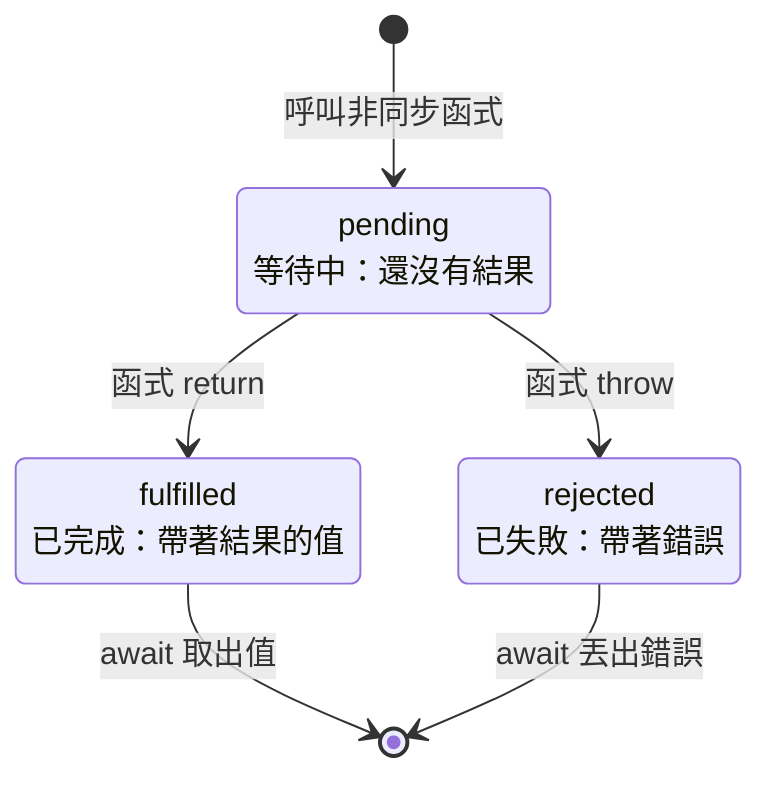
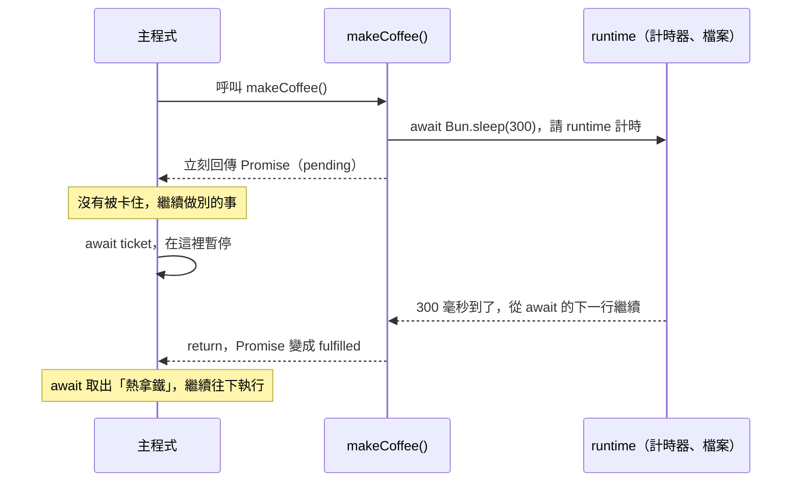
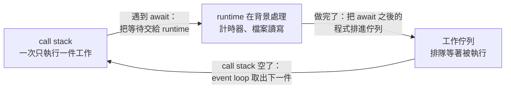
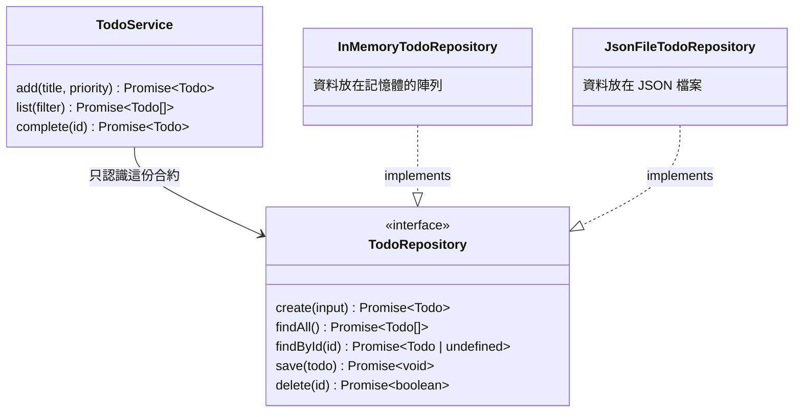

# Day 11 — 非同步與檔案持久化

> 第 2 週｜資料持久化｜必修約 60 分鐘，加練可到 3 小時

## 學習目標

完成今天的課程後，你能夠：

- 說出同步與非同步的差別，以及為什麼讀寫檔案要用非同步。
- 說出 Promise 的三種狀態，用 `async`／`await` 取得結果，用 `try`／`catch` 處理失敗。
- 用 `Promise.all` 同時等待多件互不影響的工作。
- 用 `Bun.file` 與 `Bun.write` 讀寫 JSON 檔案，並用型別守衛檢查讀進來的資料。
- 把 `TodoRepository` 改成非同步，再新增一個把資料存進檔案的實作，而且不必改 `TodoService` 的規則。

## 時間分配

| 區塊 | 內容                      | 時間        |
| ---- | ------------------------- | ----------- |
| 必修 | 觀念說明＋圖解            | 20 分鐘     |
| 必修 | 逐步解說（步驟 1–6）      | 20 分鐘     |
| 必修 | 練習 01、02               | 20 分鐘     |
| 加練 | 步驟 7、練習 03、延伸挑戰 | 30–120 分鐘 |

## 今天的 Todo 進度

昨天的 Todo App 已經分成 CLI → `TodoService` → `TodoRepository` 三層，但資料只放在記憶體，程式一結束就全部消失。今天把 `TodoRepository` 的每個方法改成回傳 Promise，`TodoService` 跟著改成 `async`，再新增 `JsonFileTodoRepository` 把資料寫進 `.data/todos.json`。CLI 只換掉一行，關掉程式再打開，待辦事項還在。

## 觀念說明

### 1. 同步與非同步

同步（synchronous）是「一行做完才做下一行」，Day 01–10 的程式全部都是同步的。非同步（asynchronous）是「先把要等的工作交出去，等待期間繼續做別的事，結果好了再回來接手」。

用早餐店來想：

- 同步：你站在櫃檯前等蛋餅煎好，這段時間你什麼都不能做，後面的客人也不能點餐。
- 非同步：老闆給你一張號碼牌，你先去找座位、拿紙巾，叫到號碼再回來取餐。

|            | 同步           | 非同步                     |
| ---------- | -------------- | -------------------------- |
| 呼叫後拿到 | 結果本身       | 一張號碼牌（Promise）      |
| 等待的時候 | 整支程式停住   | 程式可以做別的事           |
| 適合的工作 | 記憶體裡的計算 | 讀寫檔案、資料庫、網路連線 |

讀寫檔案比記憶體裡的計算慢非常多，所以 Bun 讀檔與寫檔的 API 都回傳 Promise。

### 2. Promise：一張號碼牌

Promise 是一個物件，代表「現在還沒有、之後才會有的結果」。下圖是一個 Promise 從建立到結束會經過的狀態：



重點：

- Promise 一開始是 pending。工作成功變成 fulfilled，失敗變成 rejected。
- 狀態只會改變一次，變成 fulfilled 或 rejected 之後就不會再變。
- `Promise<string>` 讀作「之後會給你一個 `string` 的 Promise」。角括號的寫法叫泛型，Day 14 會正式介紹，今天先照這個讀法使用。

### 3. `async` 與 `await`

`async` 用來宣告非同步函式，`await` 用來等一個 Promise 完成並取出裡面的值。下面的 `Bun.sleep(300)` 會回傳一個 300 毫秒後完成的 Promise，今天用它來模擬很慢的工作：

```text
async function makeCoffee(): Promise<string> {
  │                            │       │
  │                            │       └─ 之後會拿到的值的型別
  │                            └─ 回傳的是 Promise（號碼牌），不是值本身
  └─ async：函式裡可以用 await，而且一定回傳 Promise

  await Bun.sleep(300);
    │
    └─ await：這個函式在這裡暫停，等 Promise 完成後才往下一行

  return "熱拿鐵";   ← Promise 變成 fulfilled，值是 "熱拿鐵"
}
```

下圖是呼叫 `makeCoffee()` 再 `await` 它的時候，主程式、函式與 runtime 依序做的事。runtime 是執行程式的環境，在這門課就是 Bun：



重點：

- 呼叫 `async` 函式會立刻拿到 Promise。函式在第一個 `await` 之前照常執行，遇到 `await` 才暫停。
- `await` 只暫停它所在的那個函式，不會讓整支程式停住。
- `await` 只能寫在 `async` 函式裡，或寫在模組的最上層。所以一個函式只要 `await` 了別人，自己也必須是 `async`。

### 4. event loop：一次只做一件事

JavaScript 只有一個 call stack（Day 03），同一時間只能執行一件工作。等待結束的工作會先進入佇列（queue）排隊。下圖說明它們怎麼回到 call stack：



重點：

- 「等待」由 runtime 在背景處理，不佔用 call stack，所以程式不會卡住。
- event loop（事件迴圈）不斷重複同一件事：call stack 空了，就從佇列取出下一件工作來執行。
- 排隊的工作要等 call stack 空了才輪得到。一段跑很久的同步程式，會讓所有排隊的工作一起等。

> ▶ 動畫演示：[call stack、佇列與 event loop 怎麼決定 1 到 6 的印出順序](https://vincentlin0619.github.io/ts-engineer-bootcamp/day-11/#anim-day11-event-loop)

### 5. 失敗的 Promise：`try`／`catch`

`await` 一個 rejected 的 Promise 時，`await` 會把裡面的錯誤 `throw` 出來，所以用 Day 06 學過的 `try`／`catch` 就能處理：

```ts
try {
  const price = await findPrice("珍珠奶茶");
} catch (error) {
  // A rejected Promise lands here.
}
```

用不到錯誤物件時，`catch (error)` 可以省略成 `catch`。

### 6. `Promise.all`：同時等很多件事

連續寫三個 `await` 是「一件做完才開始下一件」。如果三件工作互不影響，可以先全部開始，再用 `Promise.all` 一起等：

```text
一個一個等（約 300 毫秒）           同時等（約 100 毫秒）
牛奶 ████                           牛奶 ████
雞蛋     ████                       雞蛋 ████
吐司         ████                   吐司 ████
```

寫法是 `await Promise.all([工作一, 工作二, 工作三])`。`Promise.all` 接收一個 Promise 陣列，回傳一個新的 Promise，`await` 之後得到結果的陣列，順序與傳入的順序相同。只要其中一個 rejected，整個就是 rejected。

### 7. 讀寫檔案與 JSON

資料寫進檔案之後，程式結束也不會消失，這叫做持久化（persistence）。Bun 內建的檔案 API：

| 寫法                          | 做什麼                                           | `await` 之後拿到    |
| ----------------------------- | ------------------------------------------------ | ------------------- |
| `Bun.file(path)`              | 建立代表檔案的物件，這一步還沒有讀檔，不用 await | —                   |
| `await file.exists()`         | 檢查檔案是否存在                                 | `boolean`           |
| `await file.text()`           | 讀出全部文字                                     | `string`            |
| `await file.json()`           | 讀出文字並解析成 JSON                            | 當作 `unknown` 看待 |
| `await Bun.write(path, text)` | 寫入並覆蓋整個檔案，資料夾不存在會自動建立       | 寫入的位元組數      |
| `await file.delete()`         | 刪除檔案                                         | —                   |

檔案只能存文字，所以物件要先轉成 JSON 文字：`JSON.stringify(value, null, 2)` 把值轉成文字（`2` 是縮排兩格），`JSON.parse(text)` 把文字轉回值。

### 8. 外面來的資料是 `unknown`：型別守衛

TypeScript 只檢查你寫的程式，檢查不到檔案裡的內容。檔案可能被人手動改過，也可能是舊版程式寫的。`file.json()` 與 `JSON.parse()` 的回傳型別是 `any`，等於關掉型別檢查（Day 07），所以讀進來要立刻標成 `unknown`，檢查過才使用：

```ts
const parsed: unknown = await Bun.file(path).json();
```

檢查的工具是型別守衛（type guard）：一個回傳 `boolean` 的函式，回傳型別寫成 `value is 型別`。

```text
function isTodoData(value: unknown): value is TodoData {
                      │                │
                      │                └─ 回傳 true 時，TypeScript 把 value 當成 TodoData
                      └─ 任何東西都可能被傳進來
```

守衛裡分三步檢查：是不是物件（`typeof value === "object"` 而且不是 `null`）、有沒有需要的屬性（`"id" in value`）、每個屬性的型別對不對（`typeof value.id === "number"`）。

### 9. 兩個可以互換的 Repository

下圖是今天主線的類別關係：`TodoService` 只依賴介面，介面有兩個實作。



重點：

- 合約的每個方法都回傳 Promise，因為儲存位置可能很慢。記憶體版不慢，但為了遵守同一份合約，也回傳 Promise。
- `TodoService` 不知道拿到的是哪一個實作。換實作只要改 `new TodoService(...)` 括號裡的東西。
- 這就是 Day 09 的多型與 Day 10 的相依注入，今天第一次真的換了儲存位置。

## 逐步解說

以下每一步對應 `examples/` 裡的檔案。請在專案根目錄執行指令。

### 步驟 1：同步與非同步的執行順序

檔案：[`examples/01-sync-vs-async.ts`](examples/01-sync-vs-async.ts)

```bash
bun run day-11-async-file-persistence/examples/01-sync-vs-async.ts
```

1. `takeNapkin()` 是同步函式，呼叫完就拿到 `"紙巾"`。
2. `makeCoffee()` 是 `async` 函式。`const ticket = makeCoffee()` 沒有寫 `await`，所以 `ticket` 是 Promise，印出來是 `Promise { <pending> }`。
3. 「店員：開始煮咖啡」比第 2 行早印出來：函式在第一個 `await` 之前照常執行。
4. 第 3 行在咖啡煮好之前就印出來了：程式沒有被卡住。
5. `const coffee = await ticket` 等到 Promise 完成，取出 `"熱拿鐵"`。這時 `ticket` 印出來是 `Promise { <resolved> }`，Bun 把 fulfilled 顯示成 resolved。

### 步驟 2：`async`／`await` 與 `try`／`catch`

檔案：[`examples/02-async-await.ts`](examples/02-async-await.ts)

```bash
bun run day-11-async-file-persistence/examples/02-async-await.ts
```

1. `findPrice` 裡的 `return` 讓 Promise 變成 fulfilled，`throw` 讓 Promise 變成 rejected。
2. `await findPrice("拿鐵")` 取出 `120`。
3. `await findPrice("珍珠奶茶")` 丟出錯誤，被 `catch` 接住，印出「查價失敗」。
4. `describeOrder` 是一個 `await` 了別人的函式，所以它自己也是 `async`，回傳 `Promise<string>`。
5. 最後一段示範忘記寫 `await`：`forgotten + 10` 印出 `[object Promise]10`。把上面那行 `// @ts-expect-error` 刪掉再執行 `bun check`，會看到 `TS2365` 並提示 `Did you forget to use 'await'?`。看完把註解加回去。

### 步驟 3：觀察 event loop

檔案：[`examples/03-event-loop.ts`](examples/03-event-loop.ts)

```bash
bun run day-11-async-file-persistence/examples/03-event-loop.ts
```

輸出的編號就是執行順序，從 1 排到 6。

1. `setTimeout(函式, 0)` 請 runtime「0 毫秒後把這個函式排進佇列」。它沒有馬上執行。
2. `readMenu()` 執行到 `await` 就暫停，把控制權還給主程式。
3. `while` 迴圈讓 call stack 忙了 100 毫秒。計時器與 `Bun.sleep(20)` 早就到期了，但是都只能排隊。
4. 主程式執行到 `await pendingMenu` 才暫停，call stack 空了，event loop 依序執行排隊的第 4、5 項工作。

### 步驟 4：`Promise.all`

檔案：[`examples/04-promise-all.ts`](examples/04-promise-all.ts)

```bash
bun run day-11-async-file-persistence/examples/04-promise-all.ts
```

1. 連續三個 `await`：每次查庫存 100 毫秒，總共約 300 毫秒。
2. `Promise.all([...])`：三件工作同時開始，總共約 100 毫秒，結果用陣列解構（Day 04）取出。
3. `items.map((item) => countStock(item))` 得到 Promise 陣列，直接交給 `Promise.all`，印出 `[ 8, 12 ]`。
4. 最後一段有一個品項不存在，整個 `Promise.all` 變成 rejected，被 `catch` 接住。

### 步驟 5：讀寫 JSON 檔案

檔案：[`examples/05-file-json.ts`](examples/05-file-json.ts)

```bash
bun run day-11-async-file-persistence/examples/05-file-json.ts
```

1. `import.meta.dir` 是「這個檔案所在的資料夾」。`join(...)` 把路徑片段接起來，得到這一課的 `.data/` 資料夾。這樣不論從哪裡執行，檔案都寫在同一個地方。
2. `Bun.write` 寫入文字，`Bun.file(...).text()` 讀回來，兩者都要 `await`。
3. `exists()` 對存在的檔案回傳 `true`，對不存在的檔案回傳 `false`。
4. `JSON.stringify(notes, null, 2)` 把陣列轉成 JSON 文字再寫入。
5. `const parsed: unknown = await ....json()` 把讀進來的資料標成 `unknown`。先用 `Array.isArray(parsed)` 確認它是陣列，再用 `isNote(item)` 檢查每一筆，通過之後才能讀 `item.id` 與 `item.text`。
6. 形狀不對的資料（`id` 是文字、缺少 `text`）都被 `isNote` 判定為 `false`。範例最後把檔案刪除，不留下任何東西。

### 步驟 6：換掉 Repository，Service 不用動

主線程式在 [`examples/todo/`](examples/todo/)。先讀這四個檔案，對照昨天的版本：

- [`todo-repository.ts`](examples/todo/todo-repository.ts)：每個方法的回傳型別包上 `Promise`，例如 `findAll(): Promise<Todo[]>`。
- [`todo-service.ts`](examples/todo/todo-service.ts)：每個方法加上 `async`，呼叫 repository 的地方加上 `await`。規則本身（重複標題、找不到 `id`）完全沒變。
- [`json-file-todo-repository.ts`](examples/todo/json-file-todo-repository.ts)：新的實作。每個 CRUD 方法都是「讀出整個陣列 → 修改 → 寫回整個檔案」，讀與寫集中在 `#readAll` 與 `#writeAll` 兩個私有方法。
- [`todo.ts`](examples/todo/todo.ts)：多了 `isPriority` 與 `isTodoData` 兩個型別守衛，`Todo` 類別沒有變。

想親眼確認 `TodoService` 的規則沒有變，可以比較昨天與今天的檔案。印出來的差異只有開頭的註解，以及加上 `async`、`await`、`Promise<...>` 所做的改寫：

```bash
diff day-10-oop-composition-layers/examples/todo/todo-service.ts day-11-async-file-persistence/examples/todo/todo-service.ts
```

檔案：[`examples/06-swap-repository.ts`](examples/06-swap-repository.ts)

```bash
bun run day-11-async-file-persistence/examples/06-swap-repository.ts
```

1. `runDemo` 的參數型別是 `TodoRepository` 介面，它不知道自己拿到哪一個實作。
2. 同一個 `runDemo` 跑了兩次，一次給記憶體版，一次給 JSON 檔案版。兩次都印出 `[x] #1 買牛奶（優先度：高）` 與 `[ ] #2 寫作業（優先度：中）`，格式和 Day 03 的 `formatTodo` 相同。
3. 只有檔案版在磁碟上留下資料。印出來的檔案內容就是 `TodoData[]` 的 JSON。
4. 最後用同一個檔案建立全新的 repository 物件，資料還讀得到。這就是「程式重新啟動後資料還在」。

### 步驟 7：互動式 CLI 與主線測試（加練）

檔案：[`examples/todo/cli.ts`](examples/todo/cli.ts)

CLI 配合今天的改動做了兩件事：`main()` 裡建立 repository 的那一行換成 `JsonFileTodoRepository`，以及呼叫 service 的地方加上 `await`，所以 `runCommand` 與 `main` 都變成 `async`。

```bash
bun run day-11-async-file-persistence/examples/todo/cli.ts
```

1. 輸入 `add 買牛奶`、`list`、`quit`。再執行一次並輸入 `list`：上次新增的 `[ ] #1 買牛奶（優先度：中）` 還在。
2. 資料存在 `day-11-async-file-persistence/.data/todos.json`，可以直接打開來看。
3. 接著執行主線的測試。[`todo-repository.test.ts`](examples/todo/todo-repository.test.ts) 用同一組測試檢查兩個實作，這是「可以互換」的證明：

   ```bash
   bun test day-11-async-file-persistence/examples
   ```

4. 測試非同步程式有兩個新寫法：測試函式寫成 `async () => { ... }`，以及用 `await expect(promise).rejects.toThrow(...)` 檢查 Promise 是否 rejected。

## 規範重點

- **非同步函式要寫出回傳型別 `Promise<...>`**。讀程式的人一眼就知道呼叫它需要 `await`。
- **每個 Promise 都要有人等**。呼叫非同步函式時寫 `await`，或把 Promise 直接 `return` 出去。沒人等的 Promise 失敗時，沒有任何 `catch` 接得到。
- **互不影響的工作才用 `Promise.all`**。會互相影響的工作（例如寫入同一個檔案）要一個一個 `await`。
- **外部來的資料先當 `unknown`**，通過型別守衛才使用。不要用 `as` 假裝它是對的型別。
- **只在處理得了的地方寫 `try`／`catch`**。處理不了的錯誤讓它繼續往上丟，像 `cli.ts` 的 `reportError` 只處理 `ValidationError` 與 `TodoNotFoundError`，其他錯誤重新丟出。
- **檔案路徑從 `import.meta.dir` 組出來**，執行時產生的檔案一律放在該課的 `.data/`，這個資料夾不會進 git。

## 常見錯誤

| 錯誤訊息或現象                                                                                          | 原因                                         | 修法                                         |
| ------------------------------------------------------------------------------------------------------- | -------------------------------------------- | -------------------------------------------- |
| 印出 `Promise { <pending> }` 或 `[object Promise]`                                                      | 忘了 `await`，拿到的是 Promise               | 在呼叫前面加上 `await`                       |
| `TS2339: Property 'title' does not exist on type 'Promise<Todo \| undefined>'.`                         | 把 Promise 當成裡面的值來用                  | 先 `await`，再使用結果                       |
| `TS1308: 'await' expressions are only allowed within async functions and at the top levels of modules.` | 在不是 `async` 的函式裡寫 `await`            | 在函式前面加上 `async`，回傳型別改成 Promise |
| `TS18046: 'parsed' is of type 'unknown'.`                                                               | 還沒檢查就使用 `unknown` 的值                | 先用型別守衛檢查                             |
| `try`／`catch` 沒有接到錯誤                                                                             | `try` 裡面呼叫非同步函式卻沒有 `await`       | 加上 `await`                                 |
| 用 `Promise.all` 同時新增多筆之後，檔案裡少了資料                                                       | 多件工作同時「讀檔 → 修改 → 寫回」，互相覆蓋 | 對同一個檔案的寫入改成一個一個 `await`       |

## 練習

練習檔在 `exercises/`。每個檔案裡標著 `TODO` 的地方就是你要改的地方。

```bash
# 檢查你的答案：全部顯示 pass 就完成了
bun test day-11
```

`bun test day-11` 也會一起執行 `examples/todo/` 裡的主線測試，那些測試本來就會通過。

| 練習                                               | 內容                                            | 類型 |
| -------------------------------------------------- | ----------------------------------------------- | ---- |
| [`01-async-await.ts`](exercises/01-async-await.ts) | `async`／`await`、`try`／`catch`、`Promise.all` | 必修 |
| [`02-json-notes.ts`](exercises/02-json-notes.ts)   | 讀寫 JSON 檔案、型別守衛                        | 必修 |
| [`03-todo-backup.ts`](exercises/03-todo-backup.ts) | 替 Todo App 做備份與還原，適用任何 Repository   | 加練 |

卡住超過 15 分鐘再看 `solutions/` 裡的參考解答。看完後把解答關掉，自己重寫一次。

### 延伸挑戰（加練）

1. 把 `examples/todo/cli.ts` 的 `main()` 裡建立 repository 的那一行改回 `new InMemoryTodoRepository()`（記得改 `import`）。執行兩次，確認資料不會留下來，再改回去。整個過程你只動了 CLI，沒有動 `TodoService`。
2. 用 CLI 新增幾筆待辦事項，然後手動編輯 `.data/todos.json`，把某一筆的 `done` 改成 `"yes"`。再執行 CLI 輸入 `list`：程式會停下來，並顯示「JSON 檔案裡有一筆資料不是待辦事項」。這就是 `isTodoData` 擋下壞資料的結果。看完把檔案刪掉。
3. 用 CLI 新增三筆、輸入 `rm 3` 刪除第 3 筆、再新增一筆，觀察新的 `id` 是多少。讀 `json-file-todo-repository.ts` 的 `nextId` 找出原因，想一想這可能造成什麼問題。明天的資料庫會解決它。

## 自我檢查清單

- [ ] 我能用自己的話說出同步與非同步的差別。
- [ ] 我能說出 Promise 的三種狀態，以及 `return` 與 `throw` 各自讓 Promise 變成哪一種。
- [ ] 我能解釋為什麼 `const ticket = makeCoffee()` 拿到的不是咖啡。
- [ ] 我能解釋為什麼 `setTimeout(..., 0)` 的工作沒有馬上執行。
- [ ] 我知道什麼時候可以用 `Promise.all`，什麼時候必須一個一個 `await`。
- [ ] 我能寫出一個型別守衛，並說出為什麼讀進來的 JSON 要先當成 `unknown`。
- [ ] 我能指出換掉 Repository 時，程式裡哪一行要改、哪些檔案完全不用改。
- [ ] `bun test day-11` 全部通過。

## 下一課

[Day 12 — CRUD（二）：SQL 與資料庫](../day-12-crud-sql/README.md)：今天的 JSON 檔案每次都要整份讀出、整份寫回。明天改用 SQLite 資料庫，新增第三個 Repository，而 `TodoService` 一行都不用改。
