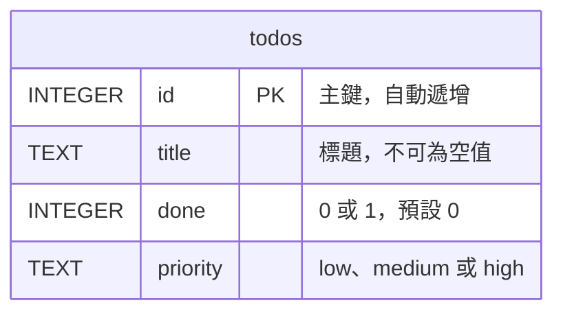
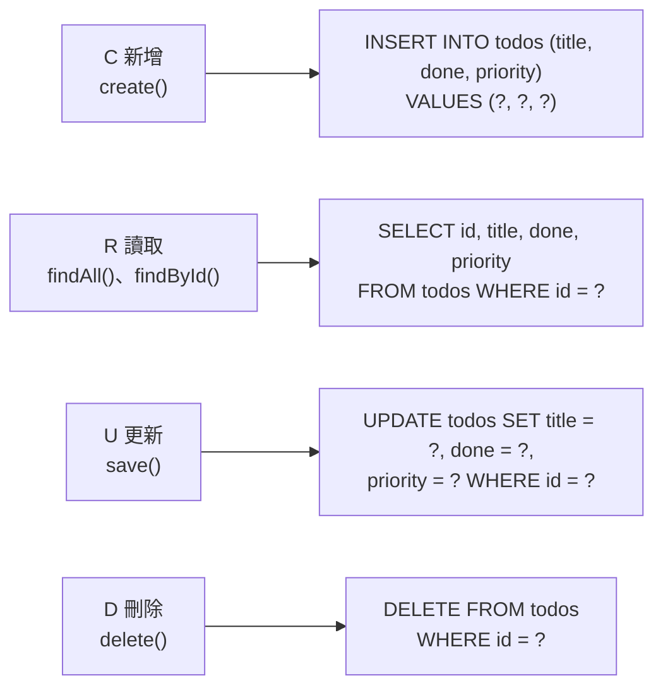
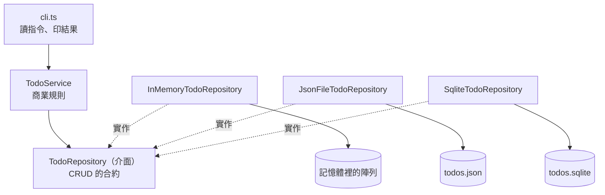
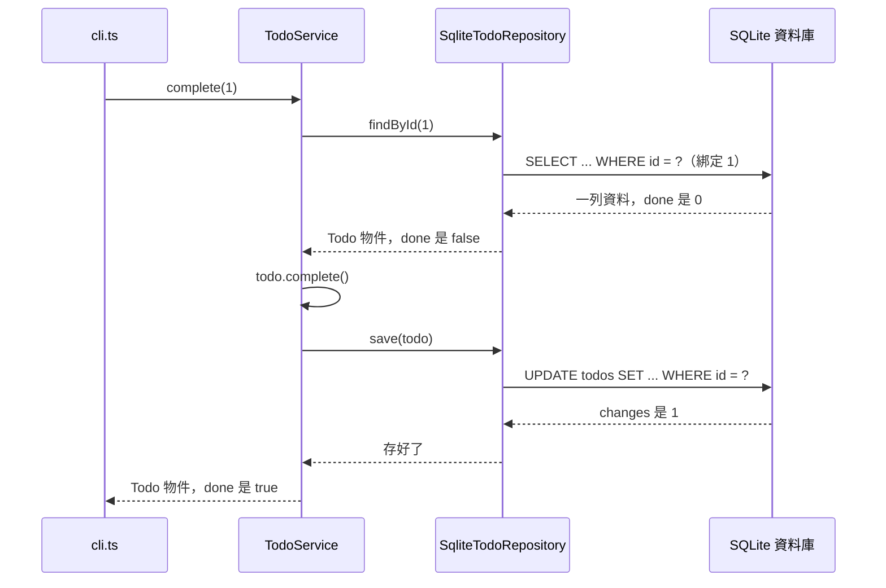

# Day 12 — CRUD（二）：SQL 與資料庫

> 第 2 週｜資料持久化｜必修約 60 分鐘，加練可到 3 小時

## 學習目標

完成今天的課程後，你能夠：

- 說出資料表、列、欄各是什麼，並讀懂一段 `CREATE TABLE`。
- 用 `INSERT`、`SELECT`、`UPDATE`、`DELETE` 做出 CRUD，並用 `WHERE` 指定要處理哪幾列。
- 用參數綁定把值交給 SQL，並說出把值拼進 SQL 字串為什麼危險。
- 把資料庫回傳的列轉成程式裡的物件。
- 寫出 `SqliteTodoRepository`，並確認 `TodoService` 一行都沒有改。

## 時間分配

| 區塊 | 內容                      | 時間        |
| ---- | ------------------------- | ----------- |
| 必修 | 觀念說明＋圖解            | 20 分鐘     |
| 必修 | 逐步解說（步驟 1–6）      | 20 分鐘     |
| 必修 | 練習 01、02               | 20 分鐘     |
| 加練 | 步驟 7、練習 03、延伸挑戰 | 30–120 分鐘 |

## 今天的 Todo 進度

昨天的 Todo App 把資料存進 JSON 檔，但每做一個動作都要把整份檔案讀出來、再整份寫回去。今天新增第三個實作 `SqliteTodoRepository`，把資料存進 SQLite 資料庫的 `todos` 資料表，CRUD 的每個動作各對應一句 SQL。`TodoService` 和昨天的檔案一模一樣，CLI 只改了建立 Repository 的那幾行。

## 觀念說明

### 1. 資料庫、資料表、列、欄

資料庫（database）是專門負責存放與查詢資料的程式。資料放在資料表（table）裡，資料表長得像一張試算表：

```text
資料表 todos

  id │ title  │ done │ priority     ← 欄（column）：每一欄有名稱與型別
 ────┼────────┼──────┼──────────
   1 │ 買牛奶 │    1 │ high         ← 列（row）：一列就是一筆待辦事項
   2 │ 寫作業 │    0 │ medium
   3 │ 倒垃圾 │    0 │ low
```

對照你已經會的東西：資料表像 `TodoData[]`，一列像陣列裡的一個物件，一欄像物件的一個屬性。

和 JSON 檔相比，資料庫多做了三件事：只讀寫用得到的那幾列；每一欄的型別與規則由資料庫把關；篩選與排序交給資料庫做。今天用的 SQLite 把整個資料庫存成一個檔案，不需要另外安裝，Bun 內建 `bun:sqlite` 模組可以直接使用。

### 2. `CREATE TABLE`：定義資料表

和資料庫溝通的語言叫 SQL。第一句要學的 SQL 是建立資料表：

```text
CREATE TABLE IF NOT EXISTS todos (
│            │             └─ 資料表的名稱
│            └─ 已經存在就什麼都不做，所以程式每次啟動都可以執行這一句
└─ 建立資料表

  id INTEGER PRIMARY KEY AUTOINCREMENT,
  │  │       │           └─ 新增時自動給下一個號碼，用過的號碼不會再用
  │  │       └─ 主鍵（primary key）：每一列的值都不同，用來指出「是哪一列」
  │  └─ 型別：整數
  └─ 欄的名稱

  title TEXT NOT NULL,                ← 文字。NOT NULL 表示一定要有值
  done INTEGER NOT NULL DEFAULT 0,    ← SQLite 沒有 boolean，用 0 和 1。沒給值就是 0
  priority TEXT NOT NULL
)
```

下圖用另一種方式呈現同一張資料表有哪些欄：



重點：

- 每一欄有名稱、型別與規則。違反規則的資料會被資料庫拒絕。
- `id` 由資料庫產生。昨天 `nextId` 做的事，今天交給 `AUTOINCREMENT`。
- 資料庫只知道 `priority` 是文字，不知道它只能是三個字之一。這件事要由程式檢查（第 6 節）。

### 3. 四個 SQL 動詞與 `WHERE`

CRUD 的四個動作各對應一個 SQL 動詞。下圖是 `TodoRepository` 的方法與 SQL 的對應：



重點：

- 四個動詞：`INSERT` 新增列、`SELECT` 讀取列、`UPDATE` 修改列、`DELETE` 刪除列。
- `?` 是佔位符號（placeholder），執行時才把值放進去（第 5 節）。

`WHERE` 是條件，用來指定要處理哪幾列：

```text
UPDATE todos SET done = ? WHERE id = ?
│      │     │            └─ 條件：只處理符合條件的列
│      │     └─ 要改哪些欄、改成什麼
│      └─ 哪一張資料表
└─ 動詞
```

- SQL 的「相等」是一個 `=`。條件可以用 `AND`、`OR` 組合，也可以用 `>=`、`<` 比較大小。
- 沒有任何一列符合條件不算錯誤：`SELECT` 得到空的結果，`UPDATE` 與 `DELETE` 處理了 0 列。
- `UPDATE` 與 `DELETE` 沒有寫 `WHERE` 時，會處理資料表裡的**每一列**。
- `SELECT` 最後加上 `ORDER BY id`，結果會依 `id` 排序。

### 4. 在 Bun 裡使用 SQLite

| 寫法                       | 做什麼                                        | 得到什麼                            |
| -------------------------- | --------------------------------------------- | ----------------------------------- |
| `new Database(":memory:")` | 開啟只存在記憶體的資料庫，程式結束就消失      | `Database` 物件                     |
| `new Database(path)`       | 開啟資料庫檔案，檔案不存在就建立              | `Database` 物件                     |
| `db.run(sql)`              | 直接執行不需要帶值的 SQL，例如 `CREATE TABLE` | —                                   |
| `db.query(sql)`            | 準備好一句 SQL，這一步還沒有執行              | 可以重複執行的陳述式（statement）   |
| `.run(值, ...)`            | 執行 `INSERT`、`UPDATE`、`DELETE`             | `{ changes, lastInsertRowid }`      |
| `.get(值, ...)`            | 執行 `SELECT`，只取第一列                     | 一列的物件，沒有符合的列時是 `null` |
| `.all(值, ...)`            | 執行 `SELECT`，取出每一列                     | 物件陣列，沒有符合的列時是空陣列    |
| `db.close()`               | 關閉資料庫                                    | —                                   |

`changes` 是這句 SQL 處理了幾列，`lastInsertRowid` 是剛新增那一列的 `id`。`bun:sqlite` 的 API 是同步的，呼叫時不用 `await`。

讀取資料時要告訴 TypeScript 一列長什麼樣子：

```ts
type TodoRow = { id: number; title: string; done: number; priority: string };

const row = db
  .query<TodoRow, [number]>(
    "SELECT id, title, done, priority FROM todos WHERE id = ?",
  )
  .get(1);
```

角括號裡第一格是「一列的型別」，第二格是「依序要帶入哪些型別的值」，不需要帶值時寫 `[]`。角括號是泛型的寫法，先照抄，Day 14 會解釋。

### 5. 參數綁定與 SQL injection

SQL 需要用到變數的值時，最直覺的寫法是用樣板字串把值拼進去。**這是危險的寫法，不要這樣寫**：

```ts
// DANGEROUS: never build SQL out of values like this.
const sql = `SELECT id, title FROM todos WHERE title = '${userInput}'`;
```

`userInput` 是 `買牛奶` 時一切正常。但使用者可以輸入任何文字，如果他輸入 `' OR '1'='1`，拼出來的 SQL 結尾會變成 `WHERE title = '' OR '1'='1'`。條件永遠成立，整張資料表的資料都被讀走。換一段輸入，甚至可以刪掉整張資料表。這種攻擊叫 SQL injection（SQL 注入）：使用者輸入的文字被當成 SQL 的一部分來執行。

正確的做法是參數綁定（parameter binding）：SQL 文字裡只寫 `?`，值另外交給資料庫。

```text
db.query("SELECT id, title FROM todos WHERE title = ?").all(userInput)
          │                                         │        │
          │                                         │        └─ 值：另外交給資料庫，永遠只被當成資料
          │                                         └─ 佔位符號：之後會放進一個值
          └─ SQL 文字：固定不變，裡面沒有任何使用者輸入
```

有好幾個 `?` 時，值依照順序對應：第一個值給第一個 `?`。用了參數綁定，不管值裡面有引號還是 SQL 關鍵字，它都只是一段文字。

### 6. 把列轉成物件

資料庫回傳的列還不是 `Todo`，有兩個欄位需要轉換：

| 欄         | 資料庫裡的值 | 程式裡的型別 | 讀出來時                 | 寫進去時            |
| ---------- | ------------ | ------------ | ------------------------ | ------------------- |
| `id`       | 整數         | `number`     | 直接使用                 | 由資料庫產生        |
| `title`    | 文字         | `string`     | 直接使用                 | 直接使用            |
| `done`     | `0` 或 `1`   | `boolean`    | `row.done === 1`         | `todo.done ? 1 : 0` |
| `priority` | 任何文字     | `Priority`   | 用 `isPriority` 型別守衛 | 直接使用            |

這和昨天的 `isTodoData` 是同一個道理：資料庫也在程式的外面，讀進來的資料要先檢查。轉換集中寫在 `rowToTodo` 這一個函式裡，步驟 4 會逐行看它。

### 7. 三個可以互換的 Repository

下圖是今天的分層架構。和昨天相比，只多了 `SqliteTodoRepository` 與它的資料庫檔案：



重點：

- 相依方向由上往下。`TodoService` 只認識介面，所以下面換成哪一個實作，它都不用改。
- SQL 只出現在 `SqliteTodoRepository` 裡。CLI 與 `TodoService` 完全不知道有資料庫。

下圖是在 CLI 輸入 `done 1` 之後，各層依序做的事：



重點：

- 規則（把待辦事項標成完成）在 `TodoService` 與 `Todo` 裡，SQL 只負責讀與寫。
- 列與物件的轉換發生在 Repository 的邊界：往上交出去的是 `Todo`，往下送的是 SQL 與值。

## 逐步解說

以下每一步對應 `examples/` 裡的檔案。請在專案根目錄執行指令。

### 步驟 1：建立資料表、新增與讀取

檔案：[`examples/01-table-and-rows.ts`](examples/01-table-and-rows.ts)

```bash
bun run day-12-crud-sql/examples/01-table-and-rows.ts
```

1. `new Database(":memory:")` 開啟一個只存在記憶體的資料庫，適合做實驗。
2. `db.run(...)` 執行 `CREATE TABLE`。剛建好的資料表有欄、沒有列，所以印出「目前有 0 列」。
3. `db.query("INSERT ...")` 準備好一句 SQL，`insert.run("買牛奶", "high")` 才真的執行。SQL 裡沒有寫 `id` 與 `done`，這兩欄由資料庫自己填，`result.lastInsertRowid` 就是新那一列的 `id`。
4. `selectAll.all()` 回傳物件陣列，每個物件是一列，每個屬性是一欄。
5. 最後故意新增一列沒有 `title` 的資料，資料庫回報 `NOT NULL constraint failed: todos.title` 並拒絕它。

### 步驟 2：四個動詞與 `WHERE`

檔案：[`examples/02-sql-crud.ts`](examples/02-sql-crud.ts)

```bash
bun run day-12-crud-sql/examples/02-sql-crud.ts
```

1. C：三次 `INSERT` 之後，資料表有三列。
2. R：`WHERE priority = ?` 加上 `.all("high")` 只取出兩列。`.get(2)` 取出一列，`.get(99)` 得到 `null`。
3. U：`UPDATE ... WHERE id = ?` 帶入 `(1, 2)`，把 `id` 是 2 的那一列的 `done` 改成 1，`changes` 是 1。
4. 對不存在的 `id` 99 執行同一句 `UPDATE`，不會出錯，`changes` 是 0。
5. D：`DELETE ... WHERE id = ?` 刪掉 `id` 3。之後再新增一列，`id` 是 4：`AUTOINCREMENT` 不會重複使用號碼。

### 步驟 3：參數綁定

檔案：[`examples/03-parameter-binding.ts`](examples/03-parameter-binding.ts)

```bash
bun run day-12-crud-sql/examples/03-parameter-binding.ts
```

1. 標題 `It's Friday` 裡有單引號，用參數綁定不需要做任何處理。
2. 標題 `'); DROP TABLE todos; --` 看起來像 SQL，但它只被存成一段文字。資料表還在，共有 4 列。
3. 用 `' OR '1'='1` 當搜尋條件，找到 0 列。它只是一個沒有人用過的標題，不會讓條件永遠成立。
4. `update.run("medium", 1)` 示範順序：第一個值給第一個 `?`，第二個值給第二個 `?`。

### 步驟 4：列與物件互相轉換

檔案：[`examples/04-row-mapping.ts`](examples/04-row-mapping.ts)

```bash
bun run day-12-crud-sql/examples/04-row-mapping.ts
```

1. 讀出來：列裡的 `done` 是 `number`，經過 `rowToTodo` 之後，`Todo` 的 `done` 是 `boolean`。
2. 寫進去：`todo.done ? 1 : 0` 把 `boolean` 轉回 `1` 或 `0`，再交給 `UPDATE`。
3. 最後直接用 SQL 新增一列 `priority` 是 `urgent` 的資料。資料庫照收，因為它只知道這一欄是文字。
4. `rowToTodo` 裡的 `isPriority` 擋下這一列，丟出「資料庫裡有不認識的優先度：urgent」。

### 步驟 5：資料庫檔案

檔案：[`examples/05-file-database.ts`](examples/05-file-database.ts)

```bash
bun run day-12-crud-sql/examples/05-file-database.ts
```

1. SQLite 會建立資料庫檔案，但不會建立資料夾，所以先用 `node:fs/promises` 的 `mkdir(dataFolder, { recursive: true })` 建立 `.data/`。
2. 第一次開啟：建立資料表、新增一列、`close()` 關閉。
3. 第二次開啟同一個檔案：那一列還在。`CREATE TABLE IF NOT EXISTS` 因為資料表已經存在，什麼都沒做。
4. 兩個 `:memory:` 資料庫互不相干，各自從空的開始，所以測試都用 `:memory:`。範例最後把資料庫檔案刪除，不留下任何東西。

### 步驟 6：第三個 Repository，Service 一行都沒改

先讀 [`examples/todo/sqlite-todo-repository.ts`](examples/todo/sqlite-todo-repository.ts)：

1. 建構子接收一個 `Database`，並執行 `CREATE TABLE IF NOT EXISTS`。開哪一個資料庫由外面決定，所以同一個類別可以用檔案，也可以用 `:memory:`。
2. 五個方法各是一句 SQL，對應第 3 節的圖。
3. `create` 先建立一個 `Todo`，讓 `Todo` 類別檢查標題，通過了才 `INSERT`，所以不合規則的標題不會變成資料表裡的一列。這時資料庫還沒有給 `id`，先用 0 代替。
4. `findById` 把 `get()` 回傳的 `null` 轉成合約規定的 `undefined`。
5. `bun:sqlite` 是同步的，但合約規定回傳 Promise，所以每個方法仍然是 `async`。

接著確認 `TodoService` 真的沒有改。下面的指令比較昨天與今天的檔案，沒有印出任何東西就代表兩個檔案完全相同：

```bash
diff day-11-async-file-persistence/examples/todo/todo-service.ts day-12-crud-sql/examples/todo/todo-service.ts
```

最後執行示範：

檔案：[`examples/06-swap-repository.ts`](examples/06-swap-repository.ts)

```bash
bun run day-12-crud-sql/examples/06-swap-repository.ts
```

1. `runDemo` 就是昨天那個函式，參數型別是 `TodoRepository` 介面。
2. 同一個 `runDemo` 跑了三次，分別交給三個實作，三次都印出 `[x] #1 買牛奶（優先度：高）` 與 `[ ] #2 寫作業（優先度：中）`。
3. 最後直接用 SQL 讀出資料表。程式裡的 `[x] #1 買牛奶（優先度：高）`，在資料表裡是 `1 | 買牛奶 | 1 | high` 這一列：`done` 存成 `1`，`priority` 存成文字。

### 步驟 7：互動式 CLI 與主線測試（加練）

檔案：[`examples/todo/cli.ts`](examples/todo/cli.ts)

```bash
bun run day-12-crud-sql/examples/todo/cli.ts
```

1. 和昨天的 `cli.ts` 相比，不同的只有 `import` 與 `main()` 裡的接線：開啟 `.data/todos.sqlite`、交給 `SqliteTodoRepository`、結束前 `database.close()`。處理指令的程式完全沒變。
2. 輸入 `add 買牛奶`、`list`、`quit`。再執行一次並輸入 `list`：`[ ] #1 買牛奶（優先度：中）` 還在。
3. 執行主線的測試。[`todo-repository.test.ts`](examples/todo/todo-repository.test.ts) 現在用同一組測試檢查三個實作，SQLite 版用的是 `:memory:`：

   ```bash
   bun test day-12-crud-sql/examples
   ```

## 規範重點

- **一律用參數綁定**。SQL 字串裡不可以出現 `${...}`，值只能透過 `?` 交給資料庫。
- **SQL 關鍵字大寫，資料表與欄的名稱小寫**。一眼就能分出哪些是語法、哪些是名稱。
- **`SELECT` 寫出需要的欄名，不寫 `SELECT *`**。讀程式的人看得到拿了哪些欄，資料表之後多了欄也不會影響這段程式。
- **`UPDATE` 與 `DELETE` 一定要有 `WHERE`**，除非你真的要處理每一列。
- **列與物件用兩個型別**（`TodoRow` 與 `Todo`），轉換集中在 `rowToTodo` 一個函式裡。
- **SQL 只寫在 Repository 裡**。`TodoService` 與 CLI 不知道資料存在哪裡，這是它們不用改的原因。
- **測試用 `:memory:`，資料庫檔案放在該課的 `.data/`**。

## 常見錯誤

| 錯誤訊息或現象                                                                                      | 原因                                                        | 修法                                              |
| --------------------------------------------------------------------------------------------------- | ----------------------------------------------------------- | ------------------------------------------------- |
| `SQLiteError: no such table: todos`                                                                 | 還沒建立資料表。每個 `:memory:` 資料庫都是全新的            | 先執行 `CREATE TABLE IF NOT EXISTS`               |
| `SQLiteError: near "todos": syntax error`                                                           | SQL 打錯字，例如把 `FROM` 打成 `FORM`。訊息指出出錯位置的字 | 檢查訊息裡那個字與它前面的 SQL                    |
| `Error: SQLite query expected 2 values, received 1`                                                 | `?` 的數量和傳入的值的數量不同                              | 一個 `?` 對一個值，順序要相同                     |
| `SQLiteError: NOT NULL constraint failed: todos.title`                                              | 新增時沒有給 `NOT NULL` 的欄位一個值                        | 在 `INSERT` 裡補上那一欄                          |
| `SQLiteError: unable to open database file`                                                         | 資料庫檔案所在的資料夾不存在                                | 先用 `mkdir(..., { recursive: true })` 建立資料夾 |
| `TS2345: Argument of type 'string' is not assignable to parameter of type 'Priority \| undefined'.` | 把資料庫讀出來的 `priority` 直接當成 `Priority`             | 先用 `isPriority` 檢查                            |
| `TS18046: 'row' is of type 'unknown'.`                                                              | `db.query(...)` 沒有寫出一列的型別                          | 寫成 `db.query<TodoRow, [number]>(...)`           |
| 整張資料表的資料都被改掉或刪光                                                                      | `UPDATE` 或 `DELETE` 忘了寫 `WHERE`                         | 加上 `WHERE id = ?`                               |

## 練習

練習檔在 `exercises/`。每個檔案裡標著 `TODO` 的地方就是你要改的地方。

```bash
# 檢查你的答案：全部顯示 pass 就完成了
bun test day-12
```

`bun test day-12` 也會一起執行 `examples/todo/` 裡的主線測試，那些測試本來就會通過。

| 練習                                                 | 內容                                          | 類型 |
| ---------------------------------------------------- | --------------------------------------------- | ---- |
| [`01-sql-crud.ts`](exercises/01-sql-crud.ts)         | `CREATE TABLE`、四個 SQL 動詞、參數綁定       | 必修 |
| [`02-row-mapping.ts`](exercises/02-row-mapping.ts)   | 把列轉成物件：`0`／`1` 轉 `boolean`、型別守衛 | 必修 |
| [`03-todo-queries.ts`](exercises/03-todo-queries.ts) | 替 Todo App 的 `todos` 資料表寫三個新查詢     | 加練 |

卡住超過 15 分鐘再看 `solutions/` 裡的參考解答。看完後把解答關掉，自己重寫一次。

### 延伸挑戰（加練）

1. 用今天的 CLI 新增三筆、輸入 `rm 3`、再新增一筆，觀察新的 `id`。對照昨天延伸挑戰的結果，說出 `AUTOINCREMENT` 解決了什麼問題。
2. 在 `examples/` 新增一個自己的檔案：建立一張 `notes` 資料表（`id`、`text`），用參數綁定完成四個動詞，全部用 `:memory:`。
3. 讀 [`examples/todo/sqlite-todo-repository.test.ts`](examples/todo/sqlite-todo-repository.test.ts)，找出哪一個測試在檢查 SQL injection，並說明如果 `create` 是用樣板字串拼 SQL，這個測試會怎麼失敗。
4. 如果你的電腦有 `sqlite3` 指令，執行 `sqlite3 day-12-crud-sql/.data/todos.sqlite "SELECT id, title, done, priority FROM todos"`，直接看 CLI 存進資料庫的內容。

## 自我檢查清單

- [ ] 我能指出一張資料表的列與欄，並說出主鍵的用途。
- [ ] 我能讀懂 `todos` 的 `CREATE TABLE`，說出每一欄的型別與規則。
- [ ] 我能寫出 `INSERT`、`SELECT`、`UPDATE`、`DELETE` 各一句，並說出它們對應 CRUD 的哪個字母。
- [ ] 我能說出 `UPDATE` 或 `DELETE` 少了 `WHERE` 會發生什麼事。
- [ ] 我能解釋 SQL injection 是什麼，以及參數綁定為什麼能擋住它。
- [ ] 我能說出 `done` 與 `priority` 從資料庫讀出來之後各要做什麼轉換。
- [ ] 我能解釋為什麼換成 SQLite 之後 `TodoService` 一行都不用改。
- [ ] `bun test day-12` 全部通過。

## 下一課

[Day 13 — CRUD（三）：HTTP API](../day-13-crud-http-api/README.md)：今天換掉的是最下面的儲存位置。明天換最上面那一層，把 CLI 換成 HTTP API，讓其他程式也能透過網路對同一個 `TodoService` 做 CRUD。
