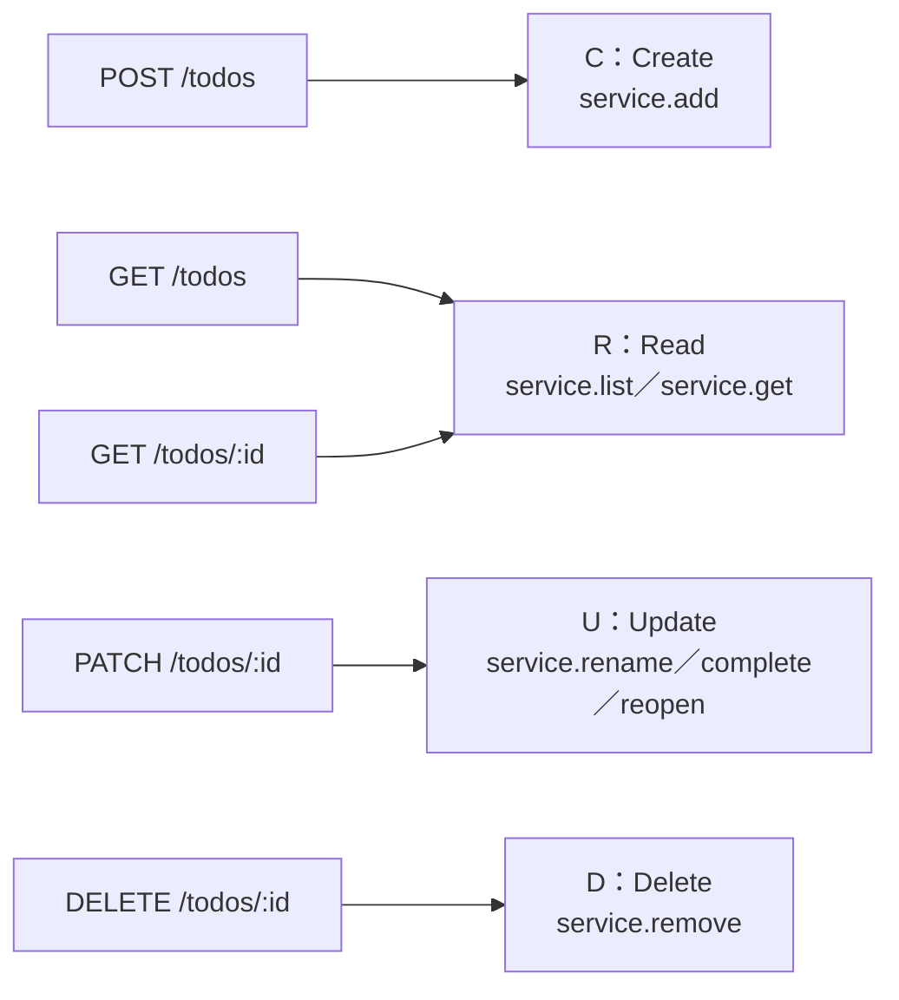
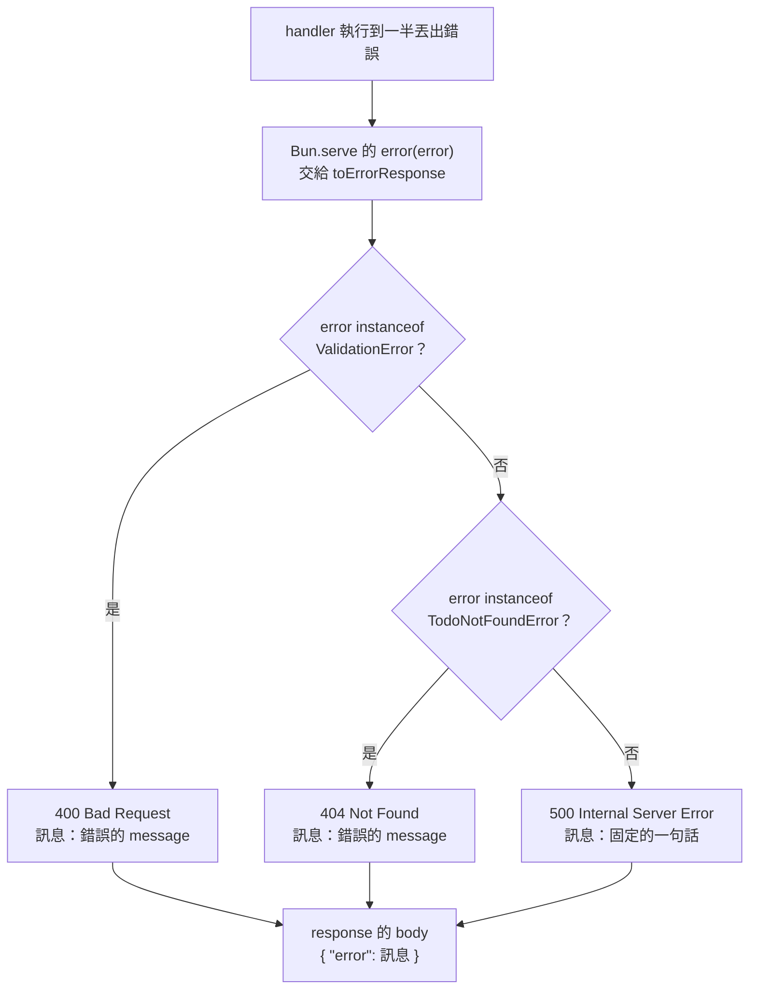
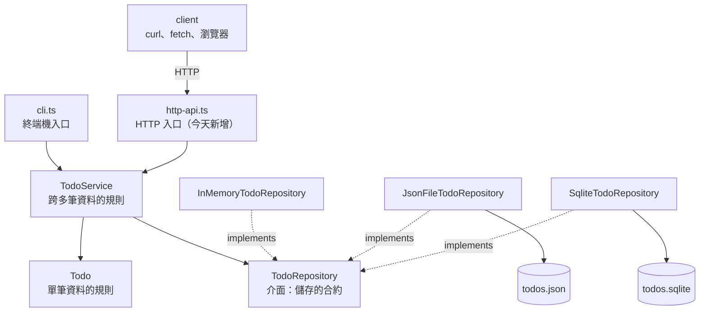
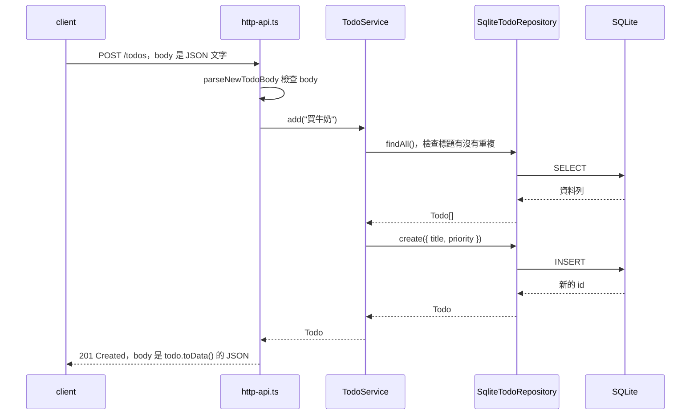

# Day 13 — CRUD（三）：HTTP API

> 第 2 週｜HTTP API｜必修約 60 分鐘，加練可到 3 小時

## 學習目標

完成今天的課程後，你能夠：

- 說出 client 與 server 各自做什麼，以及一個 request 和一個 response 由哪些部分組成。
- 把 HTTP 方法與 REST 網址對應到 CRUD，並選出正確的狀態碼。
- 用 `Bun.serve` 的 `routes` 寫出回應 JSON 的 HTTP API。
- 把型別是 `unknown` 的 request body 檢查過再使用，並把錯誤對應到狀態碼。
- 用 `fetch` 搭配 `port: 0` 測試 API，用 `curl` 手動操作 API。

## 時間分配

| 區塊 | 內容                      | 時間        |
| ---- | ------------------------- | ----------- |
| 必修 | 觀念說明＋圖解            | 20 分鐘     |
| 必修 | 逐步解說（步驟 1–5）      | 20 分鐘     |
| 必修 | 練習 01、02               | 20 分鐘     |
| 加練 | 步驟 6、練習 03、延伸挑戰 | 30–120 分鐘 |

## 今天的 Todo 進度

昨天的 Todo App 是 CLI → `TodoService` → `TodoRepository` → SQLite，只有坐在這台電腦的終端機前才能操作。今天新增 `http-api.ts`，把同一個 `TodoService` 接上 HTTP，任何會講 HTTP 的程式（`curl`、瀏覽器、手機 App）都能對待辦事項做 CRUD。`Todo` 與三個 Repository 一行都不用改；`TodoService` 只多了 `get` 與 `reopen` 兩個方法，因為 API 需要「讀取一筆」與「改回未完成」，這兩件事 CLI 從來沒用到。

## 觀念說明

### 1. client 與 server

HTTP 是兩支程式之間「一問一答」的規則。發問的一方叫用戶端（client），回答的一方叫伺服器（server）。client 送出一個請求（request），server 回一個回應（response），一問配一答。

- server 啟動後一直開著，等別人來問。它不會主動找 client。
- client 用網址（URL）指出要問誰、問什麼：

```text
http://localhost:3000/todos?filter=open
  │        │       │     │        │
  │        │       │     │        └─ query string：附加的條件，? 後面
  │        │       │     └─ 路徑（path）：要操作哪一個資源
  │        │       └─ port：那台電腦上的哪一支程式
  │        └─ 主機（host）：哪一台電腦。localhost 是「我自己這台」
  └─ 協定（protocol）：用 HTTP 的規則溝通
```

### 2. request 與 response 的結構

request 與 response 都是有固定格式的文字。下面是「新增一筆待辦事項」的一問一答：

```text
request（client → server）
POST /todos HTTP/1.1                  ← 方法（method）＋路徑：要做什麼、對誰做
Content-Type: application/json        ← 標頭（header）：補充說明，這裡是「body 是 JSON」
                                      ← 空一行，標頭結束
{ "title": "買牛奶" }                  ← 內容（body）：要送過去的資料，GET 與 DELETE 通常沒有

response（server → client）
HTTP/1.1 201 Created                  ← 狀態碼（status code）：結果如何
Content-Type: application/json        ← 標頭
                                      ← 空一行
{ "id": 1, "title": "買牛奶", "done": false, "priority": "medium" }   ← body
```

body 用的格式是 Day 11 學過的 JSON。物件不能直接放進網路，要先用 `JSON.stringify` 轉成文字，對方收到後再轉回值。

### 3. HTTP 方法、REST 與 CRUD

REST 是一種設計 API 的慣例：**網址是名詞，方法是動詞**。網址指出資源（resource），`/todos` 是「所有待辦事項」，`/todos/2` 是「id 為 2 的那一筆」。要做什麼動作由 HTTP 方法決定，網址裡不放動詞（不寫 `/createTodo`）。

下圖是今天五個端點（endpoint，一組方法＋路徑）與 CRUD 的對應：



重點：

- 同一個路徑搭配不同方法，就是不同的動作：`GET /todos/2` 是讀取，`DELETE /todos/2` 是刪除。
- `:id` 是路由參數（route parameter），代表「這個位置可以是任何文字」。
- CRUD 你已經用三種方式寫過，今天是第四種說法：

| CRUD | Day 05 的函式  | Day 09 的 Repository  | Day 12 的 SQL | 今天的 HTTP                    |
| ---- | -------------- | --------------------- | ------------- | ------------------------------ |
| C    | `createTodo`   | `create`              | `INSERT`      | `POST /todos`                  |
| R    | `findTodoById` | `findAll`、`findById` | `SELECT`      | `GET /todos`、`GET /todos/:id` |
| U    | `updateTodo`   | `save`                | `UPDATE`      | `PATCH /todos/:id`             |
| D    | `deleteTodo`   | `delete`              | `DELETE`      | `DELETE /todos/:id`            |

### 4. 狀態碼

狀態碼是三位數字，client 不必讀 body 就知道結果。先看第一位數字：`2` 是成功，`4` 是 client 的問題，`5` 是 server 的問題。

| 狀態碼 | 名稱                  | 什麼時候用                                |
| ------ | --------------------- | ----------------------------------------- |
| 200    | OK                    | 成功，body 裡有資料                       |
| 201    | Created               | 成功，而且新增了一筆資料                  |
| 204    | No Content            | 成功，沒有東西要回傳（例如刪除）          |
| 400    | Bad Request           | request 的資料不合規則，client 改了才能過 |
| 404    | Not Found             | 沒有這個路徑，或沒有這個 `id` 的資料      |
| 500    | Internal Server Error | server 自己出錯，client 沒做錯事          |

### 5. `Bun.serve` 與 `routes`

`Bun.serve` 啟動一個 HTTP server。`routes` 是一個物件：路徑對應到方法，方法對應到處理函式（handler）。handler 收到 request，回傳一個 `Response`。

```text
Bun.serve({
  port: 3000,                        ← 在哪個 port 等待。0 代表「挑一個沒人用的」
  routes: {
    "/todos/:id": {                  ← 路徑。:id 的實際內容在 request.params.id
      GET: async (request) => {      ← 方法 → handler
        return Response.json(data);  ← 回傳 Response，沒指定狀態碼就是 200
      },
    },
  },
  fetch() { ... },                   ← 沒有任何路徑或方法符合時執行
  error(error) { ... },              ← handler 丟出錯誤時執行
});
```

handler 裡常用的工具：

| 寫法                                               | 做什麼                                   |
| -------------------------------------------------- | ---------------------------------------- |
| `Response.json(value, { status: 201 })`            | 把值轉成 JSON 文字當 body，並指定狀態碼  |
| `new Response(null, { status: 204 })`              | 沒有 body 的 response                    |
| `await request.json()`                             | 讀出 body 並解析成值，結果當作 `unknown` |
| `request.params.id`                                | 路由參數，型別永遠是 `string`            |
| `new URL(request.url).searchParams.get("filter")`  | query string 的值，沒有帶就是 `null`     |
| `server.url`、`server.port`、`await server.stop()` | server 的網址、實際的 port、關閉 server  |

`Bun.serve` 的回傳型別寫成 `Bun.Server<undefined>`。角括號的部分先照抄，Day 14 會解釋。

### 6. request body 是 `unknown`：先檢查再使用

TypeScript 只檢查你寫的程式，管不到別人送來的 request。client 可能少給欄位、給錯型別，甚至送來的根本不是 JSON。所以 body 的型別是 `unknown`，要像 Day 11 檢查檔案內容那樣，一個問題一個問題確認：

```ts
export function parseNewTodoBody(body: unknown): NewTodoBody {
  // 1. Is it an object at all?
  if (typeof body !== "object" || body === null) {
    throw new ValidationError("request body 必須是 JSON 物件");
  }
  // 2. Does it have a title, and is the title text?
  if (!("title" in body) || typeof body.title !== "string") {
    throw new ValidationError("title 必須是文字");
  }
  // 3. (not shown) priority is optional, but must be a Priority when present.
  return { title: body.title, priority };
}
```

這個函式只有兩種結局：回傳型別正確的資料，或丟出 `ValidationError`。通過這一關，後面的程式就不必再懷疑資料的形狀。網址裡的 `:id` 與 `?filter=` 也是外部輸入，而且一定是文字，分別交給 `parseId` 與 `parseFilter` 檢查並轉換。

### 7. 把錯誤對應到狀態碼

Day 10 把錯誤分成 `ValidationError` 與 `TodoNotFoundError` 兩個類別，今天這個分類直接對應到狀態碼。下圖是 handler 丟出錯誤之後的流程：



重點：

- 「哪種錯誤變成哪個狀態碼」只寫在 `toErrorResponse` 一個地方，handler 裡不需要 `try`／`catch`。
- 錯誤不管是哪一層丟的（body 檢查、`Todo`、`TodoService`），都走同一條路。
- 沒預料到的錯誤一律回 500，細節用 `console.error` 留在 server 這邊，不回傳給 client。
- 錯誤的 response 格式固定是 `{ "error": string }`，client 只要學一種讀法。

### 8. 加上 HTTP 層的分層架構

下圖是今天完成後的架構。箭頭是「誰使用誰」，只會由上往下：



重點：

- `cli.ts` 與 `http-api.ts` 是同一個 `TodoService` 的兩個入口。規則只寫一次，兩個入口都遵守。
- HTTP 層只做翻譯：request → 呼叫 Service → response。它不知道資料存在哪裡。
- 新增入口不必動下面任何一層，這是 Day 10 分層的回報。

下圖是一個 `POST /todos` 從進來到回去，依序經過哪些層：



重點：

- 實線是呼叫，虛線是回傳。每一層只跟相鄰的一層說話。
- 進來時資料一路從 JSON 文字變成 `unknown`、通過檢查的物件、`Todo` 實例；出去時用 `toData()` 變回純資料，再轉成 JSON 文字。

> ▶ 動畫演示：[`POST /todos` 一路到 SQLite 再帶著 201 回來，`GET /todos/99` 怎麼變成 404](https://vincentlin0619.github.io/ts-engineer-bootcamp/day-13/#anim-day13-http-request)

### 9. 測試與手動操作：`fetch` 與 `curl`

`fetch` 是程式裡的 client。`await fetch(網址, { method, headers, body })` 送出 request，等到的是 response：`response.status` 是狀態碼，`await response.json()` 讀出 body（一樣先當 `unknown`）。

測試時用 `port: 0` 啟動 server，由系統挑一個空的 port，就不會和別的程式搶同一個 port。每個測試前啟動、測試後 `server.stop()`，不留下任何還在執行的 server。

`curl` 是終端機裡的 client，用來手動試 API：

| 選項            | 意思                       |
| --------------- | -------------------------- |
| `-X POST`       | 指定方法，不寫就是 `GET`   |
| `-H "名稱: 值"` | 加一個標頭                 |
| `-d '...'`      | request 的 body            |
| `-i`            | 連同狀態碼與標頭一起印出來 |

## 逐步解說

以下每一步對應 `examples/` 裡的一個檔案。請在專案根目錄執行指令。

### 步驟 1：第一個 server

檔案：[`examples/01-first-server.ts`](examples/01-first-server.ts)

```bash
bun run day-13-crud-http-api/examples/01-first-server.ts
```

1. `Bun.serve({ port: 0, routes: { ... } })` 啟動 server。`port: 0` 讓系統挑 port，所以每次印出的 port 都不一樣。
2. `"/hello": () => Response.json(...)` 是最短的 route：路徑直接對應一個 handler，任何方法都由它處理。
3. `await fetch(new URL("/hello", server.url))` 扮演 client 送出 `GET /hello`。同一支程式裡同時有 server 與 client，方便觀察。
4. 印出 response 的三個部分：狀態碼 `200`、標頭 `application/json;charset=utf-8`、body。
5. `/nothing` 沒有對應的 route，Bun 自動回 `404`。
6. `await server.stop()` 關閉 server。少了這一行，程式會一直開著等 request，不會結束。

### 步驟 2：request 的每個部分

檔案：[`examples/02-request-anatomy.ts`](examples/02-request-anatomy.ts)

```bash
bun run day-13-crud-http-api/examples/02-request-anatomy.ts
```

1. `"/notes/:id"` 底下有 `GET`、`PATCH`、`DELETE` 三個 handler，一個方法一個。
2. `GET` 把收到的東西原樣回報。注意輸出裡的 `"id":"7"` 有引號：路由參數是文字，不是數字。
3. 第一次沒帶 query string，`lang` 是 `null`；第二次帶了 `?lang=zh`，`lang` 是 `"zh"`。
4. `PATCH` 用 `await request.json()` 讀出 body，並回報 `Content-Type` 標頭。
5. `DELETE` 回 `204`，輸出顯示「（沒有 body）」。
6. 最後兩個 request 都得到 `404`：`POST /notes/7` 的路徑存在但沒有 `POST` 的 handler，`GET /notebooks` 連路徑都不存在。兩者都落到 `fetch()`。
7. `routes` 前後的 `biome-ignore-start`／`biome-ignore-end` 註解見「規範重點」。

### 步驟 3：檢查 `unknown` 的 body

檔案：[`examples/03-validate-body.ts`](examples/03-validate-body.ts)

```bash
bun run day-13-crud-http-api/examples/03-validate-body.ts
```

1. `const body: unknown = JSON.parse(...)`：解析出來的值先標成 `unknown`。
2. 下一行沒檢查就讀 `body.title`，靠 `// @ts-expect-error` 才通過檢查。把那行註解刪掉再執行 `bun check day-13-crud-http-api/examples/03-validate-body.ts`，會看到 `TS18046: 'body' is of type 'unknown'.`。看完記得加回去。
3. 接著三層 `if` 依序問三個問題：是不是物件、有沒有 `title`、`title` 是不是文字。走到最裡面，TypeScript 才允許呼叫 `body.title.toUpperCase()`。
4. 第二部分把七種 body 交給主線的 `parseNewTodoBody`。前兩個通過，後五個各自得到一則 `ValidationError`，訊息指出是哪一個問題沒過。

### 步驟 4：Todo API 的五個端點

檔案：[`examples/04-todo-api-demo.ts`](examples/04-todo-api-demo.ts)、主線 [`examples/todo/http-api.ts`](examples/todo/http-api.ts)

```bash
bun run day-13-crud-http-api/examples/04-todo-api-demo.ts
```

1. 前兩行是組裝：`new TodoService(new InMemoryTodoRepository())`，再交給 `startTodoApi(service, 0)`。
2. 「C：新增」兩個 `POST /todos` 都回 `201`，第二筆指定了 `priority`。
3. 「R：讀取」`GET /todos` 回陣列，`GET /todos/2` 回一筆。
4. 「U：修改」`PATCH` 的 body 只放要改的欄位。之後 `GET /todos?filter=open` 只剩還沒完成的那一筆。
5. 「D：刪除」`DELETE /todos/2` 回 `204`，再讀同一筆就得到 `404`。
6. 「錯誤的 request」有五種情況，丟出錯誤的地方各不相同：標題全是空白是 `Todo` 的標題規則（400），沒有 `title` 是 `parseNewTodoBody`（400），`done` 是 `"yes"` 是 `parseTodoChangesBody`（400），`/todos/abc` 是 `parseId`（400），`/todos/99` 是 `TodoService` 丟的 `TodoNotFoundError`（404）。
7. 打開 `http-api.ts` 看 `startTodoApi`：每個 handler 都只有三件事，檢查輸入、呼叫 `service`、回傳 `Response`。

### 步驟 5：啟動真的 server，用 `curl` 操作

檔案：[`examples/05-todo-server.ts`](examples/05-todo-server.ts)

這個範例和其他的不同：它**不會自己結束**，因為 server 的工作就是一直等 request。

1. 在終端機啟動 server。看到下面兩行就代表它在等了：

   ```bash
   bun run day-13-crud-http-api/examples/05-todo-server.ts
   ```

   ```text
   Todo API 已啟動：http://localhost:3000/todos
   按 Ctrl+C 關閉伺服器
   ```

2. **另外開一個終端機視窗**，在專案根目錄用 `curl` 當 client：

   ```bash
   # C: create
   curl -i -X POST http://localhost:3000/todos -H "Content-Type: application/json" -d '{"title":"買牛奶"}'
   # R: read
   curl http://localhost:3000/todos
   curl "http://localhost:3000/todos?filter=open"
   # U: update
   curl -X PATCH http://localhost:3000/todos/1 -H "Content-Type: application/json" -d '{"done":true}'
   # D: delete
   curl -i -X DELETE http://localhost:3000/todos/1
   # An id that does not exist
   curl -i http://localhost:3000/todos/99
   ```

   第一個指令加了 `-i`，會先印出 `HTTP/1.1 201 Created` 與標頭，空一行後才是 body，和「觀念說明 2」的圖一樣。

3. 回到第一個終端機，按 **Ctrl+C** 關閉 server。再執行一次 `curl http://localhost:3000/todos`，會得到 `curl: (7) Failed to connect`，因為沒有人在那個 port 等了。
4. 這個 server 用的是 `SqliteTodoRepository`，資料存在 `day-13-crud-http-api/.data/todos.sqlite`。重新啟動 server，資料還在。想從頭來就刪掉那個檔案。
5. `examples/todo/cli.ts` 開的是同一個資料庫檔案。用 `curl` 新增一筆之後執行下面的指令，會在 CLI 看到它，這就是「兩個入口、同一個 Service」：

   ```bash
   printf 'list\nquit\n' | bun run day-13-crud-http-api/examples/todo/cli.ts
   ```

### 步驟 6：用測試操作 API（加練）

檔案：[`examples/todo/http-api.test.ts`](examples/todo/http-api.test.ts)

```bash
bun test day-13-crud-http-api/examples/todo
```

1. `beforeEach` 與 `afterEach` 是 `bun:test` 提供的函式：每個測試開始前、結束後各執行一次。
2. `beforeEach` 用 `startTodoApi(service, 0)` 啟動全新的 server，搭配空的 `InMemoryTodoRepository`，測試之間互不影響。`afterEach` 呼叫 `server.stop(true)`，測完不留下任何 server。
3. 每個測試都是「用 `fetch` 送 request → 檢查狀態碼 → 檢查 body」，和你剛才用 `curl` 手動做的事一樣，差別是它會自動比對結果。

## 規範重點

- **外部輸入一律先當 `unknown`**：body、路由參數、query string 都要檢查過才使用。檢查寫成 `parseXxx` 函式，回傳有型別的資料，不合格就丟錯誤。不要用 `as` 假裝資料是對的。
- **HTTP 層只做翻譯，不寫規則**。「標題不能重複」屬於 `TodoService`，寫在 handler 裡的話，CLI 就不受這條規則約束了。
- **錯誤對應狀態碼只寫在一個地方**。新增一種錯誤時只要改 `toErrorResponse`。
- **狀態碼要誠實**。失敗就回 4xx 或 5xx，不要回 `200` 再把錯誤訊息塞進 body。
- **回傳純資料，不回傳類別實例**。`Todo` 的標題、完成狀態、優先度都在 `#` 私有欄位裡，直接轉成 JSON 只會剩下 `{"id":1}`，所以一律 `todo.toData()`。
- **規則的例外要寫明原因，範圍越小越好**。HTTP 方法名稱是大寫，和 Biome 的 camelCase 規則衝突，所以用 `// biome-ignore-start`／`// biome-ignore-end` 只包住 `routes`，冒號後面寫理由。
- **測試用 `port: 0`，測完一定 `stop()`**。寫死 port 的測試會在 port 被佔用時失敗。

## 常見錯誤

| 錯誤訊息或現象                                              | 原因                                               | 修法                                                      |
| ----------------------------------------------------------- | -------------------------------------------------- | --------------------------------------------------------- |
| `Failed to start server. Is port 3000 in use?`              | 上一個 server 還沒關，或別的程式佔用 3000          | 到原本的終端機按 Ctrl+C，或改掉範例裡的 `PORT`            |
| `curl: (7) Failed to connect to localhost port 3000`        | server 沒有啟動                                    | 先在另一個終端機啟動 server                               |
| `POST` 得到 400「request body 必須是合法的 JSON」           | `-d` 的內容不是合法 JSON，常見是屬性名稱沒加雙引號 | JSON 裡一律用雙引號，整段再用單引號包起來                 |
| `TS18046: 'body' is of type 'unknown'.`                     | 還沒檢查就使用 body                                | 先確認是物件、有屬性、型別正確                            |
| `TS2339: Property 'title' does not exist on type 'object'.` | 只確認了是物件，還沒用 `in` 確認有這個屬性         | 加上 `"title" in body`                                    |
| response 的 body 只有 `{"id":1}`                            | 把 `Todo` 實例直接交給 `Response.json`             | 改成 `Response.json(todo.toData())`                       |
| 程式執行完不會結束                                          | server 還開著                                      | 範例與測試的最後要 `await server.stop()`                  |
| Biome：`This object property name should be in camelCase.`  | `GET`、`POST` 這些屬性名稱是大寫                   | 用 `biome-ignore-start`／`biome-ignore-end` 包住 `routes` |

## 練習

練習檔在 `exercises/`。每個檔案裡標著 `TODO` 的地方就是你要改的地方。

```bash
# 檢查你的答案：全部顯示 pass 就完成了
bun test day-13
```

| 練習                                                       | 內容                                                 | 類型 |
| ---------------------------------------------------------- | ---------------------------------------------------- | ---- |
| [`01-http-vocabulary.ts`](exercises/01-http-vocabulary.ts) | 方法對應 CRUD、狀態碼分類、檢查 body、錯誤對應狀態碼 | 必修 |
| [`02-notes-api.ts`](exercises/02-notes-api.ts)             | 用 `Bun.serve` 寫一個筆記 API                        | 必修 |
| [`03-todo-client.ts`](exercises/03-todo-client.ts)         | 用 `fetch` 寫 Todo API 的 client 函式                | 加練 |

還沒作答時，`examples/todo/http-api.test.ts` 的主線測試會通過，三個練習的測試會失敗，這是正常的。卡住超過 15 分鐘再看 `solutions/` 裡的參考解答。看完後把解答關掉，自己重寫一次。

### 延伸挑戰（加練）

1. 幫 Todo API 加上修改優先度：讓 `PATCH /todos/:id` 接受 `"priority"`。你需要改 `parseTodoChangesBody`、在 `TodoService` 加一個方法，並在 `http-api.test.ts` 補上測試。
2. `PATCH /todos/1` 同時送 `title` 與 `done` 時，handler 會依序呼叫兩個 Service 方法。如果第二個失敗，第一個已經存進去了。想一想這個問題該在哪一層解決，再動手改。
3. 把 `04-todo-api-demo.ts` 的 `InMemoryTodoRepository` 換成 `JsonFileTodoRepository`（檔案放在 `.data/`），確認 HTTP 層一行都不用改。

## 自我檢查清單

- [ ] 我能說出 request 與 response 各有哪些部分。
- [ ] 我能把 `POST`、`GET`、`PATCH`、`DELETE` 對應到 CRUD，並寫出 Todo 的五個端點。
- [ ] 我能說出 200、201、204、400、404、500 各自在什麼時候用。
- [ ] 我能用 `Bun.serve` 的 `routes` 寫出一個回傳 JSON 的端點。
- [ ] 我能解釋為什麼 request body 是 `unknown`，並寫出檢查它的函式。
- [ ] 我能說出 `ValidationError` 與 `TodoNotFoundError` 各自變成哪個狀態碼，以及這件事寫在哪裡。
- [ ] 我能啟動 server、用 `curl` 做完一輪 CRUD，再用 Ctrl+C 關閉它。
- [ ] `bun test day-13` 全部通過。

## 下一課

[Day 14 — TypeScript 設計規範（二）＋總複習](../day-14-ts-conventions-2-capstone/README.md)：Todo App 的功能到今天全部完成。明天回頭整理型別，用泛型把 `TodoRepository` 變成可以重複使用的 `Repository`，並驗收兩週的成果。
