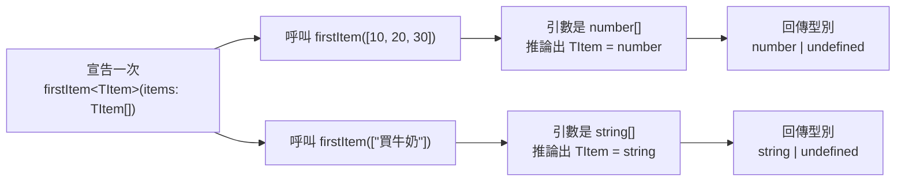
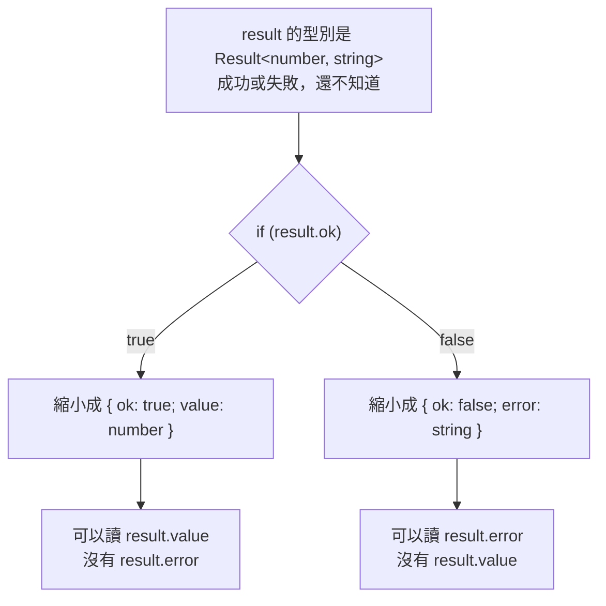
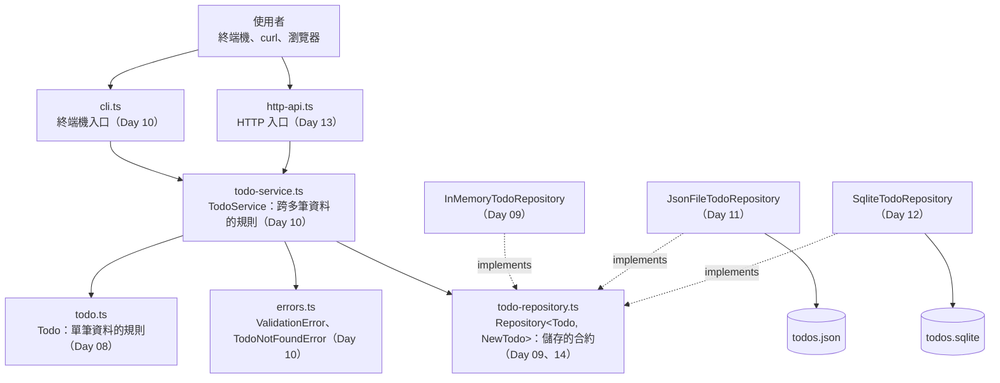

# Day 14 — TypeScript 設計規範（二）＋總複習

> 第 2 週｜規範與總複習｜必修約 60 分鐘，加練可到 3 小時

## 學習目標

完成今天的課程後，你能夠：

- 寫出泛型函式，並說出型別參數是在什麼時候、被什麼填進去的。
- 讀懂 `Repository<TEntity, TNew>` 與 `type TodoRepository = Repository<Todo, NewTodo>`。
- 用 discriminated union 與 `Result<TValue, TError>` 表達「幾種情況之一」，並用 `never` 確認每一種都處理到了。
- 用 `Partial`、`Pick`、`Omit`、`Readonly` 從現有型別推導出新型別，並判斷什麼時候不該把型別寫得更複雜。
- 對照驗收清單，說出 Todo App 每一層的責任，確認兩週的三個目標都達成。

## 時間分配

| 區塊 | 內容                         | 時間        |
| ---- | ---------------------------- | ----------- |
| 必修 | 觀念說明＋圖解               | 20 分鐘     |
| 必修 | 逐步解說（步驟 1–5）         | 15 分鐘     |
| 必修 | 練習 01、02                  | 15 分鐘     |
| 必修 | 兩週成果驗收（自我檢查清單） | 10 分鐘     |
| 加練 | 練習 03、延伸挑戰、結業挑戰  | 30–120 分鐘 |

## 今天的 Todo 進度

Todo App 的功能昨天已經全部完成。今天不加功能，只整理型別：`TodoRepository` 從「專門給 Todo 用的介面」變成泛型介面 `Repository<TEntity, TNew>` 填入 `Todo` 與 `NewTodo` 的結果，`TodoService.list` 加上 `never` 窮盡檢查。三個 Repository 類別、CLI、HTTP API 一行都沒改，所有測試照樣通過，這就是型別整理該有的樣子。

## 觀念說明

### 1. 泛型函式：把型別也變成參數

「取出陣列的第一個元素」對數字陣列、文字陣列、`Todo` 陣列的做法完全一樣，只有型別不同。泛型（generics）讓你只寫一次：把型別的位置先空下來，等呼叫時再填。這個空格叫型別參數（type parameter）。

```text
function firstItem<TItem>(items: readonly TItem[]): TItem | undefined
                   │                      │         │
                   │                      │         └─ 回傳型別用同一個 TItem
                   │                      └─ 參數型別用到 TItem
                   └─ 型別參數：一個空格，每次呼叫時才填入真正的型別
```

下圖是同一個宣告被呼叫兩次時，空格各自被填成什麼：



重點：

- 空格通常由 TypeScript 從引數推論出來，不必自己寫。沒有東西可以推論時才手動填：`firstItem<TodoData>([])`。
- 和 `unknown` 的差別：`unknown` 把型別丟掉，泛型把型別**從輸入帶到輸出**。
- 你早就在用泛型型別了：`Array<number>`（就是 `number[]`）、`Promise<Todo>`、`Bun.Server<undefined>`、`query<TodoRow, [number]>`。角括號裡都是在填空格。
- 需要用到屬性時加上限制（constraint）：`<TEntity extends { id: number }>` 表示「任何型別都可以，但一定要有數字的 `id`」。這裡的 `extends` 是「至少要符合」，不是類別的繼承。

### 2. 泛型介面：`Repository<TEntity, TNew>`

介面也可以留空格。Day 09 的 `TodoRepository` 每個方法都寫死了 `Todo`，但「新增、讀取、更新、刪除」這份合約對任何資料都成立：

```ts
export interface Repository<TEntity, TNew> {
  create(input: TNew): Promise<TEntity>; // C
  findAll(): Promise<TEntity[]>; // R
  findById(id: number): Promise<TEntity | undefined>; // R
  save(entity: TEntity): Promise<void>; // U
  delete(id: number): Promise<boolean>; // D
}

export type TodoRepository = Repository<Todo, NewTodo>;
```

`TEntity` 是「存的是什麼」，`TNew` 是「新增時要給什麼」。`Repository<Todo, NewTodo>` 的意思是把每個 `TEntity` 讀成 `Todo`、每個 `TNew` 讀成 `NewTodo`，結果和 Day 13 的介面一模一樣，所以 `implements TodoRepository` 的三個類別都不必改。哪天要存標籤，寫 `Repository<Tag, NewTag>` 就有同一份合約。

### 3. discriminated union 與 `Result`

Day 02 學過 union：「這幾種之一」。當每一種都是物件，而且都有一個型別是 literal type 的共同屬性時，這個 union 叫 discriminated union，那個屬性叫判別屬性（discriminant）。

```text
type Result<TValue, TError> =
  | { ok: true;  value: TValue }
  | { ok: false; error: TError };
      │            │
      │            └─ 每種情況自己才有的資料
      └─ 判別屬性：每種情況都有，而且各是不同的 literal type
```

`Result` 用來表達「可能失敗的結果」：成功就帶著 `value`，失敗就帶著 `error`。下圖是檢查判別屬性之後，TypeScript 怎麼縮小型別：



重點：

- 檢查之前讀 `result.value` 是型別錯誤。TypeScript 強迫你先處理失敗的可能。
- `Result` 和 `throw` 的分工：呼叫的人**當下就要處理**的失敗用 `Result`（例如解析使用者輸入）；要交給很遠的地方統一處理的失敗用 `throw`（例如 Day 13 交給 `toErrorResponse`）。
- 判別屬性不一定叫 `ok`。有三種以上情況時常用 `kind`，例如 `{ kind: "add"; title: string } | { kind: "done"; id: number }`。

> ▶ 動畫演示：[`if (result.ok)` 前後，`result` 的型別怎麼縮小](https://vincentlin0619.github.io/ts-engineer-bootcamp/day-14/#anim-day14-result-narrowing)

### 4. 用 `never` 做窮盡檢查

`never` 是「沒有任何值」的型別。用 `switch` 處理 discriminated union 時，每處理掉一種情況，剩下的可能就少一種；全部處理完，剩下的型別就是 `never`。

```ts
function assertNever(value: never): never {
  throw new Error(`沒有處理到的情況：${JSON.stringify(value)}`);
}

switch (command.kind) {
  case "add":
    return `新增「${command.title}」`;
  case "done":
    return `完成 ${command.id} 號`;
  default:
    return assertNever(command); // command is never here
}
```

`assertNever` 只接受 `never`。哪天有人在 union 加了第三種情況卻忘了補 `case`，`default` 裡的 `command` 就不再是 `never`，`bun check` 會直接指出這一行。這等於請 TypeScript 幫你記住「每個要改的地方」。

### 5. 工具型別

工具型別（utility type）是內建的泛型型別，用來從現有型別**推導**出新型別。原本的型別改了，推導出來的型別會跟著變，不必手動同步。以 `TodoData`（`id`、`title`、`done`、`priority`）為例：

| 工具型別                          | 做什麼                 | 結果                                       |
| --------------------------------- | ---------------------- | ------------------------------------------ |
| `Partial<TodoData>`               | 每個屬性都變成選用     | `{ id?: number; title?: ... }`             |
| `Pick<TodoData, "id" \| "title">` | 只留下指定的屬性       | `{ id: number; title: string }`            |
| `Omit<TodoData, "id">`            | 拿掉指定的屬性         | `{ title: ...; done: ...; priority: ... }` |
| `Readonly<TodoData>`              | 每個屬性都不能重新指派 | `{ readonly id: number; ... }`             |

它們可以組合：Day 05 手寫的 `TodoChanges` 其實就是 `Partial<Omit<TodoData, "id">>`，「除了 `id` 以外的任何部分，都可以改」。

### 6. 什麼時候不要把型別寫得太複雜

型別是為了讓程式更容易讀、更難寫錯。達不到這兩個目的的型別就是負擔。動手之前先問：

- **有第二個使用者了嗎？** 先寫具體的版本。同一段邏輯出現第二次、而且只有型別不同，才改成泛型。
- **型別參數有沒有把兩個位置綁在一起？** `firstItem<TItem>` 的 `TItem` 同時出現在參數與回傳值，所以有用。只出現一次的型別參數，直接寫具體型別或 `unknown` 就好。
- **同事三秒內看得懂嗎？** 工具型別疊到三層以上就該拆開，各自取一個說得出意思的名字。
- **這個檢查是不是該在執行時做？** 型別管不到外部資料。Day 13 的 request body 再怎麼設計型別，還是得用程式檢查。

### 7. 總複習：最終架構

下圖是兩週完成的 Todo App。每個方塊是 `examples/todo/` 裡的一個檔案，括號是它出現的那一天：



重點：

| 層         | 它回答的問題                   | 它不該知道的事             |
| ---------- | ------------------------------ | -------------------------- |
| 入口       | 使用者怎麼下指令、結果怎麼呈現 | 規則的細節、資料存在哪裡   |
| Service    | 這個動作合不合規則             | 指令從哪裡來、資料存在哪裡 |
| `Todo`     | 這一筆資料本身合不合理         | 其他筆資料、儲存方式       |
| Repository | 資料怎麼存、怎麼取             | 任何規則                   |

- 箭頭只由上往下。換掉任何一層，上面的不用改（Day 12 換儲存位置），旁邊加一個也不用改（Day 13 加 HTTP 入口）。
- 三個目標在同一張圖裡：CRUD 貫穿每一層，物件導向決定了層與層怎麼接，TypeScript 的型別把每個接點的形狀寫清楚。

## 逐步解說

以下每一步對應 `examples/` 裡的一個檔案。請在專案根目錄執行指令。

### 步驟 1：泛型函式

檔案：[`examples/01-generic-functions.ts`](examples/01-generic-functions.ts)

```bash
bun run day-14-ts-conventions-2-capstone/examples/01-generic-functions.ts
```

1. `firstNumber` 與 `firstText` 的函式本體一模一樣，只差在型別。這是泛型要解決的重複。
2. `firstLoose` 用 `unknown` 省掉重複，代價是回傳值也變成 `unknown`。把 `// @ts-expect-error` 那行刪掉再執行 `bun check day-14-ts-conventions-2-capstone/examples/01-generic-functions.ts`，會看到 `TS18046`。看完記得加回去。
3. `firstItem<TItem>` 只寫一次。`firstScore + 1` 與 `firstTitle.length` 都能通過檢查，因為型別被帶到了回傳值。
4. `firstItem<TodoData>([])` 是手動填空格：空陣列沒有東西可以推論。
5. `pairOf<TFirst, TSecond>` 有兩個空格，各自獨立推論。
6. `findById<TEntity extends { id: number }>` 加了限制，所以函式裡可以讀 `entity.id`。它同時適用於 `todos` 與 `members`。傳入文字陣列則被擋下（`TS2322`）。
7. 最後幾行提醒你：`Array<number>` 與 `Promise<string>` 一直都是泛型型別。

### 步驟 2：泛型的 Repository

檔案：[`examples/02-generic-repository.ts`](examples/02-generic-repository.ts)、主線 [`examples/todo/todo-repository.ts`](examples/todo/todo-repository.ts)

```bash
bun run day-14-ts-conventions-2-capstone/examples/02-generic-repository.ts
```

1. 先打開 `todo-repository.ts`：介面改名為 `Repository<TEntity, TNew>`，原本寫 `Todo` 的地方換成 `TEntity`，寫 `NewTodo` 的地方換成 `TNew`。最後一行用 `type` 把兩個空格填回去。
2. 範例裡的 `todoRepository` 用的是 Day 09 寫的 `InMemoryTodoRepository`，它今天沒有任何修改。
3. `InMemoryTagRepository implements Repository<Tag, NewTag>` 是第二次填空格。`implements` 會用 `Tag` 與 `NewTag` 檢查五個方法。
4. 兩個 Repository 的方法名稱相同，流過去的型別不同：`todo.title` 與 `tag.name` 都有正確的型別。
5. 最後用 `// @ts-expect-error` 示範：標籤的 `create` 不接受 `title`（`TS2353`）。注意輸出的「標籤數量： 2」：那一行在執行時照樣跑了，型別檢查擋的是寫程式的時候，不是執行的時候。

### 步驟 3：`Result` 與 `never`

檔案：[`examples/03-result-and-never.ts`](examples/03-result-and-never.ts)、主線 [`examples/todo/todo-service.ts`](examples/todo/todo-service.ts)

```bash
bun run day-14-ts-conventions-2-capstone/examples/03-result-and-never.ts
```

1. `parsePositiveInteger` 的回傳型別 `Result<number, string>` 直接說明「可能失敗，失敗時給一段文字」。它不 `throw`。
2. 迴圈裡的 `if (result.ok)` 把型別縮小：上半部能讀 `result.value`，`else` 能讀 `result.error`。
3. `unchecked.value` 沒有先檢查 `ok`，靠 `// @ts-expect-error` 才通過（`TS2339`）。
4. `Command` 有三種形狀，用 `kind` 區分。`describeCommand` 的每個 `case` 裡，`command` 都被縮小成對應的形狀。
5. 動手試：把 `Command` 裡 `// | { kind: "remove"; id: number }` 開頭的 `//` 刪掉，執行 `bun check day-14-ts-conventions-2-capstone/examples/03-result-and-never.ts`。錯誤 `TS2345: Argument of type '{ kind: "remove"; id: number; }' is not assignable to parameter of type 'never'.` 指向 `assertNever(command)` 那一行。看完把 `//` 加回去。
6. 主線的 `TodoService.list` 用了同一招：`switch (filter)` 處理 `"all"`、`"open"`、`"done"`，`default` 交給 `assertNever(filter)`。

### 步驟 4：工具型別

檔案：[`examples/04-utility-types.ts`](examples/04-utility-types.ts)

```bash
bun run day-14-ts-conventions-2-capstone/examples/04-utility-types.ts
```

1. 四個段落各示範一個工具型別，註解寫出它展開後等於什麼。
2. `Readonly` 那一段的 `frozen.title = "買豆漿"` 是型別錯誤（`TS2540`），但輸出顯示標題真的被改了。`Readonly` 和 Day 04 的 `readonly` 一樣，只在檢查時保護你。
3. `EditableFields = Partial<Omit<TodoData, "id">>` 是組合：先拿掉 `id`，再把剩下的都變成選用。
4. `applyChanges` 的參數是 `Readonly<TodoData>`，承諾不修改傳進來的物件。最後一行印出 `false`，確認原本的物件沒有被動到。

### 步驟 5：完整的 Todo App 跑一遍

檔案：[`examples/05-final-tour.ts`](examples/05-final-tour.ts)

```bash
bun run day-14-ts-conventions-2-capstone/examples/05-final-tour.ts
bun test day-14-ts-conventions-2-capstone/examples/todo
```

1. `storages` 陣列裡有三個類別的實例，型別都是 `TodoRepository`。
2. `runTour` 對每一個都做同樣的事：組裝 `TodoService` 與 HTTP API，再用 `fetch` 送出同一輪新增、修改、刪除、讀取的 request。
3. 三段輸出除了第一行的儲存位置名稱之外一模一樣：空白標題得到 `400`，讀取已刪除的資料得到 `404`，最後剩下一筆已完成的「買牛奶」。換儲存位置，行為不變。
4. 第二個指令執行主線的所有測試。兩週寫的每一層都有測試保護，這是你之後敢放心修改它的原因。

## 規範重點

這是 Day 07 與今天合起來的規範清單。寫完程式、送出之前逐項核對。

### 第 1 週建立的規範（Day 07）

- [ ] **預設用 `const`，不用 `var`**。讀的人看到 `const` 就知道這個名字不會改指向別的值。
- [ ] **命名一致**：變數與函式 camelCase，型別、類別、介面 PascalCase，全域常數 CONSTANT_CASE，檔名 kebab-case。名字要說得出內容。
- [ ] **不用 `any`**。不知道型別的資料用 `unknown`，檢查過再使用。
- [ ] **不用 `!`，不用 `as` 強制轉型**（`as const` 除外）。它們都是叫 TypeScript 閉嘴，錯誤會留到執行時才出現。
- [ ] **匯出的函式寫出參數型別與回傳型別**。簽名就是文件。
- [ ] **不會被修改的資料標上 `readonly`**，更新時回傳新的物件或陣列。
- [ ] **`import` 路徑寫 `.ts`，只匯入型別時用 `import type`**。
- [ ] **`bun check`、`bunx biome check`、`bun fmt` 全部通過才算完成**。規範交給工具把關，不靠記憶。

### 今天加上的規範（Day 14）

- [ ] **型別參數用 `T` 開頭、說得出意思的名字**：`TEntity`、`TItem`，不要只寫 `T`、`U`。
- [ ] **型別參數要把至少兩個位置綁在一起**。只出現一次就不需要泛型。
- [ ] **「幾種情況之一」用 discriminated union**，不要用一堆選用屬性讓呼叫的人猜哪些會同時出現。
- [ ] **處理 union 的 `switch` 用 `never` 檢查收尾**。新增情況時，由 `bun check` 告訴你哪裡要補。
- [ ] **從現有型別推導，不要手抄一份**。用 `Pick`、`Omit`、`Partial`、`Readonly`，型別才不會各改各的。
- [ ] **先具體，後抽象**。泛型與工具型別是用來消除已經出現的重複，不是用來預測未來。

## 常見錯誤

| 錯誤訊息或現象                                                                                       | 原因                                                    | 修法                                           |
| ---------------------------------------------------------------------------------------------------- | ------------------------------------------------------- | ---------------------------------------------- |
| `TS2345: Argument of type '...' is not assignable to parameter of type 'never'.`                     | union 多了一種情況，`switch` 沒有處理                   | 補上對應的 `case`                              |
| `TS2339: Property 'value' does not exist on type 'Result<number, string>'.`                          | 還沒檢查判別屬性就讀取其中一種情況的資料                | 先寫 `if (result.ok)`                          |
| `TS2322: Type 'string' is not assignable to type '{ id: number; }'.`                                 | 引數不符合型別參數的限制                                | 傳入符合限制的資料，或檢查限制是否寫得太嚴     |
| `TS2540: Cannot assign to 'title' because it is a read-only property.`                               | 修改了 `Readonly` 或 `readonly` 的屬性                  | 用展開語法建立新物件                           |
| `TS2322: Type '{ ok: boolean; error: string; }' is not assignable to type 'Result<number, string>'.` | 物件先存進變數，`ok: false` 被推論成 `boolean`          | 幫變數標上 `Result<...>` 型別，或加 `as const` |
| 加了新的情況，程式照樣通過檢查，執行時才走到奇怪的分支                                               | `switch` 的 `default` 直接回傳預設值，沒有 `never` 檢查 | `default` 改成 `return assertNever(...)`       |

## 練習

練習檔在 `exercises/`。每個檔案裡標著 `TODO` 的地方就是你要改的地方。

```bash
# 檢查你的答案：全部顯示 pass 就完成了
bun test day-14
```

| 練習                                                           | 內容                                               | 類型 |
| -------------------------------------------------------------- | -------------------------------------------------- | ---- |
| [`01-generics.ts`](exercises/01-generics.ts)                   | 泛型函式、限制、用工具型別改寫手抄的型別           | 必修 |
| [`02-result-and-unions.ts`](exercises/02-result-and-unions.ts) | `Result`、discriminated union、`never` 檢查        | 必修 |
| [`03-todo-commands.ts`](exercises/03-todo-commands.ts)         | 把 Todo CLI 的指令改寫成 `Command` union＋`Result` | 加練 |

練習 01 有兩個型別要改寫，測試看不到型別，請用 `bun check` 確認沒有錯誤，再對照解答。卡住超過 15 分鐘再看 `solutions/` 裡的參考解答。看完後把解答關掉，自己重寫一次。

### 延伸挑戰（加練）

1. `examples/todo/cli.ts` 的 `priorityLabel` 用兩個 `if` 加一個預設值。把它改成 `switch` 加 `assertNever`，然後在 `Priority` 暫時加上 `"urgent"`，看 `bun check` 指出哪些地方要改。
2. 用練習 03 的 `parseCommand` 與 `runCommand` 重寫 `cli.ts` 的迴圈，比較改寫前後哪一版比較容易加新指令。
3. 寫一個 `Repository<Tag, NewTag>` 的 SQLite 實作，對照 `SqliteTodoRepository` 看哪些部分一樣、哪些不同。

### 結業挑戰（加練）：幫 Todo 加上到期日

這個挑戰沒有參考解答。它要你把一個新功能從最底層做到最上層，每一層都會用到這兩週學的東西。直接修改 `day-14-ts-conventions-2-capstone/examples/todo/` 裡的檔案，建議照下面的順序，每做完一層就跑一次檢查。

| 順序 | 層   | 檔案                    | 要做的事                                                                                                                                                                                |
| ---- | ---- | ----------------------- | --------------------------------------------------------------------------------------------------------------------------------------------------------------------------------------- |
| 1    | 資料 | `todo.ts`               | `TodoData` 加上 `dueDate: string \| null`（格式 `"2026-12-31"`）。`Todo` 加上私有欄位、getter 與 `changeDueDate`，格式不對丟 `ValidationError`。更新 `toData`、`fromData`、`isTodoData` |
| 2    | 合約 | `todo-repository.ts`    | `NewTodo` 加上 `dueDate`。`Repository<TEntity, TNew>` 本身不用動                                                                                                                        |
| 3    | 儲存 | 三個 Repository         | 記憶體與 JSON 版跟著 `TodoData` 走。SQLite 版要多一個欄位，而且舊的 `.data/todos.sqlite` 沒有這個欄位，想好怎麼處理                                                                     |
| 4    | 規則 | `todo-service.ts`       | `add` 多收一個到期日。`TodoFilter` 加上 `"overdue"`，`assertNever` 會告訴你 `list` 哪裡要補。`parseFilter` 與 CLI 的 `toFilter` 沒有 `never` 檢查，要自己記得補                         |
| 5    | 入口 | `cli.ts`、`http-api.ts` | CLI 加上 `due <id> <日期>`。`POST /todos` 與 `PATCH /todos/:id` 接受 `"dueDate"`，格式錯誤回 400                                                                                        |
| 6    | 測試 | 各層的 `*.test.ts`      | 每一層都補上成功與失敗的測試                                                                                                                                                            |

提示：`"2026-12-31"` 這種格式的日期可以直接用 `<` 比較先後。今天的日期用 `new Date().toISOString().slice(0, 10)` 取得，這一行先照抄。

完成的標準：

```bash
bun check day-14-ts-conventions-2-capstone
bunx biome check day-14-ts-conventions-2-capstone
bun test day-14-ts-conventions-2-capstone/examples/todo
```

## 自我檢查清單

這份清單同時是兩週的成果驗收，依課程的三個目標分組。每一項都試著不看筆記說出來或寫出來。

### 目標一：CRUD

- [ ] 我能說出 CRUD 四個字母的意思，並各舉一個 Todo App 的例子。
- [ ] 我能用四種方式寫出同一組 CRUD：操作陣列的函式（Day 05）、Repository 的方法（Day 09）、SQL（Day 12）、HTTP 端點（Day 13）。
- [ ] 我能解釋為什麼更新資料時回傳新的陣列或物件，而不是修改原本的。
- [ ] 我能說出資料放在記憶體、JSON 檔案、SQLite 各有什麼差別。
- [ ] 我能寫出 `INSERT`、`SELECT`、`UPDATE`、`DELETE`，並說出為什麼一定要用參數綁定。
- [ ] 我能為一種資源設計 REST 端點，並為成功與失敗選出狀態碼。

### 目標二：物件導向

- [ ] 我能寫出有建構子、`#` 私有欄位、getter 與方法的類別，並說出封裝保護了什麼。
- [ ] 我能解釋介面是一份合約，以及為什麼 `TodoService` 只認識 `TodoRepository`。
- [ ] 我能用三個 Repository 說明什麼是多型。
- [ ] 我能說出繼承與組合的差別，以及各自適合的情況。
- [ ] 我能不看圖畫出 Todo App 的分層架構，說出每一層的責任與相依方向。
- [ ] 我能解釋相依注入，並說出它讓測試變簡單的原因。

### 目標三：TypeScript 設計規範

- [ ] 我能讀懂型別錯誤訊息，並說出 `bun run` 與 `bun check` 的差別。
- [ ] 我能用 union、literal type、選用屬性描述資料的形狀。
- [ ] 我能說出 `any` 與 `unknown` 的差別，並為外部資料寫出型別守衛。
- [ ] 我能寫出泛型函式，並讀懂 `Repository<TEntity, TNew>`。
- [ ] 我能用 discriminated union 表達多種情況，並用 `never` 檢查有沒有漏掉。
- [ ] 我能逐項說明「規範重點」清單裡每一條的原因。
- [ ] `bun test day-14` 全部通過。

## 下一課

[兩週之後的學習路線](../ROADMAP.md)：你現在有一個分層清楚、有型別、有測試、有 HTTP API 的 Todo App。下一個階段從幫它做網頁介面開始，路線與順序都寫在 `ROADMAP.md`。
